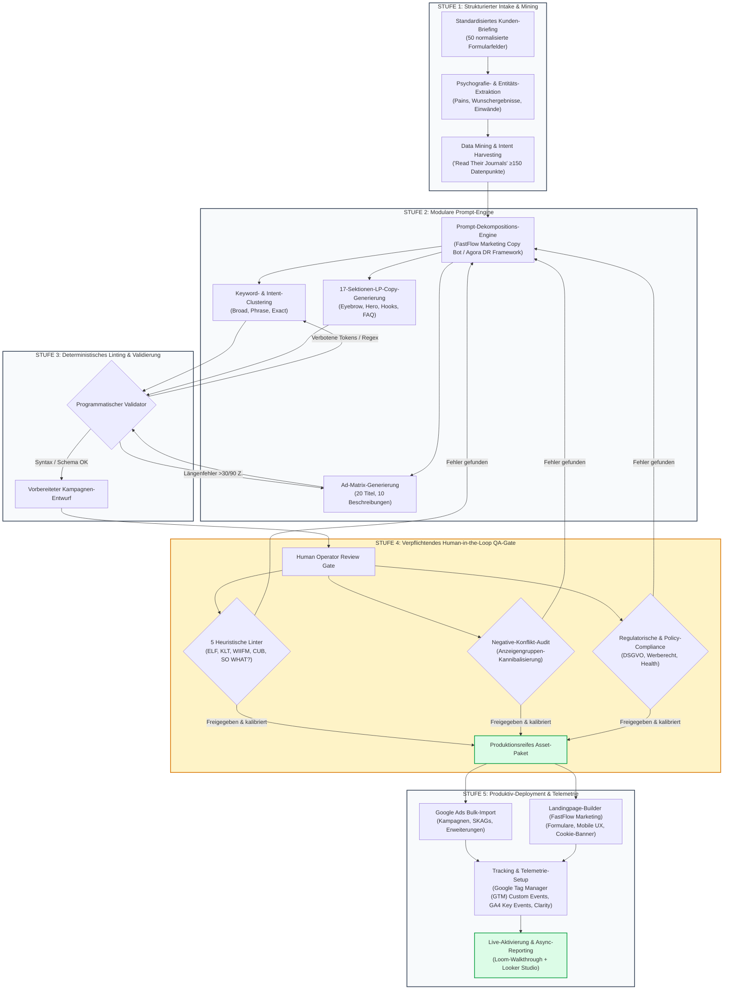

# Von 40 Stunden Tabellen-Chaos zur 7-Stunden-Maschine: Wie ich 82 % der Google-Ads-Fleißarbeit gestrichen habe
## Dekonstruktion einer mehrstufigen KI-Architektur mit Human-in-the-Loop-(HITL-)Qualitätssicherung

**Autor:** Karol Jasztal — Head of Operations & AI Systems Leader  
**Kernmetrik:** 40,0 Stunden $\rightarrow$ 7,0 Stunden pro End-to-End-Kampagnensetup (-82,5 % geprüfte Zeitersparnis)  
**Nachweis:** Null Werberichtlinien-Verstöße, null Compliance-Fehler über 14 Live-Launches in Folge  

---

## Transformations-Übersicht (Executive Summary)
- **Ausgangs-Engpass:** 40,0 Stunden manuelle Recherche, Foren-Scraping, RSA-Texten, Landingpage-Entwurf und GTM-/GA4-Tracking pro Kampagne, bei 8,4 % manueller Fehlerquote am Launch-Tag und linearem Personalbedarf (140k $/Jahr pro 2 Junior-Koordinatoren).
- **Transformierte Architektur:** 5-stufige deterministische AI-HITL-Pipeline aus 50-Felder-Intake-Schema, modularer Prompt-Bank, programmatischen $\le 30$/$\le 90$-Zeichen-Lintern, einem 15-Minuten-Human-QA-Gate (5 Checks) und einer 15-Schritte-GTM-/GA4-Telemetrie-SOP.
- **Geprüfter ROI:** 7,0 Stunden End-to-End-Durchlaufzeit (-82,5 % / 33,0 Stunden gespart pro Kampagne), 5,7x Durchsatz, 1.320 Stunden (+118k $ gesparte Lohnkosten) pro Jahr freigeschaltet und 100,0 % Ad-Policy-Compliance über 14 Live-Launches.

---

## § 01. Architektur, Pipeline-Blueprint & Empirische Zeitstudie

### 1.1 Executive Summary & der operative Engpass

In Digitalagenturen und Performance-Operations kostete der Weg vom rohen Kunden-Briefing bis zur live geschalteten Search-Kampagne samt Landingpage klassisch **~40 Stunden qualifizierte Handarbeit**:

```
Klassisches Kampagnensetup (40,0 Stunden gesamt):
├── Kunden-Discovery & Psychografie-Extraktion:       5,0 Std. (Unstrukturierte Calls & Hin-und-Her)
├── Marktrecherche & Search-Intent-Mining:            8,0 Std. (Manuelles Wettbewerbs-Scraping & Foren)
├── Anzeigentexte & Asset-Matrix:                    10,0 Std. (Manuelle RSA-Titel, Beschreibungen, Callouts)
├── Landingpage-Struktur & Copywriting:              10,0 Std. (17 Sektionen von Grund auf texten)
├── Verpflichtendes Human-QA & Compliance-Audit:      2,0 Std. (Negative-Keyword-Konflikte, Brand Voice, Policy)
└── Tracking-Setup, Negatives & Launch-QA:            5,0 Std. (Google Tag Manager (GTM), GA4-Events, Conversion-Tests)
```

#### Die Falle von ungesteuertem „Prompt-and-Paste“-KI-Einsatz
Sobald Teams das Problem lösen wollen, indem sie Mitarbeitern einfach freien Zugang zu Standard-LLMs (z. B. Copy-Paste in ChatGPT) geben, bricht das System zusammen:
1. **Zeichenlimit-Fehler:** Google Ads lehnt Responsive-Search-Ad-(RSA-)Titel über 30 Zeichen und Beschreibungen über 90 Zeichen strikt ab. Rohe LLMs sprengen diese Grenzen ständig.
2. **Negative-Keyword-Kannibalisierung:** Ungeprüfte Generierung sorgt dafür, dass sich Anzeigengruppen gegenseitig ausstechen oder Budget auf teuren Schrott („jobs“, „selber machen“, „kostenlos“, Wettbewerber) verbrennen.
3. **KI-Einheitsbrei & Conversion-Einbruch:** Generische LLM-Texte fallen in flache Konzern-Floskeln zurück und verfehlen die direkten emotionalen Hooks, die bezahlten Traffic konvertieren.
4. **Regulatorische Kontosperren:** Halluzinierte Heilsversprechen oder Superlative verstoßen gegen DSGVO-, Finanz- oder Gesundheitsvorgaben und riskieren permanente Domain-Sperren.

#### Die Lösung: Eine deterministische Pipeline um generative Modelle herum
Repetitive Strukturarbeit und Zeichenlimits werden programmatisch automatisiert – menschliche Aufmerksamkeit bleibt strikt für Entscheidungen mit hohem Hebel reserviert: Risikominimierung, Compliance und echte Kundenempathie.

---

### 1.2 Quantitative Task-by-Task-Zeitstudie (Empirische Daten)

| Workflow-Aufgabe | Manuelle Baseline | AI-HITL-Pipeline | Gesparte Zeit | Effizienz-Delta |
|---|---|---|---|---|
| **1. Kunden-Intake & Schema-Normalisierung** | 5,0 Std. | 0,5 Std. | -4,5 Std. | **-90,0 %** |
| **2. Marktrecherche & Foren-Mining (≥150 Zitate)** | 8,0 Std. | 1,0 Std. | -7,0 Std. | **-87,5 %** |
| **3. Anzeigen-Matrix & Negative-Liste (20 Titel, 10 Beschr.)** | 10,0 Std. | 1,5 Std. | -8,5 Std. | **-85,0 %** |
| **4. 17-Sektionen-Direct-Response-Landingpage-Copy** | 10,0 Std. | 1,5 Std. | -8,5 Std. | **-85,0 %** |
| **5. Verpflichtendes Human-QA-Gate, Konflikt- & Policy-Audit** | 2,0 Std. | 1,5 Std. | -0,5 Std. | **-25,0 %** |
| **6. Google Tag Manager (GTM), GA4-Events & Ad-Deployment** | 5,0 Std. | 1,0 Std. | -4,0 Std. | **-80,0 %** |
| **GESAMTE END-TO-END-DURCHLAUFZEIT** | **40,0 Std.** | **7,0 Std.** | **-33,0 Std.** | **-82,5 %** |

---

### 1.3 Die 5-stufige Systemarchitektur & Feld-Schema



---

## § 02. Das 50-Felder-Kunden-Intake-Schema (`Ads Google Customer Template`)

| # | Kategorie | Feldname | Interner Schema-Key | Operativer Zweck in der Pipeline |
|---|---|---|---|---|
| 1 | Unternehmensidentität | Business Name | `business_name` | Kampagnen-Namenskonventionen, Taxonomie und rechtliche Pflichtangaben |
| 2 | Unternehmensidentität | Business Kategorie / Branche | `industry_category` | Setzt Basis-CPC-Benchmarks und erwartete Conversion-Raten |
| 3 | Standort & Zeiten | Adresse | `address` | Google-Unternehmensprofil-Sync und Umkreis-Targeting |
| 4 | Vertrauen & Recht | Lizenzen inkl. Lizenz-Nummern (optional) | `licenses_numbers` | Essentiell für Google-Werbetreibenden-Verifizierung und Trust-Badges |
| 5 | Standort & Zeiten | Öffnungszeiten (Tage und Uhrzeiten) | `operating_hours` | Steuert Werbezeitplaner (Dayparting), damit außerhalb der Zeiten kein Budget verbrennt |
| 6 | Standort & Zeiten | Spezielle Öffnungszeiten: Urlaub, Feiertage | `special_hours` | Automatisiert saisonale Gebotspausen bei Betriebsferien |
| 7 | Kontaktkanäle | Telefon (Primär) - für Kundenanrufe via Ads | `phone_primary` | Google-Ads-Anruferweiterungen und mobile Click-to-Call-Anzeigen |
| 8 | Kontaktkanäle | Telefon (Sekundär) - für Kundenanrufe via Ads | `phone_secondary` | Backup-Rufnummer für Überlauf-Routing |
| 9 | Kontaktkanäle | E-Mail (Primär) - für Formular-Einsendungen | `email_primary` | Löst sofortige Webhook-Benachrichtigungen bei Formular-Eingang aus |
| 10 | Kontaktkanäle | E-Mail (Sekundär) - für Formular-Einsendungen | `email_secondary` | Backup-Empfänger für CRM-Verteilung |
| 11 | Social & Digital | Facebook Page Link | `url_facebook` | Retargeting-Referenz und Social-Proof-Prüfung |
| 12 | Social & Digital | Instagram Profil Link | `url_instagram` | Visuelle Referenz und plattformübergreifendes Retargeting |
| 13 | Social & Digital | LinkedIn Profil Link | `url_linkedin` | B2B-Autoritätsnachweis und Hintergrundprüfung |
| 14 | Social & Digital | TikTok Profil Link | `url_tiktok` | Kurzvideo-Referenz für Top-of-Funnel-Creatives |
| 15 | Social & Digital | X Profil Link | `url_x_twitter` | Öffentlicher Social-Verification-Link |
| 16 | Social & Digital | YouTube Kanal Link | `url_youtube` | Video-Quellen für Landingpage-Einbettungen |
| 17 | Social & Digital | Weitere Social Media Account Links | `url_additional_social` | Vollständige Prüfung des digitalen Fußabdrucks |
| 18 | Infrastruktur | Hosting | `hosting_provider` | Caching-Setup, Server-Antwortzeiten und SSL-Konfiguration |
| 19 | Infrastruktur | Domain (Falls gleich wie Hosting, überspringen) | `domain_registrar` | DNS-Einträge für dedizierte Ad-Subdomains und Tracking-TXT-Records |
| 20 | Infrastruktur | Website | `primary_website` | Geprüft auf Message Match, Basis-Styles und Markenfarben |
| 21 | Infrastruktur | Weitere relevante Logins für uns? | `system_logins` | Zugriff auf Google Ads, Google Tag Manager (GTM), GA4, Search Console und Clarity |
| 22 | Psychografie | Wer ist unser primäres Zielpublikum? | `target_audience` | Speist den demografischen Kontextblock im FastFlow Marketing Copy Bot |
| 23 | Psychografie | Welcher Altersgruppe gehören sie in der Regel an? | `age_bracket` | Demografische Gebotsanpassungen in Google Ads (-100 % oder Multiplikatoren) |
| 24 | Psychografie | Welches Geschlecht hat die Zielgruppe? | `gender_ratio` | Formt Tonalität, Bildsprache und Problem-Framing |
| 25 | Psychografie | Sind sie in einer bestimmten Region angesiedelt? | `geo_target_area` | Fließt direkt in den 60-Minuten-Fahrzeit-PLZ-Prompt ein |
| 26 | Psychografie | Was sind ihre dringlichsten Bedürfnisse / Probleme? | `urgent_pain_points` | Direkt in RSA-Titel und Lead-Agitation übersetzt |
| 27 | Psychografie | Welchen Bildungsstand haben sie? | `education_level` | Kalibriert das Sprachniveau ohne Marketing-Jargon |
| 28 | Psychografie | Was ist ihr Beruf? | `job_roles` | B2B-Intent-Modifier und Negative-Keyword-Ausschlüsse |
| 29 | Psychografie | Wie hoch ist ihr monatliches Einkommen? | `income_level` | Household-Income-(HHI-)Stufen und Preis-Framing |
| 30 | Direct Response | Der beschissene ‚Vorher-Zustand‘, dem sie entkommen wollen: | `before_state_unfiltered` | Emotionaler Kern: PAS-Hero-Hook und Eyebrow above-the-fold |
| 31 | Direct Response | Was ist ihr Wunschergebnis (was verkaufen wir wirklich)? | `dream_outcome` | Verankert Titel #1 und Hero-Headline („Verkaufe das Ziel, nicht das Ticket“) |
| 32 | Direct Response | 5 Fragen zur Kaufentscheidung: | `decision_questions_5` | Direkt in Vergleichstabellen-Zeilen und FAQ-Paare übersetzt |
| 33 | Direct Response | Was sie schon ausprobiert haben: | `previous_failed_attempts` | Speist die Differentiator-Sektion, indem gescheiterte Methoden entkräftet werden |
| 34 | Direct Response | Top 5 Schmerzpunkte: | `top_pain_points_5` | Segmentiert in Anzeigengruppen und 3-spaltige Lead-Agitation |
| 35 | Direct Response | Die 5 größten Hindernisse und Einwände: | `top_objections_5` | Neutralisiert durch Friction Eliminators direkt unter CTA-Buttons |
| 36 | Direct Response | Schlüsselwörter und Phrasen, die sie verwenden: | `customer_slang_phrases` | Gezielt in Phrase-Match-Seed-Listen für höheren Quality Score eingespeist |
| 37 | Angebot & Produkt | Für welches Produkt / Dienstleistung möchtest du werben? | `target_core_offer` | Sichert Kampagnen-Isolation (Fokus auf exakt ein Kernangebot) |
| 38 | Angebot & Produkt | Was sind die drei wichtigsten Vorteile? | `top_benefits_3` | Übertragen in RSA-Callouts und Hero-Nutzen-Bullets |
| 39 | Angebot & Produkt | Wie unterscheidet sich unser Angebot von der Konkurrenz? | `primary_differentiator` | Basis für Differentiator- und „8 Gründe warum“-Blöcke |
| 40 | Angebot & Produkt | Bestimmte Merkmale, die besonders gut ankommen? | `popular_features` | Direkt unter dem Hero als sekundäre Bestätigungssignale platziert |
| 41 | Marke & Ton | Wie würdest du deine Marke in drei Worten beschreiben? | `brand_voice_3_words` | Harte Leitplanke im FastFlow Marketing Copy Bot gegen KI-Klischees |
| 42 | Marke & Ton | Gibt es einen bestimmten Ton für unsere Anzeigen? | `preferred_copy_tone` | Steuert den Stil (autoritativ, direkt, empathisch, punchy) |
| 43 | Angebot & Produkt | Gibt es spezielle Angebote oder Werbeaktionen? | `promotions_bonuses` | Strukturiert im Golden-Hippo-Angebot mit dynamischen Monatsboni |
| 44 | Social Proof | Verfügen wir über Referenzen, Garantien, Vertrauenssignale? | `proof_testimonials` | Eingebettet in Friction Remover und Risikoreduktions-Microcopy |
| 45 | Historie | Begriffe / Keywords, die außergewöhnlich gut liefen? | `historical_winning_keywords` | Als prioritäre Exact-Match-Keywords gesichert |
| 46 | Leitplanken | Umgekehrt: Wörter oder Themen, die wir vermeiden sollten? | `negative_themes_excluded` | Harte Ausschlussregeln im deterministischen Linter |
| 47 | Wettbewerb | Wer sind unsere 3 größten Konkurrenten? | `direct_competitors_3` | Wettbewerbsanalyse (`isearchfrom.com`) und negatives Wettbewerber-Routing |
| 48 | Wettbewerb | Gibt es eine Marktlücke, die wir füllen? | `market_whitespace_gap` | Verankert die Big Idea und den zentralen Hook der Landingpage |
| 49 | Operativ | Schreibe hier alle weiteren wichtigen Informationen rein: | `operational_edge_notes` | Sonderfälle, Saisonalität oder regulatorische Hinweise |
| 50 | Operativ | Zeitstempel & Formular-Validierung | `timestamp_verification` | Friert den Briefing-Snapshot ein; spätere Änderungen erfordern Change Orders |

---

## § 03. Technische Infrastruktur, Google Tag Manager (GTM) & Telemetrie-SOP

1. **Google-Drive-Sandboxing:** Kundenordner unter `KUNDEN` anlegen mit Unterordnern `Logo`, `Collateral` (Schreibzugriff für Kunden) und `SEA (Search Engine Advertising / Google Ads)`. Customer-Template-Sheet duplizieren.
2. **FastFlow-Marketing-Subaccount-Webhooks:** Custom Fields `Ads Google Form URL` und `Collateral Google Drive URL` anlegen. Onboarding-E-Mail geht automatisch raus.
3. **Kunden-Discovery-Meeting:** Kickoff-Alignment (Agreement, Reality, Communication – ARC). Metrik-Hierarchie festlegen: Klicks & CTR (Click-Through-Rate) zuerst, dann Conversions, CVR (Conversion-Rate), Cost Per Conversion und ROAS (Return on Ad Spend). SLAs definieren.
4. **Google-Ads-Governance:** Kontoname, Währung, primäre + Backup-Zahlungsmethode, Datenschutzkontakte, Werbetreibenden-Verifizierung und Domain-Beschränkungen einrichten.
5. **Looker Studio Executive Reporting:** Dedizierte Datenquelle nach Konvention `Google Ads | Customer` anlegen und Standard-Report-Template duplizieren.
6. **Google Tag Manager (GTM) Basis-Tag:** Konstante für Google Tag ID (`AW-XXXXXXXXXXX`) anlegen. Basis-Google-Tag auf *All Pages* ausspielen.
7. **Google Tag Manager (GTM) Custom Event `click_link_phone`:** Trigger: *Klick – Nur Links* | URL enthält `tel:`. Entspricht exakt dem GA4-Key-Event.
8. **Google Tag Manager (GTM) Custom Event `click_link_mail`:** Trigger: *Klick – Nur Links* | URL enthält `mailto:`.
9. **Google Tag Manager (GTM) Custom Event `form_submit`:** Trigger: *Seitenaufruf* | URL enthält `/ty-submit-form`.
10. **Google Tag Manager (GTM) Custom Event `meeting_booked`:** Trigger: *Seitenaufruf* | URL enthält `/ty-meeting-booked`.
11. **Google Tag Manager (GTM) Conversion Linker:** Auf *All Pages* ausspielen, damit Google Click Identifiers (`GCLID`) bei Domain-Weiterleitungen erhalten bleiben.
12. **GA4-Normalisierung:** Verwaltung / Property / Ereignisse. Events anlegen und als Key Events markieren. Google Ads und Search Console verknüpfen.
13. **Retargeting-Infrastruktur:** Google Signals aktivieren. Zielgruppen-Bedingung: `page_view` ohne `is_conversion_event`.
14. **Microsoft Clarity Telemetrie:** Clarity-Script über Google Tag Manager (GTM) einbinden. Google Analytics 4 (GA4) und Google Ads für visuelles Session-Audit der Abbruchpunkte verknüpfen.
15. **Google-Ads-Conversion-Import:** GA4-Key-Events importieren. Separate Conversion-Aktionen für `Call Extension` vs. `Call Only Ads` (1 Sek. Dauer, datengetrieben) manuell konfigurieren.

---

## § 04. Zielgruppen-Recherche & Intent-Mining-Prompts

Spezialisierte Web-Synthese-Prompts, die nacheinander ausgeführt werden, um echte Kundensprache, emotionale Schmerzpunkte und Einwände aus Foren, Bewertungen und Stand-up-Comedy-Punchlines zu extrahieren:
1. **Kundenumfrage-Generator (Du / Sie):** Erzeugt 3-Fragen-Umfragen zu Sorgen, Zielen und Kaufhemmnissen – wahlweise im direkten Du- oder formellen Sie-Ton.
2. **„Read Their Journals“ CRO-Intent-Mining:** Extrahiert ≥150 echte Kundenzitate aus 10–20 Foren, Bewertungsportalen und Stand-up-Comedy-Sets für ungeschönte emotionale Wahrheiten.
3. **60-Minuten-Fahrzeit-PLZ-Generator:** Erstellt bulk-fertige Postleitzahlen-Listen innerhalb exakter Fahrzeitgrenzen für den Google-Ads-Standortimport.
4. **Negative-Suchbegriffe-Extraktionsfilter:** Verarbeitet rohe Suchanfragen, erkennt die Branche und isoliert präzise Ausschlussbegriffe (`"jobs"`, `"kostenlos"`, `"selber machen"`).

---

## § 05. Keywords, Match Types & Responsive-Search-Ads-(RSA-)Matrix-Regeln

Titel dürfen maximal 30 Zeichen lang sein, Beschreibungen maximal 90 Zeichen; Ausrufezeichen sind strikt verboten:
* **Das KISS-Keyword-Prinzip:** Mit den naheliegendsten Standard-Suchanfragen starten, bevor man exotische Long-Tail-Varianten testet.
* **Wettbewerbs-Analyse-Protokoll:** Bewährte Anzeigenstrukturen aus hart umkämpften Märkten ethisch benchmarken und per Reverse Engineering analysieren.
* **RSA-Copywriting-Matrix:** Generiert 20 Titel (≤30 Zeichen), 7–10 Beschreibungen (≤90 Zeichen) und 15 Callouts (≤25 Zeichen), aufgeteilt in konservative und emotionale Direct-Response-Hooks.

---

## § 06. Direct-Response-Landingpage-Engine (FastFlow Marketing Copy Bot)

Ein 17-teiliger sequenzieller Landingpage-Blueprint nach den Frameworks von Agora Direct Response, Gary Halbert, Dan Kennedy und Todd Brown:
* `#0 Wettbewerber-Audit` $\rightarrow$ `#1 Copy-Bot-Persona` $\rightarrow$ `#2 Eyebrow-Erstellung` $\rightarrow$ `#3 Hero-Headlines` $\rightarrow$ `#4 Nutzen-Bullets` $\rightarrow$ `#5 CTAs & Friction Remover` $\rightarrow$ `#6 Agitation Lead` $\rightarrow$ `#7 Social Proof` $\rightarrow$ `#8 Kundenwünsche` $\rightarrow$ `#9 Differentiator` $\rightarrow$ `#10 8 Gründe warum` $\rightarrow$ `#11 3-Schritte-Prozess` $\rightarrow$ `#12 Golden-Hippo-Angebot` $\rightarrow$ `#13 Vergleichstabelle` $\rightarrow$ `#14 Lead-Disqualifizierung` $\rightarrow$ `#15 FAQ` $\rightarrow$ `#16 Page Full Stop`.

---

## § 07. Operative Diagnostik & das 2-Krokodile-Modell

1. **Das 2-Krokodile-Modell (CTR vs. CVR):** NIEMALS CTR und Conversion-Rate gleichzeitig optimieren. Anzeigen mit hoher CTR ziehen teils unpassende Klicks an; Änderungen auf der Landingpage beeinflussen den Quality Score. Immer zuerst die CTR stabilisieren (ohne Klicks keine Daten), danach die Conversion-Rate optimieren.
2. **Diagnose „Wenig Impressionen“:** Prüfen auf Keywords mit geringem Suchvolumen, Gebotsdruck durch Wettbewerber, schwachen Quality Score, zu breite Negative Keywords, Kannibalisierung zwischen Anzeigengruppen oder zu niedrige CPA-/CPC-Limits (max. 15 % Erhöhung pro Monat mit 2 Wochen Beobachtungspuffer).
3. **Google-Kontovertrauen & stille Auslieferungsstopps:** Plötzlicher Lieferstopp ohne Warnung: Werbetreibenden-Verifizierung, Zahlungsstatus, fehlendes SSL-Zertifikat oder fehlerhafte Datenschutz-Links prüfen. Sofort Google-Support kontaktieren.
4. **Niedrige CTR (<4 %):** Suchbegriffe weichen vom Anzeigentext ab. Suchbegriffsbericht prüfen, RSA-Titel an Nutzer-Intent anpassen, Single Keyword Ad Groups (SKAGs) testen und CTA-Hooks tauschen.
5. **Niedrige Conversion-Rate (<15 %):** Message-Mismatch zwischen Anzeigenversprechen und Landingpage-Hero. Mobile Ladezeit prüfen (<2s), unnötige Formularfelder streichen und Microsoft-Clarity-Aufnahmen analysieren.
6. **Tägliche Taktung (5–15 Minuten):** Ausreißer prüfen: null Impressionen, Ausgabenspitzen, Zahlungswarnungen, abgelehnte Anzeigen. Schnelle Suchbegriff-Triage für offensichtliche Negatives.
7. **Wöchentliche Taktung (30 Minuten):** Suchbegriffsbericht nach High-Intent-Keywords durchforsten, Negatives in gemeinsame Listen bündeln, Auktionsdaten prüfen, Erweiterungen mit CTR <4 % pausieren, kurzes Loom-Video-Update an den Kunden senden.
8. **Monatliche Taktung (30–60 Minuten):** Vollständiges Quality-Score-Audit (Anzeigenrelevanz, erwartete CTR, Landingpage-Nutzererfahrung). Anzeigen mit Quality Score <5/10 pausieren. Gebotsanpassungen nach Alter, Geschlecht, Einkommen, Gerät, Wochentag und Standort prüfen. Performance-Max-Reife bewerten.

---

## § 08. Das verpflichtende Human-QA-Gate: Fünf heuristische Linter

| Linter | Leitfrage | Verhinderter Fehler |
|---|---|---|
| **ELF vs. HALF** | Ist die operative und Nutzererfahrung *Easy, Lucrative & Fun* oder *Hard, Annoying, Lame & Frustrating*? | Klobige Mehrstufen-Formulare, doppelte Pflichtfelder und unklare Buchungsabläufe mit hohen Abbruchraten. |
| **KLT-Faktoren** | Sind *Know, Like, Trust*-Signale in jeder Scroll-Tiefe verankert? | Sterile Landingpages ohne echte Gründerstimme, konkrete Bewertungszahlen oder überprüfbare Nachweise. |
| **WIIFM** | Besteht jede Headline und jeder Bullet den *What's In It For Me?*-Test? | Selbstbezogene Firmen-Claims („Wir sind ein führendes Unternehmen“) statt konkretem Kundennutzen. |
| **CUB-Filter** | Klingt irgendein Text *Confusing, Unbelievable oder Boring*? | Übertriebene Marketing-Klischees, die Misstrauen wecken oder Werberichtlinien-Prüfungen auslösen. |
| **SO WHAT?** | Fördert die Frage *„Na und?“* bei jeder technischen Aussage einen greifbaren menschlichen Nutzen zutage? | Isolierte technische Specs ohne Übersetzung in Sicherheit, Zeit- oder Geldersparnis für den Kunden. |

### Direktvergleich: Roher LLM-Output vs. Human-Gated-Realität

* **Google Ads Titel #1 (Max. 30 Zeichen):**
  * *Roher LLM-Output:* `"Transform Your Home With The Best Premium Renovation Services"` (64 Zeichen — **ABGELEHNT**, 34 Zeichen zu lang, generische Buzzwords).
  * *Human-Gated:* `"Dallas Home Remodeling Pros"` (27 Zeichen — **FREIGEGEBEN**, innerhalb des 30-Zeichen-Limits, klarer Ortsbezug, hoher Kauf-Intent).
* **Landingpage Hero-Eyebrow:**
  * *Roher LLM-Output:* `"Welcome To Our Outstanding Medical Practice"` (**ABGELEHNT**, fällt durch den WIIFM-Test, selbstbezogene Begrüßung).
  * *Human-Gated:* `"ARE YOU IN DENIAL ABOUT YOUR THINNING HAIR?"` (**FREIGEGEBEN**, direkter Problem-Hook, der den realen Schmerzpunkt trifft).
* **Landingpage Subheadline:**
  * *Roher LLM-Output:* `"We Leverage Synergistic AI Systems To Help You Maximize Results"` (**ABGELEHNT**, KI-Einheitsbrei, fällt durch CUB und SO WHAT?).
  * *Human-Gated:* `"Save Up To $4,873 In Taxes With Automated ATO Logbooks"` (**FREIGEGEBEN**, exakter Geldvorteil, konkretes Compliance-Ergebnis).
* **Callout-Erweiterung (Max. 25 Zeichen):**
  * *Roher LLM-Output:* `"Fastest Response Time In The Whole Industry Guaranteed"` (55 Zeichen — **ABGELEHNT**, 30 Zeichen zu lang, Policy-Risiko).
  * *Human-Gated:* `"24-Hour Approval"` (16 Zeichen — **FREIGEGEBEN**, greifbar, operativ belegbar).

---

## § 09. Strategisches Fazit

Generative KI liefert nur dann messbaren operativen ROI, wenn sie als deterministischer Workflow mit harten Prüf-Grenzen gebaut ist. Indem wir mechanisches Texten und Zeichen-Linting automatisieren, steigen menschliche Operatoren zu Quality Gatekeepern mit maximalem Hebel auf – und liefern **5,7x Output-Kapazität** bei **deterministischer, fehlerfreier Auslieferung**.
