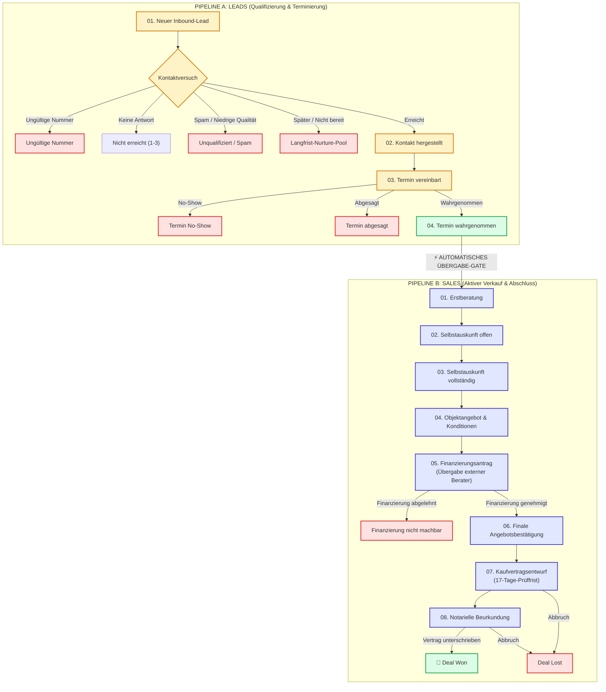

# Verlorene Deals & Kalender-Chaos gestoppt: HubSpot & Calendly neu gebaut — 500+ Std. für ein 50-köpfiges Maklerhaus gespart
## Entkopplung von Inbound-Lead-Qualifizierung und aktivem Immobilienverkauf mit automatisierten Zustandsautomaten & Multi-Kalender-Sync

**Autor:** Karol Jasztal — Head of Operations & Systems Leader  
**Zertifizierungen:** 6x Zertifizierter HubSpot Professional (Revenue Operations, Sales Hub Software, Marketing Hub Software, Sales Enablement, Inbound Marketing, Inbound Marketing Optimization)  
**Primärer Impact:** 288–576 Stunden pro Jahr über 6 Kern-Makler gespart (~500+ Std. zurückgewonnen)  
**Architektur:** Entkoppelter Zwei-Pipeline-Zustandsautomat (11 Lead-Phasen $\rightarrow$ 12 Sales-Phasen) + Multi-Kalender-Routing  

---

## Transformations-Übersicht (Executive Summary)

- **Ausgangs-Engpass:** Ein 50-köpfiges Immobilienmakler-Haus arbeitete mit einer einzigen, monolithischen HubSpot-Pipeline, in der kalte Web-Leads, aktive Preisverhandlungen, Finanzierungsberechnungen und Notartermine in einem Topf landeten. Verwirrende Phasen-Namen, manuelle Follow-up-Mails, abbrechende Zapier-Lead-Imports und chaotische Terminabstimmung zwischen 6 internen Maklern und einem externen Finanzierungspartner verbrannten 1–2 Stunden pro Makler und Woche und ließen lukrative Immobilien-Deals durch die Lappen gehen.
- **Transformierte Architektur:** Eine in Figma entworfene Zwei-Track-CRM-Engine, die **Pipeline A (Leads: 11 Phasen)** sauber von **Pipeline B (Sales: 12 Phasen)** trennt. Dazu ein automatisiertes Qualifizierungs-Übergabe-Gate, eine automatisierte 3-Strike-Anrufkadenz mit Delay-Timern, dynamische Du- vs. Sie-Sequenzen für die Käufer-Selbstauskunft sowie automatisches Calendly-Routing für interne Makler und den externen Finanzierungspartner.
- **Geprüfter ROI:** 288–576 Stunden manueller Routinekram pro Jahr im 6-köpfigen Kernteam eliminiert (~500+ Stunden zurückgewonnen). Speed-to-Lead von Tagen auf wenige automatisierte Minuten gesenkt, fehlerhafte Lead-Imports ins CRM gestoppt und unnötige Notarkosten verhindert, indem vor der Kaufvertrags-Erstellung ein verbindliches Finanzierungs-Gate greift.

---

## § 01. Architektur, Pipeline-Blueprint & Zeitstudie

### 1.1 Ausgangslage & operative Krise

Im hochpreisigen Immobilienvertrieb entscheiden Timing und klare Pipeline-Struktur direkt über den Umsatz. Wenn ein Interessent ein Exposé anfragt, kostet jede Stunde Verzögerung Abschlusswahrscheinlichkeit.

Bei diesem ~50-köpfigen Maklerunternehmen und Wohnungsbau-Partner stand das Vertriebsteam in HubSpot vor einem operativen Albtraum:

```
Monolithische Legacy-Pipeline (Der „Alles-in-einen-Topf“-Zustand):
├── Kalte Web-Leads (vermischt mit aktiven Käufern)
├── Falsche / Fake-Telefonnummern (verstopfen Makler-Ansichten)
├── Manuelle E-Mail-Follow-ups (abhängig vom Gedächtnis einzelner Makler)
├── Unqualifizierte Käufer-Beratungen (ohne finanzielle Vorprüfung)
├── Übergaben an externen Finanzierungspartner (ungetrackte Mails & Anrufe)
└── Kaufvertragsentwurf & Notarfristen (keine Phasenkriterien oder automatischen Erinnerungen)
```

#### Warum die monolithische Pipeline gescheitert ist
1. **Pipeline-Wildwuchs & Phasen-Verwirrung:** Kalte Anfragen von Immobilienportalen lagen direkt neben Deals vor dem Notartermin. Makler verschwendeten Energie darauf, aktive Käufer aus toten Leads herauszufiltern.
2. **Das Speed-to-Lead-Leck:** Eingehende Leads kamen über Portale (z. B. Prospective) durch fragile Zapier-Verbindungen. Fehlten Pflichtfelder, blieben Leads ohne Warnung im Limbo hängen.
3. **Manueller Follow-up-Burnout:** Makler mussten sich selbst merken, wen sie zurückrufen, wann sie nach einem verpassten Anruf nachfassen und welches E-Mail-Template sie kopieren sollten. War viel los, blieben Follow-ups einfach liegen.
4. **Kalender-Chaos mit externen Partnern:** Immobilientransaktionen erfordern eine Finanzierungsprüfung. Das Haus arbeitete mit einem unabhängigen externen Finanzierungsberater zusammen. Die Terminkoordination zwischen Käufer, internem Makler und externem Finanzierungspartner lief über endlose E-Mail-Ketten – massiver Reibungsverlust.
5. **Modal-Hopping & Reibung für Makler:** Die Standard-Oberfläche von HubSpot zwang Makler während Live-Telefonaten zum ständigen Wechsel zwischen Kontakt-Tabs, Deal-Phasen und Aktivitäts-Timelines – Ergebnis: fehlende Felder und genervte Vertriebler.

#### Die Lösung: Visuelle Figma-Architektur, Zwei-Track-Entkopplung & natives Makler-Formular
Statt Einstellungen direkt im laufenden HubSpot-Betrieb zusammenzuklicken, habe ich das komplette System zuerst visuell in **Figma** entworfen. Wir haben jede Phase, jede Bedingung und jede Automatisierungsregel gemappt, live in Zoom-Sessions mit der Geschäftsführung geprüft und den Flow abgenommen, bevor ein einziger Workflow produktiv ging. Um die Bedienungsreibung für Makler zu eliminieren, habe ich ein dediziertes natives HubSpot-Intake-Formular gebaut, das Kontaktdaten, Qualifizierungschecks, Termindaten und Notizen in einer einzigen scrollbaren Ansicht vereint.

---

### 1.2 Quantitative Zeit- & Kapazitätsstudie (Jährlicher Team-ROI)

Die Kern-Vertriebseinheit bestand aus **6 Vollzeit-Maklern**. Durch die Automatisierung von Aufgaben-Erstellung, wiederkehrenden E-Mails, Wiedervorlagen und Kalender-Abstimmung wurden **1 bis 2 Stunden verschwendete Admin-Zeit pro Makler und Woche** zurückgewonnen:

| Operativer Workflow-Task | Bisherige manuelle Methode | Automatisierte HubSpot-Engine | Gesparte Zeit / Woche | Gesparte Zeit / Jahr |
|---|---|---|---|---|
| **01. Inbound-Lead-Triage & Willkommen** | Manuelle Portal-Prüfung & Copy-Paste-Mail | Sofortige Zapier-Validierung & Auto-Mail | 1,5 – 3,0 Std./Wo. | **72 – 144 Std./Jahr** |
| **02. Nachfass-Kadenz bei verpasstem Anruf** | Manuelle Kalender-Erinnerungen / vergessene Leads | 3-Strike-Anrufkadenz mit 48h-Delay-Timern | 2,0 – 4,0 Std./Wo. | **96 – 192 Std./Jahr** |
| **03. Terminbestätigungen & Vorbereitung** | Manuelles Schreiben mit Zoom-/Adress-Links | Automatische Bestätigungs-Mail & 08:00-Morgen-Task | 1,0 – 2,0 Std./Wo. | **48 – 96 Std./Jahr** |
| **04. Versand Käufer-Selbstauskunft** | Makler prüfte Tonalität & hängte PDF manuell an | Dynamischer Du/Sie-Branch-Versand per Property | 1,0 – 1,5 Std./Wo. | **48 – 72 Std./Jahr** |
| **05. Koordination externer Finanzierungspartner** | E-Mail-Ping-Pong mit externem Berater | Dedizierter Partner-Calendly + Checklisten-Gate | 0,5 – 1,5 Std./Wo. | **24 – 72 Std./Jahr** |
| **GESAMTE ZURÜCKGEWONNENE KAPAZITÄT** | **Manueller Admin-Routinekram** | **Automatisierter Zustandsautomat** | **6,0 – 12,0 Std./Wo.** | **288 – 576 Std./Jahr (~500+ Std.)** |

---

### 1.3 Das Zwei-Pipeline-Architektur-Blueprint

Der Durchbruch war die saubere Aufteilung des Vertriebsprozesses in zwei getrennte Pipelines, verbunden durch ein einziges Übergabe-Gate:



---

## § 02. Operatives Schema & Datenvertrag für Custom Fields

Um Datenmüll zu verhindern und sicherzustellen, dass Automatisierungen nie fehlzünden, haben wir einen strikten Datenvertrag über HubSpot-Kontakte und -Deals hinweg etabliert:

| Property-Name | Interner Key | Feldtyp | Pipeline-Scope | Operativer Zweck |
|---|---|---|---|---|
| **Lead-Quelle Intake** | `leadtrans` | Single Dropdown | Leads | Erfasst Eingangs-Herkunft (Prospective-Portal, Web-Formular) für Round-Robin-Zuweisung |
| **Anrufkadenz-Status (Lead)** | `lead_phone_status` | Single Dropdown | Leads | Steuert die 3-Strike-Wiederholung: `Attempt 1: Unreached` $\rightarrow$ `Attempt 2: Unreached` $\rightarrow$ `Attempt 3: Unreached` |
| **Termin-Status** | `lead_meeting_status` | Single Dropdown | Leads & Sales | Primäres Übergabe-Gate: `Meeting Attended` triggert Deal-Erstellung in Pipeline Sales |
| **Anrede-Tonalität (Kunde)** | `salutation_tone` | Radio (Du / Sie) | Sales | Bestimmt, ob automatische Mails informell (Vorname/Du) oder formell (Herr/Frau/Sie) formuliert werden |
| **Status Selbstauskunft** | `sa_status` | Single Dropdown | Sales | Trackt Status der Käufer-Selbstauskunft: `Self-Disclosure in Progress` $\rightarrow$ `Self-Disclosure Completed` |
| **Finanzierungs-Machbarkeit** | `financing_clearance` | Single Dropdown | Sales | Hartes Gate: blockiert Kaufvertragsentwurf, bis Finanzierungspartner auf `Financing Approved` stellt |
| **Externer Finanzierungspartner** | `external_finance_rep` | User Lookup | Sales | Verknüpft Kontakt mit dem externen Finanzierungsberater samt dedizierten Calendly-Links |
| **Vertrags-Prüffrist** | `kv_review_deadline` | Date Picker | Sales | Startet die gesetzliche 17-Tage-Prüffrist für Käufer vor der Notar-Terminierung |
| **Objektwert** | `amount` | Currency (EUR) | Sales | Basis für Deal-Gewichtung, Provisions-Forecasting und Geschäftsführungs-Reporting |
| **Disqualifizierungsgrund** | `disqualification_reason` | Single Dropdown | Leads | Pflicht-Audit-Tag für Spam, ungültige Rufnummern oder nicht finanzierbare Anfragen |

### 2.2 Makler-Interface-Innovation: Das Single-Pane-Intake-Formular in HubSpot

Die Standard-Oberfläche von HubSpot zwingt Makler dazu, während eines Telefonats zwischen Kontakt-Details, Deal-Phasen und Aktivitäts-Logs über mehrere Browser-Tabs und Pop-up-Modals hin- und herzuspringen. Für reibungslose Live-Calls der 6 Makler habe ich ein dediziertes **natives HubSpot-Intake-Formular** gebaut, das den gesamten Qualifizierungs-Workflow in einer einzigen Ansicht bündelt:

1. **Automatische Vorausfüllung (Zero Duplicate Entry):** Vorhandene Käuferdaten aus Immobilienportalen (Name, Telefon, E-Mail, angefragte Objektadresse) werden beim Öffnen des Formulars automatisch vorausgefüllt – Schluss mit Copy-Paste.
2. **Audit fehlender Felder (Live-Qualifizierungssicht):** Zeigt alle erforderlichen Qualifizierungsfelder in einer einzigen scrollbaren Ansicht. Makler sehen im Live-Gespräch sofort, welche Properties noch leer sind – Budget, Zeitplan und Finanzierungsstatus gehen nie wieder unter.
3. **Atomares 1-Klick-Update (Kein Modal-Hopping):** Termindaten, Gesprächsnotizen, Deal-Volumen und Objektzuordnungen werden mit einem Klick atomar übermittelt und aktualisieren Kontakt- und Deal-Datensatz gleichzeitig ohne Tab-Wechsel.

---

## § 03. Workflow-Automatisierungs-Engine & Zustandsautomat

Die Automatisierungs-Engine läuft über eine Reihe modularer HubSpot-Workflows. Makler verschieben Deal-Phasen nie manuell; ihre Routineaktionen (Anruf-Task abhaken, Termin loggen oder Qualifizierungsfeld aktualisieren) treiben den Zustandsautomaten automatisch weiter.

### Operatives Dualitäts-Panel

```
┌─────────────────────────────────────────────────────────┬─────────────────────────────────────────────────────────┐
│ ⚡ WAS VOLLAUTOMATISCH LÄUFT                            │ 🛑 WO MENSCHLICHE MAKLER-FREIGABE PFLICHT BLEIBT        │
├─────────────────────────────────────────────────────────┼─────────────────────────────────────────────────────────┤
│ • Sofortige Willkommens-Mail bei Portal-Eingang         │ • Qualifizierungs-Entscheidung: Prüfen, ob Kaufabsicht  │
│ • 3-Strike-Anrufkadenz mit 2-Tage-Delay-Timern          │   echt ist, bevor das Erstgespräch terminiert wird      │
│ • Automatische Pipeline-Übergabe von Leads nach Sales   │ • Deal-Bewertungs-Anpassung anhand des Kaufangebots     │
│ • Dynamische Wahl von Du- vs. Sie-E-Mail-Templates      │ • Prüfung auf Vollständigkeit der Finanzierungsunterlagen│
│ • Termin-Erinnerungen punktgenau um 08:00 CET am Termintag│ • Finale Vertragsfreigabe vor rechtlicher Notarbuchung │
│ • Archivierung alter Leads in den Langzeit-Nurture-Pool │ • Deal-Loss-Markierung mit Pflicht-Verlustgrund         │
└─────────────────────────────────────────────────────────┴─────────────────────────────────────────────────────────┘
```

---

### Produktions-Workflow-Spezifikationen

#### WORKFLOW 01: Inbound-Lead-Eingang & Makler-Zuweisung
```yaml
Workflow_ID: WF-01-LEAD-INTAKE
Trigger: Contact Property 'leadtrans' is known (Inbound from Portal / Zapier)
Actions:
  - Step 01: Assign Contact Owner to Senior Intake Specialist (Round-Robin)
  - Step 02: Create Deal in 'Pipeline: Leads' at Stage '01. New Inbound Lead'
  - Step 03: Send Automated Email: 'Welcome Email & Property Dossier' (Intro + Company Credentials)
  - Step 04: Create High-Priority Task for Assigned Broker:
      Title: "Call new inbound lead"
      Due_Date: 2 business days (Immediate Execution)
      Priority: HIGH
```

#### WORKFLOW 02: Die 3-Strike-Anrufkadenz & Fallback-Timer-Loop
```yaml
Workflow_ID: WF-02-CALL-CADENCE
Trigger: Contact Call Status updated to 'Unreached'
Logic_Branches:
  - Branch 1 (Attempt 01):
      Set Stage: 'Unreached Lead'
      Delay: 2 business days
      Create Task: "Missed call #1 - retry in 48 hours"
  - Branch 2 (Attempt 02):
      Set Stage: 'Unreached Lead'
      Delay: 2 business days
      Create Task: "Missed call #2 - retry in 48 hours"
  - Branch 3 (Attempt 03):
      Set Stage: 'Unreached Lead'
      Delay: 2 business days
      Create Task: "Missed call #3 - final phone attempt"
  - Branch 4 (Max Attempts Reached):
      Set Stage: 'Pipeline: Leads -> Long-Term Nurture Pool'
      Notify Broker: "Lead moved to Long-Term Nurture Pool"
```

#### WORKFLOW 03: Terminbestätigung & Lead-to-Sales-Übergabe
```yaml
Workflow_ID: WF-03-LEAD-GRADUATION
Trigger: Calendly Event Booked OR Broker sets Status to 'Meeting Scheduled'
Actions:
  - Step 01: Set Deal Stage to 'Meeting Scheduled'
  - Step 02: Send Automated Email: 'Meeting Confirmation & Property Package' (Calendar Invite, Zoom link, property packet)
  - Step 03: Delay until scheduled meeting date at 08:00 CET
  - Step 04: Create Morning Prep Task: "Meeting today at [Time] with buyer prospect"
  - Step 05 (On Status 'Meeting Attended'):
      Move Deal: From 'Pipeline: Leads' -> 'Pipeline: Sales'
      Set Sales Stage: '01. Initial Consultation'
      Send Internal Notification: "Lead successfully qualified & graduated to Active Sales"
```

#### WORKFLOW 04: Dynamischer Du- vs. Sie-Versand der Selbstauskunft
```yaml
Workflow_ID: WF-04-SA-DISPATCH
Trigger: Deal enters 'Pipeline: Sales' Stage 'Self-Disclosure in Progress'
Branching_Rule: Check Contact Property 'salutation_tone'
Logic:
  - If Tone == 'Informal':
      Send Automated Email: "Buyer Self-Disclosure Guide (Informal Tone)"
  - If Tone == 'Formal' (or unset):
      Send Automated Email: "Buyer Self-Disclosure Guide (Formal Tone)"
Follow_Up:
  - Delay: 5 business days
  - Task for Broker: "Review self-disclosure packet or call buyer for missing details"
```

#### WORKFLOW 05: Routing an externen Finanzierungspartner
```yaml
Workflow_ID: WF-05-FINANCING-HANDOFF
Trigger: Deal moves to Stage 'Mortgage Financing Application'
Actions:
  - Step 01: Prompt broker with mandatory verification checklist:
      Checklist: [ID Copies, Last 3 Paystubs, Tax Returns, Equity Proof]
  - Step 02: Send automated notification to External Mortgage Consultant
  - Step 03: Send Buyer Email with External Consultant's Dedicated Calendly Booking Link
  - Step 04: Set weekly recurrence reminder (Tuesdays at 08:00 CET):
      Task: "Check mortgage pre-approval status with external consultant"
  - Step 05 (Outcome Gate):
      - If 'Financing Approved' -> Move to Stage '06. Final Offer Confirmation'
      - If 'Financing Infeasible' -> Move to Stage 'Financing Declined' & Prompt Alternative Listing Pitch
```

#### WORKFLOW 06: 17-Tage-Vertragsprüffrist & Notar-Abschluss
```yaml
Workflow_ID: WF-06-NOTARY-CLOSING
Trigger: Deal moves to Stage 'Purchase Contract Drafting'
Actions:
  - Step 01: Task: "Request purchase contract draft from notary office"
  - Step 02: Delay timer of 17 days (Enforces statutory consumer review period)
  - Step 03: Task on Day 18: "Collect contract feedback from buyer: Approved / Revision Required / Withdrawn"
  - Step 04 (On Approval):
      Move Stage: 'Notary Deed Signing'
      Task: "Coordinate deed signing appointment with notary, buyer, and seller"
  - Step 05 (On Signature):
      Move Stage: 'Deal Won'
      Set Close Date: Today (Automated Revenue Recognition)
```

---

## § 04. Deterministische Quality Gates & Exception-Handling

Um CRM-Daten sauber zu halten und Kundenbeziehungen zu schützen, wurden vier harte Quality Gates in den Zustandsautomaten eingebaut:

```
┌───────────────────────────┬───────────────────────────────────┬─────────────────────────────────────────┐
│ QUALITY GATE              │ VERHINDERTER DEFEKT               │ SYSTEM-DURCHSETZUNG                     │
├───────────────────────────┼───────────────────────────────────┼─────────────────────────────────────────┤
│ 1. Zapier-Payload-Gate    │ Kontakte mit fehlender E-Mail oder│ Mehrstufige Zapier-Validierung prüft    │
│                           │ kaputten Telefonnummern verstopfen│ Pflichtfelder; defekte Leads landen in  │
│                           │ die Makler-Anruflisten            │ der Phase 'Invalid Number' zur Triage   │
├───────────────────────────┼───────────────────────────────────┼─────────────────────────────────────────┤
│ 2. 3-Strike-Anruf-Puffer  │ Makler geben nach 1 Anruf auf     │ Timer sperren nächsten Task für 48 Std.;│
│                           │ oder rufen 5x an einem Nachmittag │ Auto-Verschiebung in Nurture-Pool erst  │
│                           │ hinterher (Spam-Gefahr)           │ nach 3 dokumentierten Anrufversuchen    │
├───────────────────────────┼───────────────────────────────────┼─────────────────────────────────────────┤
│ 3. Finanzierungs-Freigabe │ Tausende Euro Notarkosten für     │ Phasenwechsel zum Kaufvertragsentwurf   │
│    (Clearance Sign-Off)   │ Vertragsentwürfe bei nicht        │ bleibt gesperrt, bis der Partner        │
│                           │ finanzierbaren Interessenten      │ 'Financing Approved' im Portal setzt    │
├───────────────────────────┼───────────────────────────────────┼─────────────────────────────────────────┤
│ 4. Gesetzliche 17-Tage-   │ Verfrühter Druck auf Käufer unter │ Automatisierter 17-Tage-Timer erzwingt  │
│    Prüffrist              │ Verletzung gesetzlicher           │ Prüffrist; erinnert Makler erst nach    │
│                           │ Verbraucher-Schutzfristen         │ Ablauf des gesetzlichen Fensters        │
└───────────────────────────┴───────────────────────────────────┴─────────────────────────────────────────┘
```

---

## § 05. Evaluierte Alternativen & Strategische Trade-Offs

Bevor ich diese Zwei-Pipeline-Architektur gebaut habe, wurden drei Betriebsmodelle evaluiert:

| Architektur-Dimension | Option 1: Monolithische Single-Pipeline (Status Quo) | Option 2: Manuelle Koordination (Tabellen + Postfach) | Option 3: Zwei-Track-HubSpot-Zustandsautomat (Produktiv) |
|---|---|---|---|
| **Pipeline-Transparenz** | **Miserabel:** Kalte Anfragen gemischt mit Abschlüssen; Ansichten überfüllt mit alten Leads | **Nicht vorhanden:** Isoliert in persönlichen Makler-Tabellen; null Management-Überblick | **Glasklar:** Saubere Trennung von Qualifizierung und aktiver Verkaufsverhandlung |
| **Speed-to-Lead** | **Langsam (1–3 Tage):** Abhängig von manuellem Postfach-Check und Gedächtnis | **Langsam & unzuverlässig:** Eingehende Leads blieben in Sammelpostfächern liegen | **< 15 Minuten:** Automatische Willkommens-Mails, Zapier-Validierung und sofortige Anruf-Tasks |
| **Partner-Sync (Finanzierung)** | **Kaputt:** Ungetrackte Telefonate mit externem Berater; ständiger Status-Verlust | **Manuelles Chaos:** Endlose E-Mail-Ketten zwischen Käufer, Makler und Berater | **Automatisiert:** Dediziertes Calendly-Routing, wöchentliche Sync-Tasks, klare Freigabe-Gates |
| **Admin-Ballast pro Makler** | **Hoch (2–3 Std./Wo.):** Stundenlanges Schreiben von Standard-Mails & Erinnerungen | **Extrem (4–6 Std./Wo.):** Hohe Fehlerquote, vergessene Follow-ups sowie akutes Risiko von Tabellen-Korruption und versehentlichem Datenverlust durch menschliche Fehler (ein entscheidender Faktor gegen Spreadsheets); null Management-Transparenz | **Minimal (< 30 Min./Wo.):** Makler konzentrieren sich komplett auf wertschöpfende Gespräche und Abschlüsse |
| **Jährliche Team-Kapazität** | **-300+ Std.** Verlust durch Admin-Reibung | **-600+ Std.** Verlust durch Chaos und Lead-Abbrüche | **+500+ Std.** zurückgewonnen und in den Vertrieb reinvestiert |

---

## § 06. Senior Retrospektive & Operative Learnings

### Was funktioniert hat
1. **Zuerst in Figma zu designen sparte 1–2 Wochen Nacharbeit:** Die visuelle Architektur erlaubte es der Geschäftsführung, direkt auf Engpässe zu zeigen, Phasennamen zu hinterfragen und Übergangskriterien abzustimmen, bevor eine einzige Automatisierung in HubSpot konfiguriert wurde.
2. **Entkopplung von Leads & Sales schuf sofortige Ruhe:** In dem Moment, in dem kalter Intake von aktiven Verhandlungen getrennt wurde, sank der Stress im Team. Wer Abschlüsse fuhr, schaute nur in Pipeline B; wer Akquise machte, lebte in Pipeline A.
3. **Automatisierte Übergabe an den externen Partner:** Ein dedizierter Calendly-Flow mit HubSpot-Task-Integration für den externen Finanzierungsberater schloss genau die Kommunikationslücke, die Deals zuvor wochenlang blockiert hatte.

### Was ich 2026 anders machen würde
- **KI für schnelle Architektur & klickbare HTML-Mockups nutzen:** Statt statischer Figma-Boards würde ich KI nutzen, um die initiale Workflow-Topologie zu strukturieren und interaktive, klickbare HTML-Mockups zu bauen – kombiniert mit Deep AI Research zu Best-Practice-CRM-Standards.
- **Breitere Frontline-Discovery einfordern:** Ich würde bei der Geschäftsführung darauf bestehen, nicht nur den Executive Sponsor, sondern direkt die Makler an der Front und die externen Finanzierungspartner zu interviewen, um Alltags-Edge-Cases vor dem finalen Design aufzudecken.
- **HubSpot-Konfiguration per KI automatisieren:** Statt Dutzende Properties und Workflow-Schritte manuell in HubSpot anzuklicken, würde ich KI-Automatisierung testen, um Property-Erstellung und Workflow-Pipelines zu skripten – damit mein Fokus von manueller Klickarbeit auf reine Verifikation und strategische Governance wandert.
- **KI-Anruf-Transkription (DSGVO-konform) prüfen:** Sofern deutsches und europäisches Datenschutzrecht es zulassen, würde ich automatisierte KI-Gesprächstranskription einsetzen, um Käufer-Budgets, Zeitpläne und Einwände direkt nach dem Telefonat in die HubSpot-Kontaktdaten zu extrahieren.

### Verifizierte Plattform-Zertifizierungen
Diese Implementierung basiert auf formaler, verifizierter Plattform-Expertise. Ich halte **6 offizielle HubSpot-Zertifizierungen** (zum Verifizieren anklicken):
- [HubSpot Revenue Operations Certification](https://app-eu1.hubspot.com/academy/achievements/tnv57jtb/en/1/karol-jasztal/revenue-operations)
- [HubSpot Sales Hub Software Certification](https://app-eu1.hubspot.com/academy/achievements/mf33nncz/en/1/karol-jasztal/hubspot-sales-hub-software)
- [HubSpot Marketing Hub Software Certification](https://app-eu1.hubspot.com/academy/achievements/lrk8rcb3/en/1/karol-jasztal/hubspot-marketing-hub-software)
- [HubSpot Sales Enablement Certification](https://app-eu1.hubspot.com/academy/achievements/4nnx9t0m/en/1/karol-jasztal/sales-enablement)
- [HubSpot Inbound Marketing Certification](https://app-eu1.hubspot.com/academy/achievements/34v8l643/en/1/karol-jasztal/inbound-marketing)
- [HubSpot Inbound Marketing Optimization Certification](https://app-eu1.hubspot.com/academy/achievements/lkt9cvyj/en/1/karol-jasztal/inbound-marketing-optimization)
