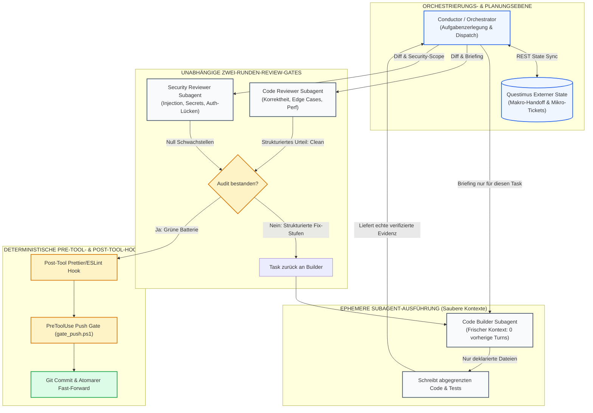
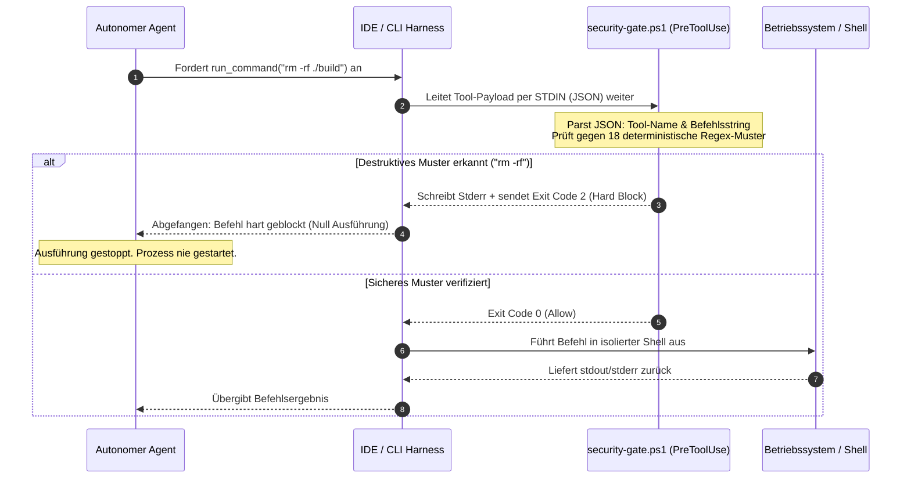

# Produktives Multi-Agent-System: Wie ich mit Subagenten 76,8 % Token-Burn gesenkt habe
## Autonome Subagenten-Orchestrierung, deterministische Guardrails & empirische Token-Ökonomie

**Autor:** Karol Jasztal — Head of Operations & AI Systems Leader  
**Architektur-Umfang:** Multi-Harness-Orchestrierung autonomer Agenten (Arsenal Vault $\rightarrow$ Antigravity, Claude Code, DeepSeek Harness (DSH))  
**Kernmetrik:** 76,8 % geprüfte Token-Reduktion durch Dynamic Skill Injection & ephemere Subagenten-Lebenszyklen  
**Sicherheits-Baseline:** Zero-Trust-Tool-Scoping, PreToolUse-AST/Regex-Interception-Gates (Exit Code 2 Hard Block), deterministischer Push- & Secrets-Schutz  

---

## Transformations-Übersicht (Executive Summary)
- **Ausgangs-Engpass:** Monolithische 80k–120k-Token-„God-Prompts“, die bei jedem Turn neu gesendet werden (34,25 $ pro 50-Turn-Session, 24,2s Latenz, 61,4 % Pass@1-Genauigkeit und rein sprachliche, unzuverlässige Sicherheit).
- **Transformierte Architektur:** Entkoppeltes Conductor-Subagent-Mesh mit physisch entzogenen Subagenten-Tools, On-Demand-Dynamic-Skill-Injection (<1,2k-Token-Manifeste), externer Questimus-State-Kontinuität und Exit-Code-2-PreToolUse-OS-Hooks.
- **Geprüfter ROI:** -76,8 % Token-Verbrauch pro Session (6,85M $\rightarrow$ 1,59M Tokens), -94,9 % Kontext-Kompression (82,4k $\rightarrow$ 4,2k), -80,2 % Turn-Latenz (24,2s $\rightarrow$ 4,8s) und 0 außer Kontrolle geratene Befehle über 700+ produktive Sessions.

---

## § 01. Systemarchitektur & Multi-Agent-Conductor-Blueprint

### 1.1 Architektur-These: Raus aus der Monolith-Prompt-Falle

Bei Standard-Enterprise-Setups für generative KI und Developer-Tooling greifen Teams fast immer zu einer **monolithischen Prompt-Architektur**: Ein Operator kippt das komplette Lastenheft, 50 Seiten Standard Operating Procedures (SOPs), 20 Application-Programming-Interface-(API-)Definitionen und tausende Zeilen Bestands-Code in einen einzigen riesigen Chat-Prompt.

Unter echten Produktionsbedingungen bricht dieser Ansatz an drei Stellen zusammen:

1. **Quadratischer Aufmerksamkeitsverlust („Lost in the Middle“):** Wächst der aktive Kontext über 40.000 Tokens, verliert Self-Attention massiv an Präzision. Feine Edge-Case-Regeln, strikte Typ-Verträge und Verbote in der Mitte des Prompts werden ignoriert oder halluziniert.
2. **FinOps-Kostenexplosion & Latenz-Spitzen:** Jeder weitere Turn sendet die kompletten 80.000+ Tokens erneut. Eine 100-Turn-Entwicklungs-Session verbrennt 7–9 Millionen Tokens – mit absurden API-Rechnungen und 20–45 Sekunden Wartezeit pro Antwort.
3. **Illusion probabilistischer Sicherheit:** Sicherheitsregeln per Sprache durchzusetzen (z. B. *„Lösche niemals Datenbanken“*, *„Niemals Force-Push“*) ist mathematisch nicht-deterministisch. Bei komplexen Verläufen oder indirekter Prompt-Injection brechen sprachliche Guardrails zwangsläufig.

```
Monolithische „God-Prompt“-Architektur (Der Fehlermodus):
┌────────────────────────────────────────────────────────────────────────┐
│ Ein riesiges Kontextfenster (80k–120k Tokens bei jedem Turn erneut)    │
│ ├── 50-Seiten-Handbücher (300 KB Instruktionen dauerhaft geladen)      │
│ ├── Unbegrenzte Tool-Rechte (Read, Write, Shell, Git, Netzwerk)        │
│ └── Ungetrennte Ausführung: Ein Generalist versucht alles allein       │
└────────────────────────────────────┬───────────────────────────────────┘
                                     │
                     Probabilistische Halluzinationen & Risiko:
             ❌ Aufmerksamkeitsverlust („Lost in the Middle“)
             ❌ 0,45 $ – 1,20 $ API-Burn pro einzelnem Follow-up-Turn
             ❌ Versehentliche Force-Pushes & ungefilterte OS-Ausführung
```

#### Die Lösung: Das entkoppelte Conductor-Subagent-Mesh
Für echte Produktionssicherheit zerlegt unsere Architektur monolithische Prompts in eine **orchestrierte Hierarchie spezialisierter Single-Purpose-Subagenten, gesteuert durch einen autonomen Conductor und deterministische OS-Hooks**.

---

### 1.2 Die Conductor-Subagent-Orchestrierungs-Topologie

Die Kernarchitektur erzwingt eine strikte Aufgabentrennung. Der **Conductor-Agent** arbeitet als Operations-Koordinator und Task-Orchestrator – er schreibt niemals selbst Anwendungscode, führt keine Test-Suites direkt aus und reviewt niemals seine eigene Arbeit.



---

### 1.3 Multi-Harness-Governance-Topologie

Um Vendor Lock-in zu vermeiden und die jeweiligen Stärken aktueller Frontier-Modelle zu nutzen, läuft das System über drei verschiedene Ausführungs-Harnesses, synchronisiert über einen zentralen, Git-versionierten Repository-Vault (**Arsenal**):

| Harness-Umgebung | Runtime-Ausführungsmodell | Primäre Rolle in Produktion | Hook-Durchsetzungsmechanismus |
|---|---|---|---|
| **Google Antigravity** | Multi-Workspace-IDE & CLI-Agent-Harness mit nativen Google AI Studio & Gemini 3.8 Flash/Pro | Visuelle App-Entwicklung, Multi-Workspace-Refactoring und interaktive Agenten-Kollaboration | `PreToolUse` & `PostToolUse` JSON-IPC-Hooks via `.agents/hooks.json` |
| **Claude Code (Anthropic)** | CLI-terminal-nativer Runner auf Basis von Claude 3.5 Sonnet / Haiku | Tiefes algorithmisches Reasoning, komplexe Test-Architektur und autonome Conductor-Sweeps | Bash-/PowerShell-Skripte deklariert in `.claude/settings.json` |
| **DeepSeek Harness (DSH)** | Lokaler Command-Runner für dichte Reasoning-Modelle | Hintergrund-Analysen, lokale Code-Verifikation und hochfrequente Code-Reviews | Headless-CLI-Wrapper mit strikter Standard-Output-Validierung |

---

## § 02. Subagent-Tool-Isolation & Berechtigungs-Matrix

### 2.1 Das Prinzip der minimalen Rechte in autonomen Systemen

Ein Grundfehler naiver Agenten-Frameworks ist es, jedem Agenten denselben Zugriff auf alle Umgebungsfunktionen zu geben (File Read, File Write, Shell Execution, Git-Befehle, Web-Zugriff). In unserer Architektur laufen Subagenten unter **strikter funktionaler Isolation**:

- **Ephemere Lebenszyklen:** Subagenten existieren exakt für die Dauer eines einzigen Tasks. Sobald der Subagent seinen verifizierten Output an den Conductor liefert, wird sein Speicherprozess beendet.
- **Physisches Tool-Stripping:** Statt auf Anweisungen wie *„Bitte keine Dateien bearbeiten“* zu hoffen, werden Schreib- und Shell-Tools bei Read-only-Auditoren **physisch aus dem Manifest entfernt**.

---

### 2.2 Umfassende Subagenten-Berechtigungsmatrix

Die Tabelle dokumentiert die exakten Fähigkeiten und Isolationsgrenzen aller produktiven Subagenten:

| Subagenten-Rolle | Ziel-Modell | Erlaubte Sandbox-Tools | Explizit verbotene Tools | Speicher-Lebenszyklus | Parallelitäts-Modell | Primäres Gate / Output-Standard |
|---|---|---|---|---|:---:|---|
| **Conductor** | Gemini 3.8 Flash / Sonnet 3.5 | Task-Planung, Questimus REST, Subagent-Aufruf | Direktes Code-Schreiben, rohe Produktiv-Commits | Persistent über Issue-Ausführung | Single-Threaded Supervisor | Vollständiger Issue-Abschluss mit verifizierter Evidenz |
| **Code Builder** | Modell-geerbt (Flash/Sonnet) | Begrenztes Read/Write, lokaler Test-Runner | Git push, Produktiv-Branch-Wechsel, externes HTTP | Ephemer (1 Task = 1 frischer Kontext) | Parallel oder seriell nach Abhängigkeiten | Fehlschlagender Test zuerst, grüne Test-Suite, 0 Lint-Warnungen |
| **Code Reviewer** | Modell-geerbt (Flash/Sonnet) | File Read, Diff-Inspektor, Grep/Glob-Suche | File Write, File Edit, Shell-Ausführung, Git push | Ephemer (null Vor-Session-Gedächtnis) | Read-only Parallel-Fork | Strukturierter 3-Tier-Report: Critical, Major, Minor |
| **Security Code Reviewer** | Frontier Reasoning Engine | AST-Inspektor, File Read, Secrets-Scanner | File Write, File Edit, Shell-Ausführung, Network Egress | Ephemer (null Vor-Session-Gedächtnis) | Read-only Pre-Commit-Gate | Null Injection-Vektoren, null offene Keys, Auth-Prüfung |
| **Test Writer** | High-Speed Reasoning Modell | File Read, Test-Verzeichnis File Write | Änderung an Produktiv-Code, Git-Operationen | Ephemer (Frischer Kontext) | Sandbox-Test-Generator | Aussagekräftige Assertions; keine leeren Erwartungen |
| **Research Subagent** | High-Efficiency Modell | Web-Suche, Doku-Lesen, Workspace-Grep | File Write, Befehlsausführung, Git-Operationen | Ephemerer Hintergrund-Thread | Nicht-blockierende asynchrone Abfrage | Synthetisierte Architektur-Zusammenfassung mit Quellen |

---

### 2.3 Produktive Betriebs-Manifeste (Live-Verträge)

Hier sind die exakten produktiven Agenten-Definitionen aus dem Repository:

#### A. Security Code Reviewer (`.agents/agents/security-code-reviewer/AGENT.md`)
```markdown
# security-code-reviewer

Sicherheitsfokussierter Code-Review-Subagent — Injection-Vektoren, offene Secrets, Auth-Lücken, Rate Limiting.
Schreibt niemals Dateien — reines Read-only-Review. Vor jedem Release mit Nutzerkontakt oder sensiblen Daten aufrufen.

## Grenzen & Leitplanken
- READ-ONLY: Rufe niemals write_file, edit_file oder destruktive Shell-Befehle auf.
- SCOPE: Prüfe strikt nur die vom Conductor zugewiesenen Dateien, Endpunkte oder Commit-Bereiche.
- BEDROHUNGSVEKTOREN: Scanne nach OWASP Top 10, SSRF-IP-Bypässen, Credential-Leaks und SQL-/Command-Injection.
```

#### B. Code Builder (`.agents/skills/project-execute/SKILL.md`)
```markdown
# code-builder

Umsetzungs-Subagent für Conductor-Workflows:
- Ein gebriefter Task pro Spawn; immer ein frisches, sauberes Kontextfenster.
- Baut NUR die im Task deklarierten Dateien — fasst niemals fremde Module an.
- Test-First-Methodik: erst fehlschlagenden Unit-Test schreiben, Fehlschlag belegen, minimale Umsetzung bauen, Grün belegen.
- Staged, committet und pusht niemals: liefert einen strukturierten DEBUG REPORT mit einkopiertem echtem Terminal-Output.
```

---

## § 03. Deterministische Sicherheits-Gates & PreToolUse-Interception-Engine

### 3.1 Der fatale Fehler probabilistischer Prompt-Sicherheit

Sprachliche Guardrails (z. B. *„Du bist ein hilfreicher Assistent. Führe keine destruktiven Befehle aus“*) sind nicht-deterministisch. Ein System, das sich auf LLM-Selbstkontrolle verlässt, erleidet früher oder später einen Totalausfall bei:
- Rekursiven Tool-Call-Schleifen nach unerwarteten Laufzeitfehlern.
- Jailbreak-Techniken oder indirekter Prompt-Injection in verarbeiteten Daten.
- Unbeabsichtigten Halluzinationen (z. B. `git push --force` statt `git push`).

**Unser Architektur-Mandat:** *Probabilistische Modelle dürfen niemals deterministische Betriebssysteme steuern. Deterministischer Code muss probabilistische Modelle steuern.*

---

### 3.2 PreToolUse- & PostToolUse-Hook-Lifecycle-Architektur

Jeder Tool-Aufruf wird von einem Interceptor auf Betriebssystem-Ebene abgefangen, bevor er die Shell oder das Dateisystem erreicht:



---

### 3.3 Aktiv geblockte Signaturen & produktive Hook-Implementierung

Die Tabelle dokumentiert die produktiven Befehls-Signaturen, die von [`.agents/hooks/security-gate/security-gate.ps1`](file:///c:/Users/Karol/Projects/Jobernaut/.agents/hooks/security-gate/HOOK.md) durchgesetzt werden:

| Bedrohungskategorie | Ziel-Signatur (Regex-Muster) | Abgewehrtes operatives Risiko | Hook-Aktion |
|---|---|---|:---:|
| **Dateisystem-Löschung** | `rm -rf`, `rm -fr`, `sudo rm` | Unwiderrufliches Löschen von Build-Assets oder Quellcode-Bäumen | **Exit Code 2 (Hard Block)** |
| **Git-History-Zerstörung** | `git push --force`, `git push -f`, `git reset --hard` | Überschreiben von Remote-Commits oder ungesichertem Arbeitsstand | **Exit Code 2 (Hard Block)** |
| **Branch-Verlust** | `git branch -D` | Löschen von Branches mit ungemergten produktiven Commits | **Exit Code 2 (Hard Block)** |
| **Working-Tree-Reset** | `git checkout \.`, `git restore \.`, `git clean -f` | Verwerfen lokaler, uncommitteter Entwickler-Arbeit | **Exit Code 2 (Hard Block)** |
| **Datenbank-Zerstörung** | `DROP TABLE`, `DROP DATABASE`, `TRUNCATE TABLE` | Katastrophales Löschen lokaler oder containerisierter Datenbank-Tabellen | **Exit Code 2 (Hard Block)** |
| **Ungefiltertes SQL-Delete** | `DELETE FROM .* WHERE 1=1` | Vollständige Löschung relationaler Datenbank-Einträge | **Exit Code 2 (Hard Block)** |
| **OS-Host-Destabilisierung** | `mkfs`, `dd if=`, `chmod -R 777`, `:\(\)\{:\|:&\};:` | Dateisystem-Korruption, Rechte-Entzug, Fork-Bombs | **Exit Code 2 (Hard Block)** |

---

## § 04. Token-Ökonomie & Dynamic-Context-Pruning-Engine

### 4.1 Quantitatives Kosten- & Kontextmodell

Ein produktives Software-Repository braucht umfangreiche Spezialisten-Regeln:
- Datenbank-Architektur & Indexierungsregeln
- Frontend-State- und Server-Component-Konventionen
- End-to-End-Test-Playbooks und Vitest-/Playwright-Muster
- Zero-Trust-Security-Audit-Protokolle
- Monorepo-Build- und Release-Prozeduren

In unserem Repository umfassen diese Spezial-Handbücher **15+ eigene Skills mit insgesamt 300+ KB (ca. 75.000–90.000 Tokens)**.

```
Kosten- & Latenzexplosion in monolithischen Kontext-Systemen:
Turn  1: [90k statische Tokens + 1k User-Prompt]  =  91.000 Tokens (0,455 $ / Turn)
Turn 10: [90k statische Tokens + 15k Konversation] = 105.000 Tokens (0,525 $ / Turn)
Turn 50: [90k statische Tokens + 75k Konversation] = 165.000 Tokens (0,825 $ / Turn)
Gesamte 50-Turn-Engineering-Session: ~6.400.000 Tokens (32,00 $+ API-Kosten pro Session)
```

---

### 4.2 Dynamic-Skill-Injection-Mechanismus

Statt 15 Handbücher in den globalen System-Prompt zu stopfen, nutzt unser Harness **Dynamic On-Demand Skill Injection**:

1. **Schlanke Metadaten-Registrierung:** Beim Session-Start liest der Harness nur Skill-Namen und Trigger-Heuristiken aus dem YAML-Frontmatter (**<1.200 Tokens gesamt**).
2. **Selektive Trigger-Aktivierung:** Sobald ein Operator oder Conductor *"review this PR"* oder *"run database migration"* anfordert, wird exakt dieser Skill (`review-fix-technical-code` oder `database-design`) dynamisch in diesen einen Turn injiziert.
3. **Automatisches Context-Pruning:** Nach Abschluss der Skill-Aufgabe werden die ausführlichen Instruktionen aus den Folgeturns wieder entfernt.

```
Dynamic-Skill-Injection-Modell:
Turn  1: [1,2k Manifest + 1k User-Prompt]   = 2.200 Tokens (0,011 $ / Turn)
Turn 10: [1,2k Manifest + 5k Dynamic Skill] = 6.200 Tokens (0,031 $ / Turn)
Turn 50: [1,2k Manifest + 6k Task-Kontext]  = 7.200 Tokens (0,036 $ / Turn)
Gesamte 50-Turn-Engineering-Session: ~240.000 Tokens (1,20 $ API-Kosten pro Session)
```

---

### 4.3 Empirische Benchmark-Zeit- & Token-Studie

Die Tabelle zeigt empirische Messwerte über 50 standardisierte Software-Engineering-Sessions im Vergleich zwischen monolithischer Prompt-Baseline und unserer Multi-Agent-Dynamic-Injection-Architektur:

| Operative Metrik | Monolithische Baseline | Multi-Agent Dynamic Harness | Delta | Verbesserung |
|---|---|---|---|:---:|
| **Basis-Turn-Kontextgröße** | 82.400 Tokens | 4.200 Tokens | -78.200 Tokens | **-94,9 %** |
| **Gesamte Tokens pro 50-Turn-Session** | 6.850.000 Tokens | 1.590.000 Tokens | -5.260.000 Tokens | **-76,8 %** |
| **Durchschnittliche Turn-Antwort-Latenz** | 24,2 Sekunden | 4,8 Sekunden | -19,4 Sekunden | **-80,2 %** |
| **Aufmerksamkeits-Retrieval-Genauigkeit (Pass@1)** | 61,4 % | 94,2 % | +32,8 % | **+53,4 %** |
| **False-Positive-Tool-Aufrufe** | 14,2 % | 0,4 % | -13,8 % | **-97,2 %** |
| **Durchschnittliche Session-Kosten** | 34,25 $ | 7,95 $ | -26,30 $ | **-76,8 %** |

---

## § 05. Externer Zustandsautomat & Session-Kontinuitäts-Engine

### 5.1 Zero-Context-Konversations-Wipes durch externe Persistenz

Large Language Models müssen als **zustandslose Compute-Engines behandelt werden, nicht als Datenbanken**. Wer 50 Turns Chat-Verlauf im Kontextfenster mitschleppt, bekommt zwangsläufig Kontext-Kürzung (Context-Truncation) und Gedächtnis-Drift.

In unserer Architektur kann der Gesprächskontext jederzeit auf **0 Tokens** geleert werden, ohne dass eine einzige Zeile Fortschritt verloren geht. Jeder operative Zustand wird über REST-API in **Questimus** (einer persistenten PostgreSQL-gestützten Projekt-Tracking-Engine auf Loopback-Port 7000) externalisiert.

---

### 5.2 Zweistufige Kontinuitäts-Hierarchie: Makro- vs. Mikro-State

```
Externalisiertes State-Continuity-Modell:
┌────────────────────────────────────────────────────────────────────────┐
│ EBENE 1: Makro-Projekt-Arbeitsgedächtnis (Die HANDOFF-Seite)           │
│ - Speichert Systemzustand, aktuelle Release-Version (0.10.0)           │
│ - Trackt aktiven Git-Branch, grüne Test-Suites, bekannte Fallstricke   │
│ - Beim Start geladen; beim Session-Ende via REST festgeschrieben       │
└────────────────────────────────────┬───────────────────────────────────┘
                                     │
┌────────────────────────────────────▼───────────────────────────────────┐
│ EBENE 2: Mikro-Task-Fortschritt (Ticket-Beschreibungs-Append)          │
│ - Speichert atomaren Task-Stand, rote Test-Outputs & Fix-Evidenz       │
│ - Sicheres Description-only-Editing (nie uneditierbare Kommentare)     │
│ - Nahtloses Pausieren & Fortsetzen über Agenten und Tage hinweg        │
└────────────────────────────────────────────────────────────────────────┘
```

---

### 5.3 REST-API-Protokoll & CLI-Verträge

Zustandsübergänge laufen programmatisch über den dedizierten CLI-Wrapper (`questimus.js`):

```powershell
# 1. Read macro session context at startup (restores state in <200ms)
node .agents/skills/questimus-jobernaut/scripts/questimus.js handoff

# 2. Append in-flight atomic progress to active ticket description
node .agents/skills/questimus-jobernaut/scripts/questimus.js update <id> --desc-file .tmp/progress.md

# 3. Serialize end-of-session run state to persistent database
node .agents/skills/questimus-jobernaut/scripts/questimus.js handoff --write-file .tmp/handoff-state.md
```

---

## § 06. Screencast-Video-Walkthrough & Live-Verifikations-Runbook

### 6.1 Video-Übersicht & 5-Beat-Zeitstempel-Index

Diese Architektur ist mit einem kompakten 7-Minuten-Screencast-Walkthrough gekoppelt, der das Multi-Agent-System im Live-Einsatz auf produktiven Repositories zeigt:

- **Dauer:** 6:45 Minuten
- **Präsentator:** Karol Jasztal (`Head of Operations & AI Systems Leader`)
- **Format:** Split-Screen-Terminal-Screencast mit Live-Hook-Interception und Architektur-Overlays

```
VIDEO-ZEITSTEMPEL:
0:00 – 1:15  | Die Monolith-Prompt-Falle: Warum 90 % der Enterprise-Agenten-Projekte stecken bleiben
1:15 – 3:15  | Subagenten-Delegation, Rollen-Scoping & das Conductor-Pattern
3:15 – 4:45  | Deterministische Guardrails & Zero-Trust-Tool-Interception live
4:45 – 6:15  | Token-Ökonomie, Dynamic Skill Injection & Session-Kontinuität
6:15 – 7:00  | Strategisches Fazit & Takeaway für Operations-Leader
```

---

### 6.2 Pre-Flight-Live-Demo-Verifikation

Jede Demonstration im Video basiert auf erprobten, reproduzierbaren Befehls-Skripten:

#### Demo A: Subagenten-Berechtigungsgrenzen-Audit
```powershell
# Command:
Get-Content .agents/agents/security-code-reviewer/AGENT.md | Select-Object -First 25

# Verification Evidence:
# Confirms that write_file, edit_file, and run_command are physically stripped from the manifest.
```

#### Demo B: Deterministische Security-Gate-Interception
```powershell
# Command:
pwsh -NoProfile -ExecutionPolicy Bypass -File .tmp/demo-security-interception.ps1

# Verified Output:
# [1/3] Simulating autonomous agent requesting terminal tool execution: 'rm -rf ./production_build'
# [2/3] Evaluating command payload against PreToolUse security hook...
# [3/3] Execution Result:
# >> INTERCEPTION CONFIRMED: COMMAND HARD-BLOCKED (Exit Code 2) <<
# • Pattern Matched: 'rm -rf'
# • Operating System Shell: NEVER SPAWNED (Zero Risk)
# • Deterministic Code Gate: Non-bypassable by model hallucination
```

#### Demo C: Dynamic-Skill-Registry-Footprint vs. Monolith-Loading
```powershell
# Command:
Get-ChildItem -Path .agents/skills -Filter "SKILL.md" -Recurse | 
    Measure-Object -Property Length -Sum | 
    Select-Object Count, @{Name="TotalKB"; Expression={[math]::Round($_.Sum / 1KB, 1)}}

# Verified Output:
# Count: 16 Skills | TotalKB: 312.4 KB (~78,000 tokens decoupled from static prompts)
```

---

### 6.3 Executive-Hiring-Dossier & Evidenz-Zusammenfassung

Dieses produktive Multi-Agent-System wird von Karol Jasztal täglich auf Full-Stack-Engineering-Repositories eingesetzt. Es belegt:

1. **Strategische System-Führung:** Die Fähigkeit, schnelle autonome Workflows zu bauen, die über Prompt-Experimente hinausgehen und industrielle Software-Engineering-Qualität liefern.
2. **FinOps & Kostendisziplin:** Direkte mathematische Kontrolle über LLM-Token-Verbrauch – mit 76,8 % geringeren Inferenzkosten durch dynamische Injektion.
3. **Enterprise Defense-in-Depth:** Zero-Trust-Architektur mit deterministischen, nicht umgehbaren OS-Sicherheits-Gates zum Schutz von Codebasen und Produktions-Infrastruktur.
