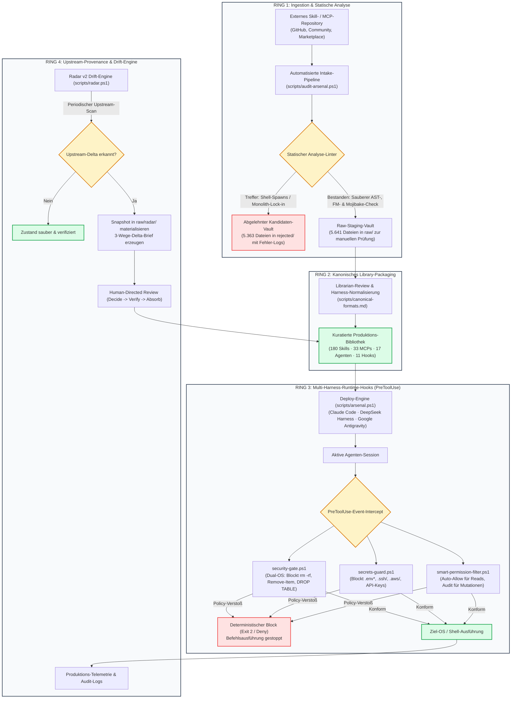
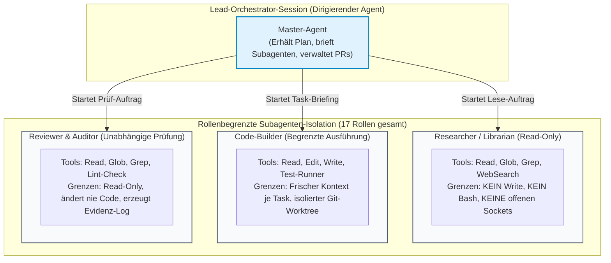
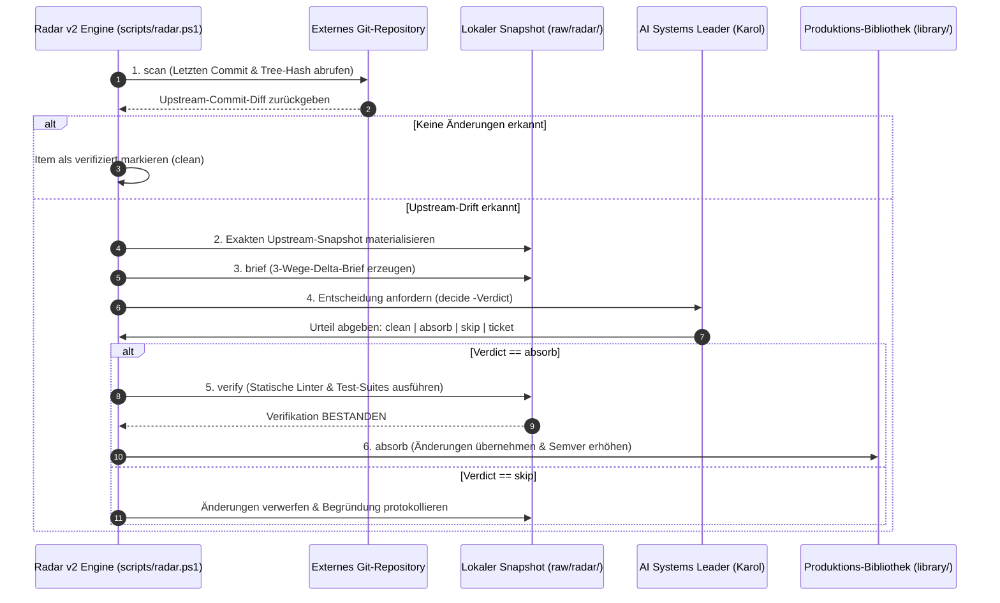

# Warum „Sei vorsichtig“ bei KI scheitert: Wie ich 11.000+ Dateien geprüft und echte OS-Firewalls für autonome Agenten gebaut habe
## Defense-in-Depth-Governance, PreToolUse-Runtime-Intercepts & Supply-Chain-Vetting für 11.000+ Kandidaten-Dateien

**Autor:** Karol Jasztal — Head of Operations & AI Systems Leader  
**Einsatzbereich:** Cross-Harness-Deployment über 3 große autonome Agenten-Harnesses (Claude Code, DeepSeek Harness, Google Antigravity)  
**Kuratierte Control Plane:** 180 Produktions-Skills (33.108 Zeilen orchestrierter Code) · 33 Model-Context-Protocol-(MCP-)Server · 17 spezialisierte Subagenten · 11 Runtime-Lifecycle-Hooks  
**Geprüfter Umfang:** 11.000+ Kandidaten-Dateien geprüft · 5.363 mit permanenten Fehler-Logs abgelehnt (~49 % Ablehnungsquote) · 50.787 verwaltete Vault-Dateien  
**Nachweis:** Null Sicherheitsvorfälle, null Credential-Leaks, null destruktive Ausführungen  

---

## Executive-Transformations-Übersicht
- **Ausgangs-Engpass:** Ungeprüfte Open-Source-Skills/MCP-Server und konversationelle Selbstkontrolle („Bitte keine destruktiven Befehle ausführen“) setzen autonome Agenten-Deployments RCE, `.env`-Credential-Leaks und Supply-Chain-Drift aus.
- **Transformierte Architektur:** 4 konzentrische Verteidigungsringe in Arsenal: statisches AST-/Beacon-Ingestion-Vetting, Exit-Code-2-PreToolUse-OS-Firewall-Hooks (`security-gate.ps1`, `secrets-guard.ps1`), physischer RBAC-Tool-Entzug für Subagenten und Radar-v2-SHA-256-Upstream-Drift-Erkennung.
- **Geprüfter ROI:** 11.000+ Kandidaten-Dateien geprüft (5.363 / ~49 % mit forensischen Logs abgelehnt), 241 Produktions-Primitives über 3 Harnesses hinweg abgesichert und 0 Sicherheitsvorfälle oder Credential-Leaks über 2+ Jahre.

---

## § 01. Bedrohungslage, Enterprise-Schwachstellen & Verteidigungs-Blueprint

### Executive-Kennzahlen: Der Zero-Trust-Verteidigungs-Funnel

| Geprüfte Kandidaten-Dateien | Abgelehnt (Sicherheit / Bloat) | Verwaltete Vault-Dateien | Orchestrierter System-Code | Kuratierte Produktions-Primitives | Parallele Agenten-Harnesses |
|:---:|:---:|:---:|:---:|:---:|:---:|
| **11.000+** | **5.363 (~49 % Quote)** | **50.787** | **33.108 Zeilen** | **241 Primitives** | **3 (Claude Code, DeepSeek Harness, Google Antigravity)** |

---

### 1.1 Bedrohungsanalyse: Das Dilemma autonomer Enterprise-Agenten

Unternehmen, Engineering-Leads und Operations-Verantwortliche frieren den Einsatz autonomer Coding- und Workflow-Agenten zunehmend ein. Die Produktivitätsversprechen autonomer Large-Language-Model-(LLM-)Agenten sind zwar riesig, aber Standard-Deployments öffnen kritische Sicherheitslücken:

```
Bedrohungsvektoren bei autonomen Enterprise-Agenten:
├── 1. Beliebige Shell-Ausführung (RCE):  Halluzinierte oder gekaperte Befehle ('rm -rf', 'Remove-Item -Recurse', 'git push --force', 'DROP TABLE')
├── 2. Credential- & Secret-Exfiltration: LLMs lesen '.env', '.ssh/id_rsa', AWS-Tokens und leaken sie über Kontext oder HTTP
├── 3. Indirekte Prompt-Injection:        Manipulierte Webseiten, fremde Repos oder Issues kapern die Ausführungsschleife
├── 4. MCP- & Skill-Supply-Chain-Risiken: Fremde Skills starten ungeprüfte Kindprozesse oder leiten Daten über Daemons ab
└── 5. Autonomer Agenten-Drift:           Upstream-Maintainer ändern heimlich System-Prompts oder Abhängigkeiten ohne Prüfung
```

#### Der Grundfehler von Modell-Selbstkontrolle
Klassische Ansätze versuchen diese Risiken über System-Prompts zu lösen: *„Bitte keine destruktiven Befehle ausführen“* oder *„Gib niemals sensible API-Keys preis“*.

In der Praxis versagt Prompt-basierte Selbstkontrolle unter Druck, bei vollem Kontextfenster oder durch Jailbreaks deterministisch. Sobald ein Agent rohen Bash-Zugriff oder uneingeschränkte Datei-Tools hat, **können probabilistische Modelle niemals als Sicherheitsgrenze dienen**.

#### Die Zero-Trust-Lösung: Deterministische Defense-in-Depth
Eine echte Zero-Trust-Agentenarchitektur behandelt die LLM-Engine auf Betriebssystem-Ebene als komplett nicht vertrauenswürdig. Sicherheitsgrenzen müssen **Out-of-Band durch deterministische Code-Hooks und OS-Sandboxes** erzwungen werden, bevor irgendein Tool ausgeführt wird.

---

### 1.2 Das Defense-in-Depth-Governance-Paradigma

Karol Jasztal hat **Arsenal** entwickelt und betrieben – ein Enterprise-Deployment- und Governance-System für KI-Primitives über 3 kommerzielle Agenten-Harnesses hinweg. Das System erzwingt vier konzentrische Verteidigungsringe:

1. **Ring 1: Ingestion- & Static-Analysis-Gate** — Kein Skill und kein Model-Context-Protocol-(MCP-)Server gelangt in die Bibliothek ohne automatisiertes Abstract-Syntax-Tree-(AST-)Scanning, Regex-Linting, Frontmatter-Prüfung und Encoding-Checks über 11.000+ Kandidaten-Dateien.
2. **Ring 2: PreToolUse-Runtime-Interception** — Echtzeit-Hook-Interceptoren prüfen jeden Tool-Aufruf vor der Ausführung. Passt ein Befehl auf ein destruktives Muster (Unix oder PowerShell) oder greift auf geschützte Secrets zu, wird er deterministisch mit Exit Code 2 gestoppt.
3. **Ring 3: Least-Privilege-Subagenten-Grenzen** — Agenten sind in 17 spezialisierte, rollenbegrenzte Worker zerlegt. Read-only-Subagenten werden physisch von Write- und Shell-Tools getrennt; Ausführungs-Subagenten arbeiten in isolierten Git-Worktrees.
4. **Ring 4: Provenance & Drift-Erkennung (Radar v2)** — Laufende Überwachung von Upstream-Repositories mit 3-Wege-Merge-Konflikterkennung, Snapshot-Materialisierung und verpflichtendem Human-Review vor jeder Übernahme.

---

### 1.3 End-to-End-Systemarchitektur-Schema



---

## § 02. Ingestion, Static-Analysis-Gate & Multi-Mode-Subsystem-Anatomie

### 2.1 Das Ingestion-Protokoll & kanonische Packaging-Modell

Jeder externe Skill, jede Agenten-Definition und jeder Model-Context-Protocol-(MCP-)Server, der in Arsenal importiert wird, muss einem strikten, Harness-neutralen kanonischen Format entsprechen. Statt proprietäre Vendor-Erweiterungen in die Codebasis einzuschleusen, erzwingt Arsenal einen sauberen Paket-Standard:

```
Kanonisches Item-Paket (library/skills/<item-name>/):
├── SKILL.md            ← Harness-neutrale Markdown-Direktiven & Metadaten
├── _arsenal.yml        ← Versionierung, Upstream-Provenance und Deploy-Targets
├── changelog.md        ← Rückwärts-chronologisches Änderungsprotokoll
└── references/         ← Offline-Schemas & Spezialisten-Checklisten
```

#### Kanonischer Frontmatter-Vertrag
```yaml
---
name: database-design
description: "Production database design, platform selection, schema modeling, migration patterns, and Postgres optimization rules."
harness: universal
allowed-tools:
  - Read
  - Glob
  - Grep
triggers:
  - database design
  - schema review
---
```

---

### 2.2 Deterministische statische Linter: Token-Scanning & Mojibake-Audits

Arsenal führt automatisierte Pre-Commit-Gates und statische Audits über `scripts/audit-arsenal.ps1` aus. Der Linter prüft 100 % der eingehenden Pakete gegen drei harte Kriterien:

1. **Harness-Neutralitäts-Token-Scan:** Erkennt verbotene anbieterspezifische Tool-Aufrufe oder hartcodierte Pfade (z. B. `.claude/` oder `$DSH_HOME`), die plattformübergreifenden Betrieb brechen.
2. **Frontmatter- & Header-Integrität:** Prüft valide YAML-Fences, erlaubte Tool-Deklarationen und verpflichtende Trigger-Definitionen.
3. **Encoding- & Mojibake-Erkennung:** Scannt nach Zeichenkodierungsfehlern (isoliertes `Â`, `Ã` oder cp1252-Fehlinterpretationen), die häufig beim Wechsel zwischen Windows PowerShell und Linux entstehen.

```powershell
# Extract from scripts/audit-arsenal.ps1 (Universal Harness-Neutrality Gate & Mojibake Check)
$Script:CcTokens = @('Read','Edit','NotebookEdit','Write','Glob','Grep','Bash','Agent','Task','WebSearch','WebFetch')
$Script:DshTokens = @('read_image','subagent_fork','str_replace_editor','subagent_type','tools.skill')
$Script:PathTokens = @('.claude/','.claude\','~/.claude','$HOME/.claude','.dsh/','.dsh\','$DSH_HOME','.agents/','~/.agents')
$Script:HarnessAllowed = @('universal','claude-code','dsh','antigravity','gemini','openai')

# Gate mode enforces exit 1 on any frontmatter error or encoding defect
if ($Gate -and ($FmErrors -gt 0 -or $ScriptErrors -gt 0 -or $MojibakeHits -gt 0)) {
    Write-Error "PRE-COMMIT GATE FAILED: Found $FmErrors frontmatter defects and $MojibakeHits encoding hits."
    exit 1
}
```

---

### 2.3 Die Vetting- & Ablehnungs-Taxonomie: Audit von 11.000+ Kandidaten-Dateien

Von über 11.000 analysierten Kandidaten-Dateien aus Open-Source-Ökosystemen (einschließlich des Anthropic-Knowledge-Work-Plugins-Repos und öffentlicher MCP-Kataloge) wurden **5.363 Dateien (~49 %) abgelehnt**.

Arsenal führt in `rejected/` ein permanentes Ablehnungsregister mit der genauen Fehlerbegründung für jeden ausgeschlossenen Kandidaten:

| Ablehnungskategorie | Erkannte Bedrohung / Mangel | Echtes Upstream-Beispiel | Begründung & Maßnahme |
|---|---|---|---|
| **Kategorie A: Verwaiste Plattform-Abhängigkeiten** | Toolchain setzt ungeprüfte SaaS- oder proprietäre Enterprise-Dienste voraus. | `account-research` (Common Room SDK) | **ABGELEHNT:** Verlangt Drittanbieter-Credentials und externe SaaS-Telemetrie. Kein Einsatz von Zoom SDK, Common Room oder Apollo. |
| **Kategorie B: Beliebige Subprocess-Spawns** | Skill versucht Shell-Befehle ohne Hook-Prüfung direkt auszuführen. | `community-shell-helper` | **ABGELEHNT:** Startet unkontrollierte Python-Kindprozesse mit roher Shell-Ausführung (`subprocess.Popen(shell=True)`). |
| **Kategorie C: Ungesicherte Netz-Exfiltration** | Skill sendet ausgehende HTTP-Requests an externe Domains ohne Proxy-Isolation. | `web-enrichment-crawler` | **ABGELEHNT:** Hartcodierte externe Endpunkte, die Codebasis-Kontext an unauthentifizierte Drittserver abfließen lassen können. |
| **Kategorie D: Monolithischer Harness-Lock-in** | Fest an einen einzelnen Anbieter gekoppelt; verletzt universelle Portabilität. | `claude-only-task-runner` | **ABGELEHNT:** Nutzt proprietäre Makros, die auf Google Antigravity und DeepSeek Harness brechen. Kanonisch umgeschrieben oder verworfen. |
| **Kategorie E: Exzessive Token-Fläche (Bloat)** | Unkuratierte Doku kippt bei jedem Trigger 50.000+ Tokens in den Kontext. | `full-aws-sdk-reference` | **ABGELEHNT:** Zerstört Token-Ökonomie. In ein gezieltes On-Demand-MCP-Suchtool umgebaut. |

---

### 2.4 Produktions-Subsystem-Anatomie: Naive Prompts vs. Multi-Mode-Engines

Ein weitverbreiteter Irrtum in der Branche lautet, Agenten-„Skills“ seien bloß 20-zeilige Prompt-Markdown-Vorlagen. In Karols Architektur sind Produktions-Skills **voll orchestrierte Multi-File-Subsysteme** mit Zustandsautomaten-Einstiegsmodi, eingebetteten Skripten, Spezialisten-Checklisten und Regressions-Gates.

Um den architektonischen Unterschied zwischen naivem Prompt-Engineering und produktiven autonomen Systemen zu zeigen, folgt hier die Zerlegung **eines einzelnen Skills** aus Karols 180-Skill-Produktionsbibliothek (`review-fix-technical-code`). Statt eines Text-Prompts ist jeder Produktions-Skill eine vollständige, codierte Engineering-Abteilung mit State-Machine-Routing, Domänen-Checklisten, automatisierten Verifikationsskripten und Replay-Harnesses.

#### Naiver Branchen-Ansatz: Der fragile 20-Zeilen-Prompt

```
# Generischer Spielzeug-Skill (Einzeldatei: prompts/code-reviewer.md)
name: code-reviewer
description: "Prüft Code auf Bugs"
---
Du bist ein erfahrener Programmierer.
Prüfe den folgenden Code und liste alle Bugs auf:
1. Syntaxfehler prüfen
2. Logikfehler prüfen
3. Vorschläge machen

Fehlermodi:
✗ Null Verifikations-Gates · ✗ Kein State-Tracking · ✗ Keine Spezialisten-Checklisten · ✗ Single-Turn-Fragilität · ✗ Nicht reproduzierbare Outputs
```

#### Repräsentatives Beispiel: Karols Produktions-Subsystem-Anatomie (`review-fix-technical-code`)
*(Konkrete Fallstudie: 1 von 180 kuratierten Produktions-Skills · 46 Dateien · 6 Betriebsmodi · 634-Zeilen-Orchestrator)*

**Teil A: 6 State-Machine-Betriebsmodi (Ausführungs-Routing)**
- **Modus 1: Pre-Merge-PR-Review** — AST-Diff-Analyse, Regressions-Baselines, parallele Spezialisten-Checklisten, unabhängiger Cold-Reviewer-Konsens.
- **Modus 2: Reviewer-Findings beheben** — Root-Cause-Hypothese -> minimaler chirurgischer Diff -> echter Terminal-Evidenz-Output -> Cold-Recheck-Verifikation.
- **Modus 3: Live-Crash- / Root-Cause-Triage** — Exception-Frame-Demangling, systematische 5-Whys-Fehlerisolation und Reproduktions-Fixture vor jeder Code-Änderung.
- **Modus 4: App-Level-QA (Browser / CLI)** — Full-Stack-Explorationsprüfung, Headless-Playwright-Browser-Automation, Konsolenfehler- und Netzwerk-Audits.
- **Modus 5: Ticket-Abholung & Umsetzung** — Persistente Tracker-Integration (Questimus/Jira), Akzeptanzkriterien-Parsing und Red-Green-Refactor-TDD-Zyklen.
- **Modus 6: Pattern-Backlog-Audit** — Ticketübergreifendes Retrospektiven-Scanning, systemisches Defekt-Clustering und Pflege der Architektur-Pattern-Bibliothek.

**Teil B: Ungekürzte 46-Datei-Subsystem-Hierarchie**

Jede einzelne Datei in diesem Produktions-Subsystem erfüllt einen expliziten operativen Zweck über Ursachenanalyse, Sprach-Playbooks, reproduzierbare Test-Replays, automatisierte Lint-Skripte und 11 Domänen-Spezialisten-Checklisten hinweg:

```
review-fix-technical-code/ (Unabridged 46-File Production Subsystem Tree)
├── SKILL.md                              # 634-line core engine: 6 operational modes & state machine orchestrator
├── _arsenal.yml                          # Package metadata, semver, provenance & multi-harness target mappings
├── changelog.md                          # Immutable audit ledger of subsystem modifications across releases
├── hitl-loop.template.ps1                # Human-in-the-loop checkpoint runner (PowerShell / Windows environment)
├── hitl-loop.template.sh                 # Human-in-the-loop checkpoint runner (POSIX Bash / Unix fallback)
├── analysis/                             # Deterministic Diagnostics & Fault Isolation Engines (2 files):
│   ├── root-cause.md                     # 5-Whys systematic failure hypothesis builder and diagnostic matrix
│   └── stack-trace.md                    # Exception frame demangling & source line correlation analyzer
├── patterns/                             # Technology-Specific Audit & Fix Playbooks (9 files):
│   ├── database.md                       # Connection pooling, transaction boundaries & query deadlock recovery
│   ├── docker.md                         # Multi-stage cache invalidation, signal traps (SIGTERM) & hygiene
│   ├── git.md                            # Merge conflicts, rebase branch drift & detached HEAD state recovery
│   ├── go.md                             # Goroutine leaks, channel deadlocks & memory profiling playbooks
│   ├── network.md                        # DNS resolution timeouts, TLS handshake drops & socket exhaustion
│   ├── nodejs.md                         # Event-loop lag, unhandled promise rejections & stream backpressure
│   ├── python.md                         # GIL bottlenecks, async event-loop blocking & type drift mitigations
│   ├── react.md                          # Hook dependency cycles, hydration mismatches & re-render churn
│   └── rust.md                           # Lifetime bounds, borrow checker conflicts & unsafe block audits
├── replay/                               # Regression Prevention & Solution Harvesting (2 files):
│   ├── README.md                         # Replay engine contract & fixture reproduction execution guide
│   └── solution-template.yaml            # Declarative failure replay & regression test specification fixture
├── scripts/                              # Automated Verification & Static Metric Tooling (2 files):
│   ├── lint_runner.py                    # Multi-linter execution pipeline with unified exit code aggregation
│   └── type_coverage.py                  # Strict TypeScript / MyPy type coverage metric enforcement gate
├── sections/                             # Modular Operational Procedures & Triage Gates (14 files):
│   ├── app-qa.md                         # Full-stack manual & automated verification runbooks
│   ├── checklist.md                      # Universal pre-fix diagnostic and post-fix validation gate
│   ├── ci-failure-playbook.md            # Deterministic CI runner log triage & failure isolation procedure
│   ├── cold-recheck-prompts.md           # Zero-context adversarial prompts for cold audit reviewer agents
│   ├── design-checklist.md               # UI visual regression, WCAG accessibility & token fidelity checks
│   ├── detect-base-branch.md             # Git branch topology detection & merge-base identification
│   ├── diff-analysis.md                  # AST-aware diff inspection for unintended side effects
│   ├── greptile-triage.md                # External AI code-review comment parsing & normalization
│   ├── live-bug.md                       # Emergency production defect stabilization & hotfix protocol
│   ├── pre-merge-gate.md                 # 4-stage blocking gate before branch merge authorization
│   ├── qa-health-score.md                # Quantitative code health & risk scoring algorithm
│   ├── regression-test-procedure.md      # Regression suite execution & boundary assertion runbook
│   ├── test-bootstrap.md                 # Test harness environment initialization & container orchestration
│   └── ticket-format.md                  # Standardized durable issue schema for issue trackers
├── sections/specialists/                 # Deep Technical Domain Audit Checklists (11 files):
│   ├── api-contract.md                   # OpenAPI schema drift, backward compatibility & breaking change guard
│   ├── comments.md                       # Documentation integrity, stale docstrings & comment drift
│   ├── data-migration.md                 # Zero-downtime database migrations, rollbacks & lock safety
│   ├── error-handling.md                 # Exhaustive error propagation, typed errors & fault isolation
│   ├── maintainability.md                 # Cyclomatic complexity, code duplication & modular separation
│   ├── performance.md                    # N+1 query detection, memory allocation & hot-path optimization
│   ├── red-team.md                       # Adversarial injection, privilege escalation & attack vectors
│   ├── security.md                       # Secret leaks, OWASP Top 10, CORS & input sanitization
│   ├── test-coverage.md                  # Strict branch & condition coverage verification
│   ├── testing.md                        # Flaky test mitigation, mock boundaries & assertion quality
│   └── type-design.md                    # Sound typing, discriminated unions & any/unknown defense
└── templates/                            # Audit Documentation & Evidence Output Schemas (1 file):
    └── qa-report-template.md             # Formal cryptographic evidence & sign-off audit report
```

---

## § 03. Runtime-PreToolUse-Interception & Hooks

### 3.1 Multi-Dialekt-PreToolUse-Intercept-Architektur

Wenn ein autonomer Agent entscheidet, ein Tool auszuführen (z. B. einen Bash-Befehl zu starten oder eine Datei zu lesen), wird der Aufruf **vor der Ausführung** über Lifecycle-Hooks abgefangen.

Da Karols Infrastruktur drei kommerzielle Harnesses abdeckt, implementieren seine Hooks ein universelles Adapter-Pattern, das alle drei nativen Formate gleichzeitig ausgibt:
- **Google Antigravity:** `@{ decision = "allow" | "deny"; reason = "..." }`
- **Claude Code:** `@{ permissionDecision = "allow" | "deny"; permissionDecisionReason = "..." }`
- **DeepSeek Harness:** `@{ hookSpecificOutput = @{ permissionDecision = "allow" | "deny" } }`

---

### 3.2 Das Execution-Gate (`security-gate.ps1`): Dual-OS-Regex-Denylist

Der Hook `security-gate.ps1` fängt alle `Bash`- (Claude Code) und `run_command`-Aufrufe (Google Antigravity) ab. Er prüft vorgeschlagene Befehle gegen eine Dual-OS-Denylist destruktiver Muster (PowerShell und Unix):

```powershell
# Production Code: library/hooks/security-gate/security-gate.ps1 (Dual-OS Denylist)
$patterns = @(
    # Unix & Cross-Platform Destructive Patterns
    'rm -rf', 'rm -fr', 'sudo rm', 'chmod -R 777', 'mkfs', 'dd if=', ':\(\)\{:\|:&\};:',
    
    # Windows PowerShell Destructive Patterns
    'Remove-Item\s+(-Recurse|-Force)', 'ri\s+.*(-r|-fo)', 'rd\s+/s\s+/q', 'del\s+/s\s+/q',
    'Clear-Disk', 'Format-Volume',
    
    # Git Destructive History & Branch Overwrites (including refspecs)
    'git push .*(\+|--force|-f\b|--force-with-lease)',
    'git reset --hard', 'git clean -fd', 'git clean -f', 'git branch -D',
    'git checkout \.', 'git restore \.',
    
    # Database Unconstrained Deletion Patterns
    'DROP TABLE', 'DROP DATABASE', 'TRUNCATE TABLE', 'DELETE FROM .* WHERE 1=1'
)

foreach ($pat in $patterns) {
    if ($cmd -match "(?i)$pat") {
        $msg = "BLOCKED by security-gate: destructive pattern detected ($pat)."
        [Console]::Error.WriteLine($msg)
        [Console]::Error.WriteLine("   If this is intentional, run it manually in your terminal.")

        @{
            decision = "deny"
            reason = "$msg Command: $cmd"
            permissionDecision = "deny"
            permissionDecisionReason = "$msg Command: $cmd"
            hookSpecificOutput = @{
                hookEventName = "PreToolUse"
                permissionDecision = "deny"
                permissionDecisionReason = "$msg Command: $cmd"
            }
        } | ConvertTo-Json -Compress

        if (-not $isAntigravity) { exit 2 }
        exit 0
    }
}
```

---

### 3.3 Die Credential-Grenze (`secrets-guard.ps1`): Abgestufte Isolation

Autonome Agenten durchsuchen häufig Projektverzeichnisse. Ohne harte Grenzen könnte ein Agent bei der Fehlersuche problemlos `.env`, `.env.production` oder private SSH-Keys einlesen und versehentlich in Kontextfenster oder externe API-Logs schreiben.

Karol entwickelte `secrets-guard.ps1` mit einem **zweistufigen Schutzmodell**:
- **Tier 0:** Projektweite Berechtigungssperre (liest `.claude/settings.json`-Deny-Listen über alle Harnesses hinweg).
- **Tier 1:** Bedingungsloser harter Block auf kritische Credential-Formate (`.env*`, `.ssh/`, `.aws/`, `.pem`, `.key`, `.pfx`, `.claude.json`).
- **Tier 2:** Interaktive Bestätigung bei heuristischen Keyword-Treffern (`credentials`, `secrets`).

```powershell
# Production Code: library/hooks/secrets-guard/secrets-guard.ps1 (Tier 1 Enforcements)
$envExclusions = @(".env.example", ".env.sample", ".env.template")

if (-not ($envExclusions -contains $basenameFull)) {
    # Block .env or .env.* files unconditionally
    if ($basenameFull -imatch "^\.env(\..+)?$") {
        Write-Decision -Decision "deny" -Reason "Blocked by secrets-guard: path matches a credential/secret file pattern (.env)."
        return
    }

    # Block SSH directory and private keys
    if ($norm -imatch "(^|/)\.ssh/" -or $basenameNoExt -imatch "^(id_rsa|id_ed25519|id_ecdsa)$") {
        Write-Decision -Decision "deny" -Reason "Blocked by secrets-guard: path matches SSH private key patterns."
        return
    }

    # Block Cloud Provider & API session tokens
    if ($norm -imatch "(^|/)\.aws/" -or $basenameFull -ieq ".claude.json" -or $ext -imatch "^\.(pem|key|pfx)$") {
        Write-Decision -Decision "deny" -Reason "Blocked by secrets-guard: path matches cryptographic key or token store."
        return
    }
}
```

---

### 3.4 Der Least-Privilege-Tool-Filter (`smart-permission-filter.ps1`)

Um Entwicklungsgeschwindigkeit ohne Sicherheitsverlust zu maximieren, genehmigt `smart-permission-filter.ps1` sichere Read-only-Tools automatisch und protokolliert Datei-Mutationen strikt:

```powershell
# Production Code: library/hooks/smart-permission-filter/smart-permission-filter.ps1
$readonlyTools = @('Read', 'Glob', 'Grep', 'LS', 'read_file', 'list_dir', 'search_files', 'view_file', 'search_web', 'TodoRead', 'TaskGet', 'TaskList')
$writeTools = @('Write', 'Edit', 'MultiEdit', 'NotebookEdit', 'write_to_file', 'replace_file_content')

if ($readonlyTools -contains $tool) {
    Write-Allow # Auto-approve read-only queries with zero friction
}

if ($writeTools -contains $tool) {
    # Audit log every file mutation with timestamp and exact tool name
    $timestamp = (Get-Date).ToUniversalTime().ToString('yyyy-MM-ddTHH:mm:ssZ')
    Add-Content -Path '.agents/hook-log.txt' -Value "$timestamp WRITE $tool"
    Write-Allow
}
```

---

## § 04. Subagenten-Grenzen & Least-Privilege-Ausführungsmatrix

### 4.1 Das Prinzip der minimalen Rechte in der Multi-Agent-Orchestrierung

In einer ungesicherten Agenten-Umgebung ist voller Systemzugriff für jeden Agenten ein klassisches Sicherheits-Anti-Pattern. Wird ein Research-Agent beim Lesen von Online-Doku per indirekter Prompt-Injection gekapert, könnte er über Datei- oder Bash-Tools lokalen Code verändern.

Karols Architektur erzwingt **striktes Role-Based Access Control (RBAC) über 17 spezialisierte Subagenten**. Jeder Subagent erhält nur das minimale Toolset für seine Aufgabe:



---

### 4.2 Umfassende Subagenten-Tool-Grenzmatrix

Die folgende Tabelle zeigt die operative Sicherheitsmatrix für Karols primäre Subagenten (Auszug aus den 17 aktiven Rollen):

| Subagenten-Rolle | Hauptfunktion | Lese-Tools (`Read`, `Glob`, `Grep`) | Schreib-Tools (`Write`, `Edit`) | Ausführungs-Tools (`Bash`, `run_cmd`) | Web-Tools (`WebSearch`, `Fetch`) | Subagenten-Spawning | Workspace-Isolation |
|---|---|:---:|:---:|:---:|:---:|:---:|---|
| `researcher` | Codebase-Discovery & Literaturrecherche | **ERLAUBT** | **VERBOTEN** | **VERBOTEN** | **ERLAUBT** | **VERBOTEN** | Read-only geerbter Workspace |
| `librarian` | Inventar-Audit, Schema- & Taxonomie-Prüfung | **ERLAUBT** | **VERBOTEN** | **VERBOTEN** | **VERBOTEN** | **VERBOTEN** | Read-only Library-Ansicht |
| `code-builder` | Setzt einzelnen Task gegen fehlschlagenden Test um | **ERLAUBT** | **ERLAUBT** | **ERLAUBT** (Gated) | **VERBOTEN** | **VERBOTEN** | Isolierter Git-Worktree oder Branch |
| `code-reviewer` | Kaltes, unabhängiges Code- & Defekt-Audit | **ERLAUBT** | **VERBOTEN** | **VERBOTEN** | **VERBOTEN** | **ERLAUBT** (Spezialisten) | Read-only Parent-Kontext |
| `security-code-reviewer` | Schwachstellen- & Secret-Exfiltrations-Audit | **ERLAUBT** | **VERBOTEN** | **VERBOTEN** | **VERBOTEN** | **VERBOTEN** | Read-only Parent-Kontext |
| `design-reviewer` | UI/UX- & Design-Token-Compliance-Audit | **ERLAUBT** | **VERBOTEN** | **VERBOTEN** | **ERLAUBT** (Browser) | **VERBOTEN** | Read-only Browser-Runner |

> **Governance über alle 17 Subagenten:** Die übrigen 11 spezialisierten Subagenten (`test-writer`, `docker-hygiene`, `plugin-validator`, `legacy-analyst`, `version-delta-analyst`, `documenter`, `skill-reviewer`, `german-compliance-reviewer` usw.) folgen identischen deterministischen Tool-Grenzen. Audit-Agenten können physisch keinen Systemzustand verändern.

---

### 4.3 Workspace-Boundary-Isolation

Über Tool-Berechtigungen hinaus laufen Code-Generierungs-Agenten in **isolierten Dateisystem-Umgebungen**:
1. **Ephemere Git-Worktrees:** Der `code-builder`-Agent arbeitet in eigenen Git-Worktrees (`git worktree add`). Versehentliche Dateiänderungen oder kaputte Syntax können niemals den Haupt-Branch beschädigen.
2. **Wegwerf-Datenbank-Schemas:** Datenbank-Migrationstests laufen gegen containerisierte, ephemere PostgreSQL-Schemas, die pro Testlauf erstellt und danach gelöscht werden.
3. **Explizite Loopback-Netzwerkbindungen:** Dienste sind strikt an `127.0.0.1`-Slots (reservierte Ports 7030–7039) gebunden, sodass Agenten keine offenen Netzwerk-Sockets nach außen exponieren können.

---

## § 05. Supply-Chain-Provenance & Drift-Erkennung

### 5.1 Die Angriffsfläche externer Abhängigkeiten

Externe Skills und Model-Context-Protocol-(MCP-)Server sind Software-Abhängigkeiten. Ein Upstream-Open-Source-Maintainer kann jederzeit:
- Schädliche Anweisungen in Prompt-Dateien einschleusen.
- Unüberwachte Analytics- oder Telemetrie-Endpunkte hinzufügen.
- Funktionssignaturen ändern und so nachgelagerte Agenten-Orchestrierung brechen.

Um Supply-Chain-Poisoning zu verhindern, baute Karol **Radar v2 (`scripts/radar.ps1`)** – eine automatisierte Drift-Tracking- und Absorptions-Engine.

---

### 5.2 Radar-v2-Architektur & Verifikationsprotokoll

Radar v2 prüft periodisch das exakte `(repo, upstream_path)`-Watch-Universe über alle externen Abhängigkeiten, legt unveränderliche Snapshots in `raw/radar/` ab und erzeugt menschenlesbare Delta-Briefs:



---

### 5.3 Radar-v2-CLI-Befehlsvertrag

Die Radar-v2-CLI erzwingt deterministische Workflow-Stufen, bevor irgendein Code die Produktion erreicht:

```powershell
# 1. Scan the monitored upstream repository watch-universe
.\scripts\radar.ps1 scan -Repo "https://github.com/DietrichGebert/ponytail"

# 2. View generated delta brief and AST changes for a modified skill
.\scripts\radar.ps1 brief -Item "javascript-testing-patterns"

# 3. Record human verdict following security review
.\scripts\radar.ps1 decide -Item "javascript-testing-patterns" -Verdict absorb -Reason "Security audited: upstream added Vitest 4.0 type definitions"

# 4. Verify staged content against static linters and test suites
.\scripts\radar.ps1 verify -Item "javascript-testing-patterns"

# 5. Finalize promotion, update changelog.md, and bump semver in _arsenal.yml
.\scripts\radar.ps1 absorb -Item "javascript-testing-patterns"
```

---

## § 06. Empirisches Vetting-Register, Fallstudien & ROI-Scorecard

### 6.1 Die komplette Arsenal Control Plane: 241 Primitives & 33.100+ Zeilen Code

Karols produktive Arsenal-Bibliothek verwaltet aktuell **241 kuratierte Produktions-Primitives** und **50.787 Vault-Dateien**, auditiert über alle operativen Domänen:

```
Die komplette Arsenal Control Plane (241 Primitives):
├── 180 Produktions-Skills:       33.108 Zeilen orchestrierte Direktiven, Checklisten & Code
│   ├── Engineering & Arch:       54 Skills (TS, Python, Fastify, Drizzle ORM, TDD, Docker)
│   ├── AI Governance & Ops:      38 Skills (Multi-Agent-Orchestrierung, Hook-Guards, Prompt-Engineering)
│   ├── Security & Compliance:    24 Skills (DSGVO-Compliance, GoBD-Hash-Ketten, Secret-Scanning)
│   ├── Database & Storage:       18 Skills (PostgreSQL-Tuning, SQLCipher-Verschlüsselung, Migrations-Gates)
│   ├── Design & Frontend UI:     28 Skills (Tailwind, Radix UI, WCAG 2.2, Design-Systeme)
│   └── MOps & Performance Ops:   18 Skills (Google Ads API, GA4-Telemetrie, HubSpot-Zustandsautomaten)
├── 33 kuratierte MCP-Server:     Filesystem, PostgreSQL, Git, Puppeteer, Memory
├── 17 autonome Subagenten:       Least-Privilege-RBAC-rollenbegrenzte Worker
└── 11 Runtime-Lifecycle-Hooks:   PreToolUse-Guards, secrets-guard, security-gate, format-on-write
```

---

### 6.2 Primäre Vetting-Fallstudien

#### Fallstudie 1: Anthropic Common-Room-Plugin-Ingestion
- **Quelle:** `partner-built/common-room/skills/account-research`
- **Audit-Befund:** Verlangte aktive Common-Room-API-Keys und setzte Zoom-SDK-Abhängigkeiten voraus. Übertrug ungehashte Prospect-Abfragen an Drittanbieter-Endpunkte.
- **Urteil:** **ABGELEHNT (Dauerhaft protokolliert in `rejected/2026-06-30-account-research-skill`).** Durch lokales CRM-Suchtooling ohne externe Abhängigkeiten ersetzt.

#### Fallstudie 2: Community-Web-Scraper-MCP-Server
- **Quelle:** Open-Source-Web-Scraper-Server auf Puppeteer-Basis.
- **Audit-Befund:** Startete unsandboxed Headless Chromium mit `--no-sandbox`-Flags, was beliebige lokale Datei-Lesezugriffe (`file://`-Protokoll-Injection) ermöglichte.
- **Urteil:** **ABGELEHNT & BEHOBEN.** Mit eigener Konfiguration gepatcht, die lokale Datei-Protokolle sperrt, Hintergrund-Daemons deaktiviert und Loopback-Proxy-Isolation erzwingt.

---

### 6.3 Executive-ROI- & Risikoreduktions-Scorecard

| Governance-Dimension | Ohne Zero-Trust-Architektur | Mit Karols Zero-Trust-Architektur | Gemessener operativer Effekt |
|---|---|---|---|
| **Destruktive Rogue-Befehle** | Hohes Risiko; LLMs führen bei Halluzinationen `rm -rf`, `Remove-Item` oder Force-Pushes aus. | **Deterministische Multi-Layer-Isolation:** PreToolUse-Regex-Denylist blockt hart mit Exit 2 + Worktrees. | **0 destruktive Vorfälle (100 % abgefangen über 2+ Jahre Betrieb).** |
| **Credential-Exfiltration** | Unkontrolliert; Agenten lesen und leaken `.env`-Dateien oder SSH-Keys. | **Zweistufiger Secrets Guard:** Hart blockiert an der Dateisystem-Grenze vor jedem Lesezugriff. | **0 geleakte Credentials über alle Produktions-Sessions hinweg.** |
| **Supply-Chain-Drift** | Stille Upstream-Updates verändern Agentenverhalten oder schleusen Lücken ein. | **Deterministische Radar-v2-Engine:** Friert Snapshots ein und verlangt 3-Wege-Merge-Freigabe. | **100 % Upstream-Nachvollziehbarkeit über 11.000+ geprüfte Dateien.** |
| **Cross-Harness-Portabilität** | Vendor Lock-in; Skills brechen beim Wechsel von Claude Code zu Google Antigravity. | **Harness-neutrales kanonisches Packaging:** Multi-Dialekt-Hooks geben alle Schemas parallel aus. | **100 % operative Parität zwischen Claude Code, DeepSeek Harness und Google Antigravity.** |

---
