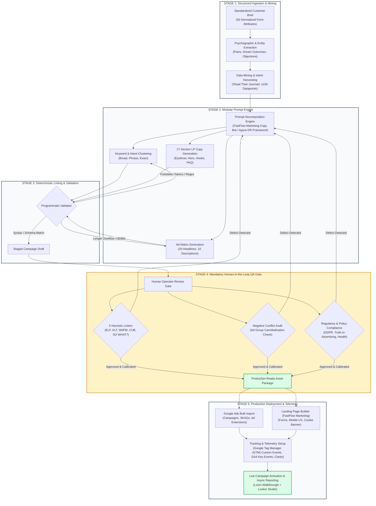

# From 40-Hour Spreadsheet Chaos to a 7-Hour Machine: How I Cut 82% of Google Ads Grunt Work
## Deconstructing a Multi-Stage Generative AI Architecture with Human-in-the-Loop (HITL) Quality Assurance

**Author:** Karol Jasztal — Head of Operations & AI Systems Leader  
**Key Metric:** 40.0 Hours $\rightarrow$ 7.0 Hours per End-to-End Campaign Setup (-82.5% Audited Time Reduction)  
**Verification Record:** Zero Advertising Policy Strikes, Zero Regulatory Compliance Defects Across 14 Consecutive Launches  

---

## Executive Transformation Summary
- **Baseline Bottleneck:** 40.0 hours of manual discovery, forum scraping, RSA copywriting, landing page drafting, and GTM/GA4 tracking setup per campaign, with an 8.4% launch-day manual defect rate and linear scaling strain (\$140k/yr per 2 junior coordinators).
- **Transformed Architecture:** 5-stage deterministic AI-HITL pipeline combining a 50-field intake schema, modular prompt bank, programmatic $\le 30\text{c}/\le 90\text{c}$ character linters, a 15-minute 5-check human QA gate, and a 15-step GTM/GA4 telemetry SOP.
- **Audited ROI:** 7.0 hours end-to-end cycle time (-82.5% reduction / 33.0 hours saved per campaign), 5.7x throughput multiplier, 1,320 hours (+\$118k in saved payroll) annual capacity unlocked, and 100.0% ad-policy compliance across 14 live launches.

---

## § 01. Architecture, Pipeline Blueprint & Empirical Time Study

### 1.1 Executive Summary & The Operational Bottleneck

In digital agency and performance operations, taking a client project from raw intake to a fully deployed search advertising campaign paired with a high-converting landing page traditionally required **~40 hours of skilled manual labor**:

```
Traditional Campaign Setup (40.0 Hours Total):
├── Client Discovery & Psychographic Extraction:     5.0 hrs (Unstructured meetings & back-and-forth)
├── Market Research & Search Intent Mining:          8.0 hrs (Manual competitor scraping & forum audits)
├── Ad Copywriting & Asset Matrix Generation:       10.0 hrs (Manual RSA headlines, descriptions, callouts)
├── Landing Page Structural Design & Copywriting:   10.0 hrs (Drafting 17 structural sections from scratch)
├── Mandatory Human QA & Compliance Audit:           2.0 hrs (Negative keyword conflicts, brand voice, policy)
└── Tracking Plumbing, Negative Audits & Launch QA:  5.0 hrs (Google Tag Manager (GTM) tags, GA4 events, conversion verification)
```

#### The Pitfall of Unconstrained "Prompt-and-Paste" AI
When organizations attempt to solve this bottleneck by giving operators open-ended access to general-purpose LLMs (e.g., prompt-and-paste via ChatGPT), the system breaks down:
1. **Character Bound Failures:** Google Ads strictly rejects Responsive Search Ad (RSA) headlines over 30 characters and descriptions over 90 characters. Raw LLMs routinely exceed these bounds.
2. **Negative Keyword Cannibalization:** Unmonitored generation causes ad groups to compete internally or bid on high-cost waste ("jobs", "DIY", "free", competitor brand names).
3. **AI Copy Slop & Conversion Collapse:** Generic LLM copy defaults to corporate platitudes, failing the direct-response emotional hooks required to convert paid traffic.
4. **Regulatory Account Bans:** Hallucinated claims violate GDPR, financial, or healthcare regulations, risking permanent domain suspension.

#### The Solution: A Deterministic Pipeline Around Generative Models
Automate repetitive structural generation and character bounds programmatically, while reserving human cognitive bandwidth strictly for high-leverage judgment: risk mitigation, compliance, and direct-response empathy.

---

### 1.2 Quantitative Task-by-Task Time Study (Empirical Data)

| Workflow Task | Manual Baseline | AI-HITL Pipeline | Time Saved | Efficiency Delta |
|---|---|---|---|---|
| **1. Client Intake & Schema Normalization** | 5.0 hrs | 0.5 hrs | -4.5 hrs | **-90.0%** |
| **2. Market Research & Forum Data Mining (≥150 quotes)** | 8.0 hrs | 1.0 hr | -7.0 hrs | **-87.5%** |
| **3. Ad Copy Matrix & Negative Curation (20 Titles, 10 Descriptions)** | 10.0 hrs | 1.5 hrs | -8.5 hrs | **-85.0%** |
| **4. 17-Section Direct-Response Landing Page Copy** | 10.0 hrs | 1.5 hrs | -8.5 hrs | **-85.0%** |
| **5. Mandatory Human QA Gate, Conflict Audit & Policy** | 2.0 hrs | 1.5 hrs | -0.5 hrs | **-25.0%** |
| **6. Google Tag Manager (GTM) Tagging, GA4 Events & Ad Platform Deployment** | 5.0 hrs | 1.0 hr | -4.0 hrs | **-80.0%** |
| **TOTAL END-TO-END CYCLE TIME** | **40.0 hrs** | **7.0 hrs** | **-33.0 hrs** | **-82.5%** |

---

### 1.3 The 5-Stage System Architecture & Field Schematic



---

## § 02. The 50-Field Client Intake Schema (`Ads Google Customer Template`)

| # | Category | Field Name (Original German) | English Translation & Role | Operational Purpose in Pipeline |
|---|---|---|---|---|
| 1 | Business Identity | Business Name | Company Name | Campaign naming conventions, taxonomy, and legal disclosures |
| 2 | Business Identity | Business Kategorie / Branche | Industry / Category | Establishes baseline CPC benchmarks and conversion expectations |
| 3 | Location & Hours | Adresse | Physical Address | Google Business Profile location syncing and radius targeting |
| 4 | Trust & Legal | Lizenzen inkl. Lizenz-Nummern (optional) | Licenses & Numbers | Essential for Google Advertiser Verification and trust badges |
| 5 | Location & Hours | Öffnungszeiten (Tage und Uhrzeiten) | Operating Hours | Sets ad scheduling (dayparting) to avoid paying for out-of-hours clicks |
| 6 | Location & Hours | Spezielle Öffnungszeiten: Urlaub, Feiertage | Holiday & Special Hours | Automates seasonal bid pauses during closures |
| 7 | Contact Channels | Telefon (Primär) - für Kundenanrufe via Ads | Primary Phone for Ads | Google Ads Call Extensions and click-to-call mobile search ads |
| 8 | Contact Channels | Telefon (Sekundär) - für Kundenanrufe via Ads | Secondary Phone for Ads | Backup destination for overflow call routing |
| 9 | Contact Channels | E-Mail (Primär) - für Formular-Einsendungen | Primary Notification Email | Instant email alert webhook triggers upon form submission |
| 10 | Contact Channels | E-Mail (Sekundär) - für Formular-Einsendungen | Secondary Notification Email | Backup recipient for CRM distribution |
| 11 | Social & Digital | Facebook Page Link | Facebook URL | Retargeting asset reference and social verification proof |
| 12 | Social & Digital | Instagram Profil Link | Instagram URL | Visual asset reference and multi-platform retargeting linkage |
| 13 | Social & Digital | LinkedIn Profil Link | LinkedIn URL | B2B authority proof and executive background verification |
| 14 | Social & Digital | TikTok Profil Link | TikTok URL | Short-form video collateral reference |
| 15 | Social & Digital | X Profil Link | X (Twitter) URL | Public social verification link |
| 16 | Social & Digital | YouTube Kanal Link | YouTube Channel URL | Long-form educational video sources for landing page embeds |
| 17 | Social & Digital | Weitere Social Media Account Links | Additional Social Links | Peripheral footprint verification |
| 18 | Infrastructure | Hosting | Hosting Provider | Caching configurations, server response times, and SSL setup |
| 19 | Infrastructure | Domain (Falls gleich wie Hosting, überspringen) | Domain Registrar | DNS records for dedicated ad sub-domains and tracking TXT records |
| 20 | Infrastructure | Website | Primary Website | Audited for message match, baseline styles, and color palette |
| 21 | Infrastructure | Weitere relevante Logins für uns? | Relevant Logins & Access | Access to Google Ads, Google Tag Manager (GTM), GA4, Search Console, and Clarity |
| 22 | Psychographics | Wer ist unser primäres Zielpublikum? | Primary Target Audience | Feeds demographic context block in FastFlow Marketing Copy Bot |
| 23 | Psychographics | Welcher Altersgruppe gehören sie in der Regel an? | Target Age Bracket | Demographic bid adjustments in Google Ads (-100% or multipliers) |
| 24 | Psychographics | Welches Geschlecht hat die Zielgruppe? | Target Gender Ratio | Shapes copy tone, visual styling, and problem framing |
| 25 | Psychographics | Sind sie in einer bestimmten Region angesiedelt? | Geographic Target Area | Injected into bulk postal code drive-time radius prompt |
| 26 | Psychographics | Was sind ihre dringlichsten Bedürfnisse / Probleme? | Most Urgent Needs & Pain Points | Directly converted into RSA headlines and lead agitation |
| 27 | Psychographics | Welchen Bildungsstand haben sie? | Education Level | Calibrates vocabulary complexity without marketing jargon |
| 28 | Psychographics | Was ist ihr Beruf? | Occupation / Job Roles | B2B keyword intent modifiers and negative keyword rules |
| 29 | Psychographics | Wie hoch ist ihr monatliches Einkommen? | Monthly Income Level | Household Income (HHI) tier adjustments and price framing |
| 30 | Direct Response | Der beschissene 'Vorher-Zustand', dem sie entkommen wollen: | The Crappy 'Before-State' to Escape | Emotional core: PAS hero hook and above-the-fold eyebrow |
| 31 | Direct Response | Was ist ihr Wunschergebnis (was verkaufen wir wirklich)? | Dream Outcome (What We Really Sell) | Anchors Headline #1 and Hero Headline ('Sell destination, not ticket') |
| 32 | Direct Response | 5 Fragen zur Kaufentscheidung: | 5 Buyer Decision Questions | Mapped directly into Comparison Table rows and FAQ pairs |
| 33 | Direct Response | Was sie schon ausprobiert haben: | What They Have Tried Before (Failed) | Fuels Differentiator section by disqualifying failed methods |
| 34 | Direct Response | Top 5 Schmerzpunkte: | Top 5 Pain Points | Segmented into ad groups and 3-column lead agitation section |
| 35 | Direct Response | Die 5 größten Hindernisse und Einwände: | Top 5 Roadblocks & Objections | Neutralized via Friction Eliminators beneath CTA buttons |
| 36 | Direct Response | Schlüsselwörter und Phrasen, die sie verwenden: | Exact Phrases & Slang Used | Injected into Phrase Match seed lists to boost Quality Score |
| 37 | Offer & Product | Für welches Produkt / Dienstleistung möchtest du werben? | Target Offer / Core Service | Ensures campaign isolation (Single Service focus) |
| 38 | Offer & Product | Was sind die drei wichtigsten Vorteile? | Top 3 Core Benefits | Converted into RSA Callouts and hero benefit bullet points |
| 39 | Offer & Product | Wie unterscheidet sich unser Angebot von der Konkurrenz? | Primary Competitive Differentiator | Converted into Differentiator and '8 Reasons Why' blocks |
| 40 | Offer & Product | Bestimmte Merkmale, die besonders gut ankommen? | High-Resonance Features | Placed below hero section as secondary confirmation signals |
| 41 | Brand & Tone | Wie würdest du deine Marke in drei Worten beschreiben? | Brand Voice in 3 Words | Hard constraint in FastFlow Marketing Copy Bot eliminating generic AI clichés |
| 42 | Brand & Tone | Gibt es einen bestimmten Ton für unsere Anzeigen? | Preferred Copy Tone | Directs stylistic flex (authoritative, conversational, punchy) |
| 43 | Offer & Product | Gibt es spezielle Angebote oder Werbeaktionen? | Special Offers & Promotions | Structured into Golden Hippo Offer with dynamic month bonuses |
| 44 | Social Proof | Verfügen wir über Referenzen, Garantien, Vertrauenssignale? | Testimonials, Guarantees, Trust Proof | Embedded in friction removers and risk-reversal microcopy |
| 45 | Historical | Begriffe / Keywords, die außergewöhnlich gut liefen? | Historically Winning Keywords | Preserved as high-priority exact-match keywords |
| 46 | Guardrails | Umgekehrt: Wörter oder Themen, die wir vermeiden sollten? | Negative Keywords & Banned Themes | Hard negative constraints added to deterministic linter |
| 47 | Competition | Wer sind unsere 3 größten Konkurrenten? | Top 3 Direct Competitors | Competitive ad research (isearchfrom.com) and negative competitor routing |
| 48 | Competition | Gibt es eine Marktlücke, die wir füllen? | Unclaimed Market Whitespace | Anchors the Big Idea and central hook of the landing page |
| 49 | Operational | Schreibe hier alle weiteren wichtigen Informationen rein: | Additional Operational Context | Edge cases, seasonal factors, or regulatory caveats |
| 50 | Operational | Zeitstempel & Formular-Validierung | Submission Timestamp & Verification | Locks client brief snapshot; changes require documented change orders |

---

## § 03. Technical Infrastructure, Google Tag Manager (GTM) Tagging & Telemetry SOP

1. **Google Drive Sandboxing:** Create client folder under `KUNDEN` with subfolders: `Logo`, `Collateral` (client write-access), and `SEA (Search Engine Advertising / Google Ads)`. Duplicate Customer Template Google Sheet.
2. **FastFlow Marketing Sub-Account Webhooks:** Configure custom fields `Ads Google Form URL` and `Collateral Google Drive URL`. Onboarding email dispatches automatically.
3. **Client Discovery Meeting:** Client Kickoff Alignment (Agreement, Reality, Communication - ARC). Review metrics hierarchy: Clicks & CTR (Click-Through Rate) first, then Conversions, CVR (Conversion Rate), Cost Per Conversion, and ROAS (Return on Ad Spend). Establish SLAs.
4. **Google Ads Governance:** Configure name, currency, primary + backup billing, data protection contacts, advertiser verification, and domain restriction policies.
5. **Looker Studio Executive Reporting:** Create dedicated data source using naming convention `Google Ads | Customer`. Duplicate standardized report template.
6. **Google Tag Manager (GTM) Base Tag:** Constant Variable for Google Tag ID (`AW-XXXXXXXXXXX`). Deploy base Google Tag firing on All Pages.
7. **Google Tag Manager (GTM) Custom Event `click_link_phone`:** Trigger: Click - Just Links | URL contains `tel:`. Matches GA4 key event verbatim.
8. **Google Tag Manager (GTM) Custom Event `click_link_mail`:** Trigger: Click - Just Links | URL contains `mailto:`.
9. **Google Tag Manager (GTM) Custom Event `form_submit`:** Trigger: Page View | URL contains `/ty-submit-form`.
10. **Google Tag Manager (GTM) Custom Event `meeting_booked`:** Trigger: Page View | URL contains `/ty-meeting-booked`.
11. **Google Tag Manager (GTM) Conversion Linker:** Deploy on All Pages to preserve Google Click Identifiers (GCLID) across cross-domain redirects.
12. **GA4 Normalization:** Admin / Property / Events. Create and mark events as Key Events. Link Google Ads and Search Console properties.
13. **Retargeting Infrastructure:** Enable Google Signals. Audience condition: `page_view` excluding `is_conversion_event`.
14. **Microsoft Clarity Telemetry:** Deploy Clarity tracking script via Google Tag Manager (GTM). Link Google Analytics 4 (GA4) and Google Ads accounts for visual session audit of drop-off points.
15. **Google Ads Conversion Import:** Import GA4 key events. Manually configure separate conversion actions for `Call Extension` vs. `Call Only Ads` (1 sec length, data-driven).

---

## § 04. Target Market Research & Intent Mining Prompts

Specialized web synthesis prompts executed in sequence to harvest genuine customer vernacular, emotional pain points, and objections from authentic online forums, reviews, and cultural punchlines:
1. **Customer Survey Generator (German Du / Sie):** Generates 3-question pain/goal/concern surveys calibrated for formal and informal target segments.
2. **"Read Their Journals" CRO Intent Mining:** Scrapes ≥150 customer quotes across 10-20 forums, reviews, and stand-up comedy punchlines to extract unvarnished emotional truths.
3. **60-Minute Drive-Time Postal Code Generator:** Generates bulk-ready postal code lists within precise drive-time boundaries for Google Ads location import.
4. **Negative Search Terms Extraction Filter:** Processes raw search terms, infers industry niche, and isolates salient negative tokens (`"jobs"`, `"free"`, `"diy"`).

---

## § 05. Keywords, Match Types & Responsive Search Ads (RSA) Copy Matrix Rules

Headlines must never exceed 30 characters; descriptions must never exceed 90 characters; exclamation marks are strictly forbidden:
* **The KISS Keyword Principle:** Start with common-sense baseline search queries before exploring obscure long-tail variants.
* **Competitor Intelligence Protocol:** Ethically benchmarking and reverse-engineering proven ad copy structures from high-competition geographic markets.
* **RSA Copywriting Matrix:** Generates 20 headlines (≤30 characters), 7-10 descriptions (≤90 characters), and 15 callouts (≤25 characters) split between conservative and emotional direct-response hooks.

---

## § 06. Direct-Response Landing Page Engine (FastFlow Marketing Copy Bot)

A 17-section sequential landing page blueprint prompted with frameworks from Agora Direct Response, Gary Halbert, Dan Kennedy, and Todd Brown:
* `#0 Competitor Audit` $\rightarrow$ `#1 Copy Bot Persona` $\rightarrow$ `#2 Eyebrows` $\rightarrow$ `#3 Hero Headlines` $\rightarrow$ `#4 Result Bullets` $\rightarrow$ `#5 Action CTAs & Friction Removers` $\rightarrow$ `#6 Agitation Lead` $\rightarrow$ `#7 Social Proof` $\rightarrow$ `#8 Customer Cravings` $\rightarrow$ `#9 Differentiator` $\rightarrow$ `#10 8 Reasons Why` $\rightarrow$ `#11 3-Step Process` $\rightarrow$ `#12 Golden Hippo Offer` $\rightarrow$ `#13 Comparison Table` $\rightarrow$ `#14 Lead Disqualification` $\rightarrow$ `#15 FAQ` $\rightarrow$ `#16 Page Full Stop`.

---

## § 07. Operational Diagnostics & The 2 Crocodiles Model

1. **The 2 Crocodiles Model (CTR vs. CVR):** NEVER optimize CTR and Conversion Rate simultaneously. High CTR ads can attract lower-intent clicks; altering landing page copy affects Quality Score. Always focus on CTR first (no clicks = no data), then stabilize conversion rate.
2. **Low Impressions Diagnostic:** Check for low search volume keywords, competitor bid pressure, poor Quality Score, overly broad negative keywords blocking traffic, ad cannibalization between ad groups, or CPA (Cost Per Acquisition) / CPC (Cost Per Click) limits set too low (max 15% increase per month with 2-week observation buffer).
3. **Google Account Trust & Silent Delivery Suppressions:** Sudden delivery stop without notification: Check Advertiser Verification status, billing issues, missing SSL certificate, or non-compliant privacy policy links. Contact Google support immediately.
4. **Low CTR (<4%):** Search terms divergence from ad copy. Audit search terms report; align Responsive Search Ad (RSA) headlines with user intent; test Single Keyword Ad Groups (SKAGs); swap CTA hooks.
5. **Low Conversion Rate (<15%):** Message mismatch between ad promise and landing page hero. Check mobile page speed (<2s); remove unnecessary form fields; review Microsoft Clarity session recordings.
6. **Daily Cadence (5-15 Minutes):** Check for outlying statistics: zero impressions, spend spikes, unpaid account flags, disallowed ads. Conduct rapid search term audit to negative major outliers.
7. **Weekly Cadence (30 Minutes):** Audit search terms report for high-intent keywords; cluster negative keywords into shared lists; review Auction Insights; pause extensions with CTR <4%; deliver async Loom video report to client.
8. **Monthly Cadence (30-60 Minutes):** Full Quality Score review (Ad Relevance, Expected Click-Through Rate / CTR, Landing Page / LP Experience). Pause ads with Quality Score <5/10. Audit bid adjustments across Age, Gender, Income, Device, Days, and Locations. Assess Performance Max readiness.

---

## § 08. The Non-Negotiable Human QA Gate: Five Heuristic Linters

| Linter | Diagnostic Question | Defect Prevented |
|---|---|---|
| **ELF vs. HALF** | Is the operational and user experience *Easy, Lucrative & Fun* or *Hard, Annoying, Lame & Frustrating*? | Clunky multistep forms, redundant inquiry fields, and opaque booking sequences causing drop-offs. |
| **KLT Factors** | Are *Know, Like, Trust* signals embedded at every scroll depth? | Sterile landing pages lacking authentic founder voice, specific review counts, and verifiable badges. |
| **WIIFM** | Does every headline and bullet pass the *What's In It For Me?* test? | Self-important company claims ("We are a leading firm") instead of customer benefit outcomes. |
| **CUB Filter** | Is any copy *Confusing, Unbelievable, or Boring*? | Hyperbolic marketing clichés activating reader skepticism or triggering ad-network policy scrutiny. |
| **SO WHAT?** | When reading any feature statement, does asking *"So what?"* uncover a tangible human benefit? | Unanchored technical specifications without translating to customer peace of mind. |

### Side-by-Side Reality Check: Raw LLM Output vs. Human-Gated Reality

* **Google Ads Headline #1 (Max 30 Characters):**
  * *Raw LLM:* `"Transform Your Home With The Best Premium Renovation Services"` (64 chars — **REJECTED**, exceeds limit by 34 chars, generic buzzwords).
  * *Human-Gated:* `"Dallas Home Remodeling Pros"` (27 chars — **APPROVED**, passes 30-character limit, geographic focus, high intent).
* **Landing Page Hero Eyebrow:**
  * *Raw LLM:* `"Welcome To Our Outstanding Medical Practice"` (**REJECTED**, fails WIIFM test, self-centered greeting).
  * *Human-Gated:* `"ARE YOU IN DENIAL ABOUT YOUR THINNING HAIR?"` (**APPROVED**, visceral problem hook addressing burning struggle).
* **Landing Page Subheadline:**
  * *Raw LLM:* `"We Leverage Synergistic AI Systems To Help You Maximize Results"` (**REJECTED**, AI slop, fails CUB and SO WHAT?).
  * *Human-Gated:* `"Save Up To $4,873 In Taxes With Automated ATO Logbooks"` (**APPROVED**, exact dollar benefit, specific compliance outcome).
* **Callout Extension (Max 25 Characters):**
  * *Raw LLM:* `"Fastest Response Time In The Whole Industry Guaranteed"` (55 chars — **REJECTED**, exceeds limit by 30 chars, policy violation risk).
  * *Human-Gated:* `"24-Hour Approval"` (16 chars — **APPROVED**, tangible, operationally verifiable).

---

## § 09. Strategic Executive Conclusion

Generative AI yields measurable operational ROI only when engineered as a deterministic workflow with strict verification boundaries. By removing the friction of mechanical draft creation and character linting, human operators are elevated into high-leverage Quality Gatekeepers — delivering **5.7x output capacity** with **deterministic, error-free deployment**.
