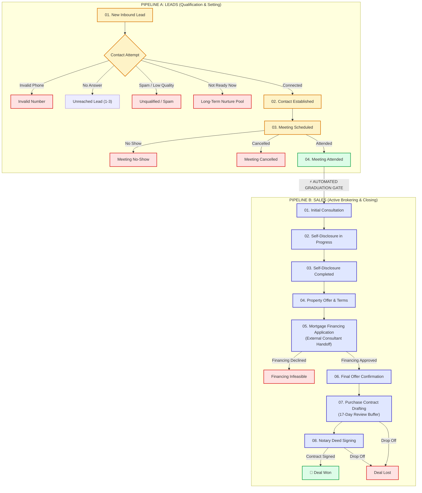

# Fixing Lost Deals and Calendar Chaos: How I Re-Engineered HubSpot & Calendly to Save 500+ Hours for a 50-Person Brokerage
## Decoupling Inbound Lead Qualification from Active Property Sales with Automated State Machines & Multi-Calendar Sync

**Author:** Karol Jasztal — Head of Operations & Systems Leader  
**Credentials:** 6x Certified HubSpot Professional (Revenue Operations, Sales Hub Software, Marketing Hub Software, Sales Enablement, Inbound Marketing, Inbound Marketing Optimization)  
**Primary Impact:** 288–576 Hours Saved Annually Across 6 Core Sales Brokers (~500+ Hours Recovered)  
**Architecture:** Two-Pipeline Decoupled State Machine (11 Lead Stages $\rightarrow$ 12 Sales Stages) + Multi-Calendar Routing  

---

## Executive Transformation Summary

- **Baseline Bottleneck:** A 50-person real estate brokerage was running on a single, monolithic HubSpot pipeline where cold web leads, active buyer negotiations, mortgage calculations, and notary closings were crammed into one bucket. Confusing stage names, manual follow-up emails, broken Zapier lead injections, and chaotic scheduling between 6 internal brokers and an external mortgage consultant burned 1–2 hours per rep weekly and let high-ticket property deals slip through the cracks.
- **Transformed Architecture:** A Figma-engineered two-track CRM engine separating **Pipeline A (Leads: 11 Stages)** from **Pipeline B (Sales: 12 Stages)**. Built an automated qualification graduation gate, an automated 3-strike phone cadence with delay timers, dynamic informal vs. formal buyer self-disclosure email sequences, and automated Calendly routing for both internal brokers and an external financing partner.
- **Audited ROI:** 288–576 hours of manual admin grunt work eliminated annually across the 6-person sales team (~500+ hours recovered). Slashed speed-to-lead from days to automated minutes, eliminated unvalidated lead injections into the CRM, and prevented wasted legal fees by enforcing a financing checklist gate before sales contract creation.

---

## § 01. Architecture, Pipeline Blueprint & Operational Time Study

### 1.1 Executive Summary & The Operational Crisis

In high-ticket real estate brokering, timing and pipeline clarity determine revenue. When a prospect requests details on a property, every hour of delay reduces conversion velocity.

At this ~50-person brokerage and housing cooperative, the sales team faced an operational nightmare inside HubSpot:

```
Legacy Monolithic Pipeline (The "Everything Bucket"):
├── Cold Web Leads (Mixed with active buyers)
├── Incorrect / Fake Phone Numbers (Cluttering broker views)
├── Manual Email Follow-ups (Dependent on individual rep memory)
├── Unqualified Buyer Consultations (No financial pre-check)
├── External Mortgage Consultant Handoffs (Untracked emails & phone calls)
└── Contract Drafting & Notary Deadlines (Zero stage criteria or automated reminders)
```

#### Why the Monolithic Pipeline Failed
1. **Pipeline Clutter & Stage Confusion:** Cold inquiries from real estate portals sat right next to prospects waiting for notary appointments. Reps wasted mental energy filtering active deals from dead leads.
2. **The Speed-to-Lead Leak:** Inbound leads arrived via portals (e.g. Prospective) through brittle Zapier connections. When required fields failed, leads stalled in limbo without alerts.
3. **Manual Follow-up Burnout:** Sales reps had to manually remember whom to call back, when to follow up after a missed call, and which email template to paste. If a rep got busy, follow-ups simply stopped.
4. **Calendar Chaos with External Partners:** Real estate transactions require mortgage financing verification. The brokerage worked with an independent external financial consultant. Coordinating schedules between the buyer, the internal listing broker, and the external finance consultant was handled via back-and-forth emails, causing massive scheduling drag.
5. **Modal Fatigue & Rep Friction:** Default HubSpot navigation forced brokers to hop across separate Contact tabs, Deal stages, and Activity timelines during live calls, causing missing fields and administrative burnout.

#### The Solution: Visual Figma Architecture, Two-Track Decoupling & Native Rep Form
Instead of tweaking settings inside HubSpot on the fly, I designed the complete system visually in **Figma** first. We mapped every stage, condition, and automation rule, reviewed it directly with leadership in Zoom sessions, and validated the flow before implementing a single workflow in production. To eliminate interface friction for brokers, I built a dedicated native HubSpot intake form that unified contact data, qualification checks, meeting dates, and notes into one single scrolling pane.

---

### 1.2 Quantitative Time & Capacity Study (Annual Team ROI)

The brokerage's core sales unit consisted of **6 full-time brokers**. Automating task creation, repetitive email drafting, follow-up reminders, and calendar coordination recovered **1 to 2 hours of wasted admin time per broker every week**:

| Operational Workflow Task | Legacy Manual Method | Automated HubSpot Engine | Weekly Time Saved | Annual Time Saved |
|---|---|---|---|---|
| **01. Inbound Lead Triage & Welcome** | Manual portal check & copy-paste email | Instant Zapier validation & automated email | 1.5 – 3.0 hrs/wk | **72 – 144 hrs/yr** |
| **02. Missed Call Follow-up Cadence** | Manual calendar reminders / forgotten leads | 3-strike cadence with 48h delay timers | 2.0 – 4.0 hrs/wk | **96 – 192 hrs/yr** |
| **03. Meeting Confirmations & Prep** | Manual email drafting with Zoom/address links | Automated post-setting email & 08:00 morning prep task | 1.0 – 2.0 hrs/wk | **48 – 96 hrs/yr** |
| **04. Financial Self-Disclosure Outreach** | Rep manually checked tone & attached PDF | Dynamic informal vs. formal property branch dispatch | 1.0 – 1.5 hrs/wk | **48 – 72 hrs/yr** |
| **05. External Mortgage Partner Coordination** | Back-and-forth email chains with external consultant | Dedicated partner Calendly + checklist gate | 0.5 – 1.5 hrs/wk | **24 – 72 hrs/yr** |
| **TOTAL OPERATIONAL CAPACITY RECOVERED** | **Manual Admin Grunt Work** | **Automated State Machine** | **6.0 – 12.0 hrs/wk** | **288 – 576 hrs/yr (~500+ hrs)** |

---

### 1.3 The Two-Pipeline Architecture Blueprint

The breakthrough was cleanly splitting the sales process into two separate pipelines linked by a single graduation gate:



---

## § 02. Operational Schema & Custom Field Data Contract

To prevent junk data and ensure automations never misfired, we established a strict schema contract across HubSpot contact and deal records:

| Property Name | Internal Key | Field Type | Pipeline Scope | Operational Purpose |
|---|---|---|---|---|
| **Lead Source Intake** | `leadtrans` | Single Dropdown | Leads | Captures inbound origin (Prospective portal, web form) to trigger round-robin assignment |
| **Lead Call Cadence Status** | `lead_phone_status` | Single Dropdown | Leads | Drives the 3-strike retry cadence: `Attempt 1: Unreached` $\rightarrow$ `Attempt 2: Unreached` $\rightarrow$ `Attempt 3: Unreached` |
| **Meeting Attendance Status** | `lead_meeting_status` | Single Dropdown | Leads & Sales | Primary graduation gatekeeper: `Meeting Attended` triggers deal creation in Pipeline Sales |
| **Customer Salutation Tone** | `salutation_tone` | Radio (Informal / Formal) | Sales | Determines whether automated emails use informal (first-name) or formal (Mr./Ms.) phrasing |
| **Self-Disclosure Status** | `sa_status` | Single Dropdown | Sales | Tracks buyer financial disclosure status: `Self-Disclosure in Progress` $\rightarrow$ `Self-Disclosure Completed` |
| **Financing Feasibility Status** | `financing_clearance` | Single Dropdown | Sales | Hard gate: blocks contract drafting unless set to `Financing Approved` by mortgage specialist |
| **External Mortgage Consultant** | `external_finance_rep` | User Lookup | Sales | Binds contact to external mortgage consultant with dedicated Calendly links |
| **Contract Review Deadline** | `kv_review_deadline` | Date Picker | Sales | Starts the 17-day statutory buyer review countdown before scheduling the notary signing |
| **Property Listing Value** | `amount` | Currency (EUR) | Sales | Tracks deal weighting, commission forecasting, and executive board reporting |
| **Disqualification Reason Code** | `disqualification_reason` | Single Dropdown | Leads | Mandatory audit tag for spam, invalid phone numbers, or unfinanceable inquiries |

### 2.2 Sales Rep Interface Innovation: The Single-Pane Native HubSpot Form

HubSpot's default interface requires brokers to bounce between Contact details, Deal stages, and Activity logs across multiple browser tabs and popup modals. To streamline live call operations for the 6 sales reps, I engineered a dedicated **native HubSpot intake form** that consolidated the entire qualification workflow into a single, cohesive view:

1. **Automatic Pre-Population (Zero Duplicate Entry):** Existing buyer data from real estate portals (full name, phone, email, inquired property address) automatically pre-fills upon form open, eliminating redundant copy-pasting.
2. **Audit of Missing Fields (Live Qualification Visibility):** Exposes all required qualification fields in one scrolling view. Reps instantly spot empty properties during live calls, ensuring critical budget, timeline, and financing status are asked and captured rather than forgotten.
3. **Atomic Single-Click Update (No Modal Switching):** Meeting dates, consultation notes, deal values, and property assignment fields are submitted atomically in one click, updating both Contact and Deal records simultaneously with zero modal hopping.

---

## § 03. Workflow Automation Engine & State Machine Deck

The automation engine executes through a series of modular HubSpot workflows. Reps never manually update deal stages; their routine actions (completing a call task, logging a meeting, or updating a qualification field) drive the state machine forward.

### Operational Duality Panel

```
┌─────────────────────────────────────────────────────────┬─────────────────────────────────────────────────────────┐
│ ⚡ WHAT IS FULLY AUTOMATED                              │ 🛑 WHERE HUMAN BROKER SIGN-OFF IS ENFORCED              │
├─────────────────────────────────────────────────────────┼─────────────────────────────────────────────────────────┤
│ • Instant welcome email dispatch upon portal intake     │ • Qualification decision: judging whether buyer intent  │
│ • 3-strike call task cadence with 2-day delay timers    │   is genuine before setting the initial meeting         │
│ • Automatic pipeline graduation from Leads to Sales     │ • Deal valuation adjustments based on purchase offer    │
│ • Dynamic informal vs. formal email template selection  │ • Financing document completeness audit before submittal│
│ • Meeting reminders timed to 08:00 CET on meeting day   │ • Final contract approval before legal Notary booking   │
│ • Stale lead archiving to Long-Term Nurture Pool        │ • Marking Deal Lost with mandatory loss-reason tagging  │
└─────────────────────────────────────────────────────────┴─────────────────────────────────────────────────────────┘
```

---

### Production Workflow Specifications

#### WORKFLOW 01: Inbound Lead Ingestion & Rep Assignment
```yaml
Workflow_ID: WF-01-LEAD-INTAKE
Trigger: Contact Property 'leadtrans' is known (Inbound from Portal / Zapier)
Actions:
  - Step 01: Assign Contact Owner to Senior Intake Specialist (Round-Robin)
  - Step 02: Create Deal in 'Pipeline: Leads' at Stage '01. New Inbound Lead'
  - Step 03: Send Automated Email: 'Welcome Email & Property Dossier' (Intro + Company Credentials)
  - Step 04: Create High-Priority Task for Assigned Broker:
      Title: "Call new inbound lead"
      Due_Date: 2 business days (Immediate Execution)
      Priority: HIGH
```

#### WORKFLOW 02: The 3-Strike Call Cadence & Fallback Timer Loop
```yaml
Workflow_ID: WF-02-CALL-CADENCE
Trigger: Contact Call Status updated to 'Unreached'
Logic_Branches:
  - Branch 1 (Attempt 01):
      Set Stage: 'Unreached Lead'
      Delay: 2 business days
      Create Task: "Missed call #1 - retry in 48 hours"
  - Branch 2 (Attempt 02):
      Set Stage: 'Unreached Lead'
      Delay: 2 business days
      Create Task: "Missed call #2 - retry in 48 hours"
  - Branch 3 (Attempt 03):
      Set Stage: 'Unreached Lead'
      Delay: 2 business days
      Create Task: "Missed call #3 - final phone attempt"
  - Branch 4 (Max Attempts Reached):
      Set Stage: 'Pipeline: Leads -> Long-Term Nurture Pool'
      Notify Broker: "Lead moved to Long-Term Nurture Pool"
```

#### WORKFLOW 03: Scheduled Meeting & Lead-to-Sales Graduation
```yaml
Workflow_ID: WF-03-LEAD-GRADUATION
Trigger: Calendly Event Booked OR Broker sets Status to 'Meeting Scheduled'
Actions:
  - Step 01: Set Deal Stage to 'Meeting Scheduled'
  - Step 02: Send Automated Email: 'Meeting Confirmation & Property Package' (Calendar Invite, Zoom link, property packet)
  - Step 03: Delay until scheduled meeting date at 08:00 CET
  - Step 04: Create Morning Prep Task: "Meeting today at [Time] with buyer prospect"
  - Step 05 (On Status 'Meeting Attended'):
      Move Deal: From 'Pipeline: Leads' -> 'Pipeline: Sales'
      Set Sales Stage: '01. Initial Consultation'
      Send Internal Notification: "Lead successfully qualified & graduated to Active Sales"
```

#### WORKFLOW 04: Dynamic Informal vs. Formal Self-Disclosure Dispatch
```yaml
Workflow_ID: WF-04-SA-DISPATCH
Trigger: Deal enters 'Pipeline: Sales' Stage 'Self-Disclosure in Progress'
Branching_Rule: Check Contact Property 'salutation_tone'
Logic:
  - If Tone == 'Informal':
      Send Automated Email: "Buyer Self-Disclosure Guide (Informal Tone)"
  - If Tone == 'Formal' (or unset):
      Send Automated Email: "Buyer Self-Disclosure Guide (Formal Tone)"
Follow_Up:
  - Delay: 5 business days
  - Task for Broker: "Review self-disclosure packet or call buyer for missing details"
```

#### WORKFLOW 05: External Mortgage & Finance Consultant Routing
```yaml
Workflow_ID: WF-05-FINANCING-HANDOFF
Trigger: Deal moves to Stage 'Mortgage Financing Application'
Actions:
  - Step 01: Prompt broker with mandatory verification checklist:
      Checklist: [ID Copies, Last 3 Paystubs, Tax Returns, Equity Proof]
  - Step 02: Send automated notification to External Mortgage Consultant
  - Step 03: Send Buyer Email with External Consultant's Dedicated Calendly Booking Link
  - Step 04: Set weekly recurrence reminder (Tuesdays at 08:00 CET):
      Task: "Check mortgage pre-approval status with external consultant"
  - Step 05 (Outcome Gate):
      - If 'Financing Approved' -> Move to Stage '06. Final Offer Confirmation'
      - If 'Financing Infeasible' -> Move to Stage 'Financing Declined' & Prompt Alternative Listing Pitch
```

#### WORKFLOW 06: Contract Review 17-Day Buffer & Notary Closing
```yaml
Workflow_ID: WF-06-NOTARY-CLOSING
Trigger: Deal moves to Stage 'Purchase Contract Drafting'
Actions:
  - Step 01: Task: "Request purchase contract draft from notary office"
  - Step 02: Delay timer of 17 days (Enforces statutory consumer review period)
  - Step 03: Task on Day 18: "Collect contract feedback from buyer: Approved / Revision Required / Withdrawn"
  - Step 04 (On Approval):
      Move Stage: 'Notary Deed Signing'
      Task: "Coordinate deed signing appointment with notary, buyer, and seller"
  - Step 05 (On Signature):
      Move Stage: 'Deal Won'
      Set Close Date: Today (Automated Revenue Recognition)
```

---

## § 04. Deterministic Quality Gates & Exception Handling

To keep CRM data clean and protect client relations, four hard quality gates were engineered into the state machine:

```
┌───────────────────────────┬───────────────────────────────────┬─────────────────────────────────────────┐
│ QUALITY GATE              │ DEFECT PREVENTED                  │ SYSTEM ENFORCEMENT                      │
├───────────────────────────┼───────────────────────────────────┼─────────────────────────────────────────┤
│ 1. Zapier Payload Gate    │ Contact records with missing      │ Zapier multi-step validation checks for │
│                           │ email or malformed phone strings  │ required fields; dumps invalid leads    │
│                           │ polluting rep dial queues         │ to 'Invalid Number' stage for triage    │
├───────────────────────────┼───────────────────────────────────┼─────────────────────────────────────────┤
│ 2. 3-Strike Call Buffer   │ Reps abandoning leads after one   │ Timers lock next call task to 48-hour   │
│                           │ unanswered call or spamming leads │ intervals; auto-routes to Nurture pool  │
│                           │ 5 times in one afternoon          │ only after 3 documented call attempts   │
├───────────────────────────┼───────────────────────────────────┼─────────────────────────────────────────┤
│ 3. Mortgage Clearance     │ Wasting thousands of Euros in     │ Deal stage cannot progress to purchase  │
│    Sign-Off               │ notary contract drafting fees for │ contract drafting until Consultant ticks│
│                           │ unfinanced prospective buyers     │ 'Financing Approved' in the portal      │
├───────────────────────────┼───────────────────────────────────┼─────────────────────────────────────────┤
│ 4. 17-Day Legal Buffer    │ Pressuring buyers prematurely     │ Automated 17-day pause timer enforces   │
│                           │ in violation of statutory review  │ review buffer; prompts broker only when │
│                           │ periods                           │ the legal review window elapses         │
└───────────────────────────┴───────────────────────────────────┴─────────────────────────────────────────┘
```

---

## § 05. Evaluated Alternatives & Strategic Trade-Offs

Before building this two-pipeline architecture, three possible operating models were evaluated:

| Architectural Dimension | Option 1: Monolithic Single Pipeline (Status Quo) | Option 2: Manual Coordination (Spreadsheets + Inbox) | Option 3: Two-Track HubSpot State Machine (Deployed) |
|---|---|---|---|
| **Pipeline Visibility** | **Terrible:** Cold inquiries mixed with closing deals; rep views cluttered with stale leads | **Non-Existent:** Siloed in individual broker spreadsheets; zero executive visibility | **Crystal Clear:** Clean separation of qualification from active property negotiation |
| **Speed-to-Lead** | **Slow (1–3 Days):** Dependent on manual email checks and individual memory | **Slow & Unreliable:** Inbound leads sat unnoticed in shared mailboxes | **< 15 Minutes:** Automated welcome emails, Zapier validation, and instant rep call tasks |
| **Partner Sync (Mortgage)** | **Broken:** Untracked phone calls with external consultant; constant lost status | **Manual Chaos:** Endless email chains between buyer, broker, and consultant | **Automated:** Dedicated Calendly routing, weekly automated sync tasks, clear clearance gates |
| **Admin Drag per Broker** | **High (2–3 hrs/wk):** Reps spent hours drafting repetitive emails and managing reminders | **Extreme (4–6 hrs/wk):** High human error, forgotten follow-ups, and severe risk of spreadsheet file corruption and accidental data loss due to human error (a decisive factor against spreadsheets); zero executive visibility | **Minimal (<30 min/wk):** Reps focus entirely on high-value conversations and closings |
| **Annual Team Capacity** | **-300+ hrs** lost in administrative friction | **-600+ hrs** lost in chaos and lead drop-off | **+500+ hrs** recovered and reinvested into sales |

---

## § 06. Senior Retrospective & Operational Learnings

### What Worked
1. **Designing in Figma First Saved 1–2 Weeks of Re-Work:** Building the architecture visually allowed the client's managing team to point at bottlenecks, question stage names, and agree on transition criteria before a single automation was configured in HubSpot.
2. **Decoupling Leads from Sales Created Instant Calm:** The moment cold intake was split from active property negotiations, broker anxiety dropped. Reps working active deals only looked at Pipeline B; reps focused on outreach lived in Pipeline A.
3. **Automating the External Partner Handoff:** Giving the external mortgage consultant a dedicated Calendly flow with HubSpot task integration closed the communication gap that previously caused deals to stall for weeks.

### What I Would Do Differently in 2026
- **Leverage AI for Rapid Architecture & HTML Mockups:** Instead of static Figma boards, I would use AI to structure the initial workflow topology and build interactive, clickable HTML mockups, paired with deep AI research into industry-standard CRM best practices.
- **Conduct Broader Frontline Discovery:** I would insist with client leadership on interviewing frontline sales reps and external mortgage consultants directly—not just the executive sponsor—to uncover day-to-day edge cases before finalizing designs.
- **Automate HubSpot Configuration with AI:** Rather than manually toggling dozens of properties and workflow steps in HubSpot, I would explore using AI automation to script property creation and workflow pipelines, shifting my effort from manual configuration grunt work to pure verification and strategic governance.
- **Explore AI Call Transcription (GDPR-Compliant):** If permitted by German and European data privacy counsel, I would explore automated AI call transcription to extract buyer budgets, timelines, and objections directly into HubSpot contact records immediately after a call.

### Professional Platform Credentials
This implementation was built on formal, verified platform expertise. I hold **6 official HubSpot certifications** (click any to verify):
- [HubSpot Revenue Operations Certification](https://app-eu1.hubspot.com/academy/achievements/tnv57jtb/en/1/karol-jasztal/revenue-operations)
- [HubSpot Sales Hub Software Certification](https://app-eu1.hubspot.com/academy/achievements/mf33nncz/en/1/karol-jasztal/hubspot-sales-hub-software)
- [HubSpot Marketing Hub Software Certification](https://app-eu1.hubspot.com/academy/achievements/lrk8rcb3/en/1/karol-jasztal/hubspot-marketing-hub-software)
- [HubSpot Sales Enablement Certification](https://app-eu1.hubspot.com/academy/achievements/4nnx9t0m/en/1/karol-jasztal/sales-enablement)
- [HubSpot Inbound Marketing Certification](https://app-eu1.hubspot.com/academy/achievements/34v8l643/en/1/karol-jasztal/inbound-marketing)
- [HubSpot Inbound Marketing Optimization Certification](https://app-eu1.hubspot.com/academy/achievements/lkt9cvyj/en/1/karol-jasztal/inbound-marketing-optimization)
