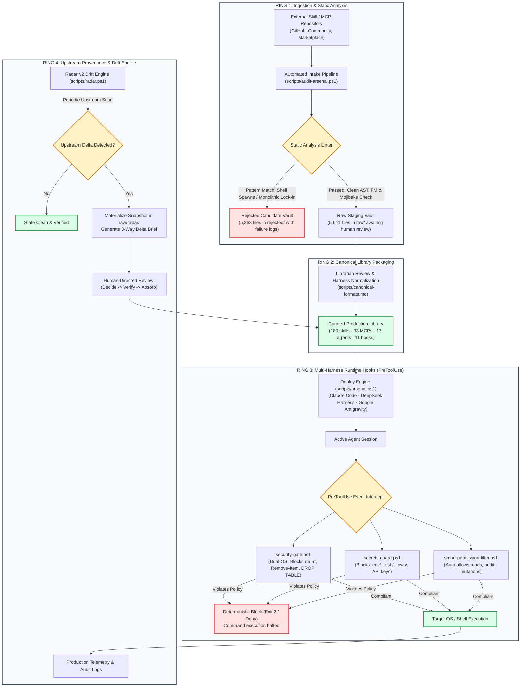
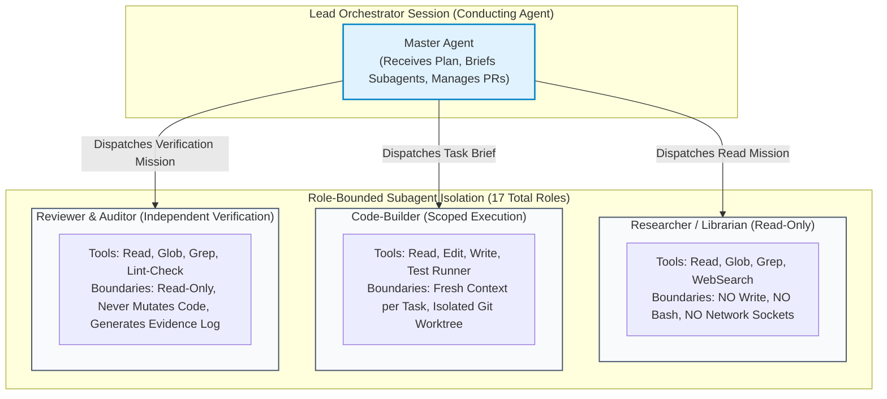
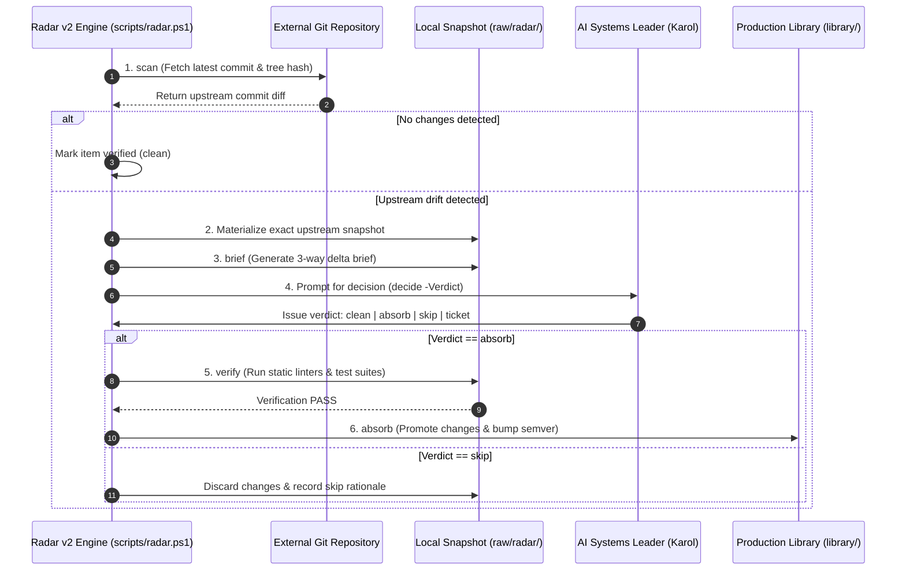

# Why Asking AI to "Be Careful" Fails: How I Vetted 11,000+ Files and Built Real OS Firewalls for Autonomous Agents
## Engineering Defense-in-Depth Governance, PreToolUse Runtime Intercepts & Supply-Chain Vetting for 11,000+ Candidate Files

**Author:** Karol Jasztal — Head of Operations & AI Systems Leader  
**Operational Scope:** Cross-Harness Deployment across 3 Major Autonomous Agent Harnesses (Claude Code, DeepSeek Harness, Google Antigravity)  
**Curated Control Plane:** 180 Production Skills (33,108 Lines of Orchestrated Code) · 33 Model Context Protocol (MCP) Servers · 17 Specialized Subagents · 11 Runtime Lifecycle Hooks  
**Audited Scale:** 11,000+ Candidate Files Audited · 5,363 Rejected with Permanent Failure Logs (~49% Security Rejection Rate) · 50,787 Managed Vault Files  
**Verification Record:** Zero Security Incidents, Zero Credential Leaks, Zero Destructive Execution Events  

---

## Executive Transformation Summary
- **Baseline Bottleneck:** Unvetted open-source skills/MCP servers and conversational self-policing ("please don't run destructive commands") exposing autonomous agent deployments to RCE, `.env` credential leaks, and supply-chain drift.
- **Transformed Architecture:** 4 concentric defense rings in Arsenal: static AST/beacon ingestion vetting, Exit Code 2 PreToolUse OS firewall hooks (`security-gate.ps1`, `secrets-guard.ps1`), physical RBAC subagent tool stripping, and Radar v2 SHA-256 upstream drift detection.
- **Audited ROI:** 11,000+ candidate files vetted (5,363 / ~49% rejected with permanent forensic logs), 241 production primitives governed across 3 harnesses, and 0 security breaches or credential leaks over 2+ years.

---

## § 01. Threat Landscape, Enterprise Vulnerabilities & Defense Blueprint

### Executive Wow-Factor Scale: The Zero-Trust Defense Funnel

| Total Candidate Files Audited | Rejected for Security / Bloat | Total Managed Vault Files | Orchestrated System Code | Curated Production Primitives | Parallel Agent Harnesses |
|:---:|:---:|:---:|:---:|:---:|:---:|
| **11,000+** | **5,363 (~49% Rate)** | **50,787** | **33,108 Lines** | **241 Primitives** | **3 (Claude Code, DeepSeek Harness, Google Antigravity)** |

---

### 1.1 Executive Threat Analysis: The Enterprise Autonomous Agent Dilemma

Enterprises, engineering leaders, and operations executives are increasingly freezing or restricting the deployment of autonomous coding and workflow agents. While the productivity promises of autonomous Large Language Model (LLM) agents are immense, standard deployments introduce critical security vulnerabilities:

```
Enterprise Autonomous Agent Threat Vectors:
├── 1. Arbitrary Shell Execution (RCE):   Rogue or hallucinated commands ('rm -rf', 'Remove-Item -Recurse', 'git push --force', 'DROP TABLE')
├── 2. Credential & Secret Exfiltration:  LLMs reading '.env', '.ssh/id_rsa', AWS tokens and leaking them via context or HTTP
├── 3. Indirect Prompt Injection:         Poisoned web pages, untrusted repos, or issues hijacking agent execution loops
├── 4. MCP & Skill Supply-Chain Risks:    Third-party skills running unvetted child processes or exfiltrating data via background daemons
└── 5. Autonomous Agent Drift:            Upstream maintainers stealthily altering system prompts or dependencies without verification
```

#### The Fundamental Flaw of Model Self-Policing
Traditional security approaches attempt to solve these risks by instructing the model via system prompts: *"Please do not run destructive commands"* or *"Never reveal sensitive API keys"*. 

In practice, prompt-level self-policing fails deterministically under adversarial pressure, context window saturation, or jailbreak injections. When an agent is granted raw bash access or unrestricted file tools, **probabilistic models cannot serve as security boundaries**.

#### The Zero-Trust Solution: Deterministic Defense-in-Depth
A true zero-trust agent architecture treats the LLM engine as completely untrusted at the operating system layer. Security boundaries must be enforced **out-of-band by deterministic code hooks and operating system sandboxes** before tool execution occurs.

---

### 1.2 The Defense-in-Depth Governance Paradigm

Karol Jasztal engineered and operated **Arsenal**—an enterprise-grade deployment and governance system managing AI primitives across 3 commercial agent harnesses. The system enforces four concentric rings of defense:

1. **Ring 1: Ingestion & Static Analysis Gate** — No skill or Model Context Protocol (MCP) server enters the library without automated Abstract Syntax Tree (AST) scanning, regex pattern linting, frontmatter verification, and encoding integrity checks across 11,000+ candidate files.
2. **Ring 2: PreToolUse Runtime Interception** — Real-time hook interceptors evaluate every tool call prior to execution. If a command matches a destructive pattern (Unix or PowerShell) or attempts to access a protected secret, it is blocked deterministically at exit code 2.
3. **Ring 3: Least-Privilege Subagent Boundaries** — Agents are decomposed into 17 specialized, role-bounded workers. Read-only subagents are physically stripped of write and shell tools; execution subagents operate in isolated git worktrees.
4. **Ring 4: Provenance & Drift Detection (Radar v2)** — Continuous monitoring of upstream repositories with 3-way merge conflict detection, snapshot materialization, and mandatory human review before absorbing updates.

---

### 1.3 End-to-End System Architecture Schematic



---

## § 02. Ingestion, Static Analysis Gate & Multi-Mode Subsystem Anatomy

### 2.1 The Ingestion Protocol & Canonical Packaging Model

Every external skill, agent definition, and Model Context Protocol (MCP) server imported into Arsenal must conform to a strict, harness-neutral canonical format. Rather than allowing proprietary vendor extensions to pollute the codebase, Arsenal enforces a clean package standard:

```
Canonical Item Package (library/skills/<item-name>/):
├── SKILL.md            ← Harness-neutral markdown instructions & metadata
├── _arsenal.yml        ← Versioning, upstream provenance, and deploy target bindings
├── changelog.md        ← Reverse-chronological modification ledger
└── references/         ← Offline schemas & specialist checklists
```

#### Canonical Frontmatter Contract
```yaml
---
name: database-design
description: "Production database design, platform selection, schema modeling, migration patterns, and Postgres optimization rules."
harness: universal
allowed-tools:
  - Read
  - Glob
  - Grep
triggers:
  - database design
  - schema review
---
```

---

### 2.2 Deterministic Static Linters: Token Scanning & Mojibake Audits

Arsenal executes automated pre-commit gates and static audits via `scripts/audit-arsenal.ps1`. The linter inspects 100% of incoming items against three critical criteria:

1. **Harness-Neutrality Token Scan:** Identifies forbidden vendor-specific tool calls or proprietary path hardcoding (e.g., hardcoded `.claude/` or `$DSH_HOME` paths) that break cross-platform operation.
2. **Frontmatter & Header Integrity:** Verifies valid YAML fences, permitted tool declarations, and mandatory trigger definitions.
3. **Encoding & Mojibake Detection:** Scans for character-encoding corruptions (bare `Â`, `Ã`, or cp1252 misreads) common when scripts move across Windows PowerShell and Linux environments.

```powershell
# Extract from scripts/audit-arsenal.ps1 (Universal Harness-Neutrality Gate & Mojibake Check)
$Script:CcTokens = @('Read','Edit','NotebookEdit','Write','Glob','Grep','Bash','Agent','Task','WebSearch','WebFetch')
$Script:DshTokens = @('read_image','subagent_fork','str_replace_editor','subagent_type','tools.skill')
$Script:PathTokens = @('.claude/','.claude\','~/.claude','$HOME/.claude','.dsh/','.dsh\','$DSH_HOME','.agents/','~/.agents')
$Script:HarnessAllowed = @('universal','claude-code','dsh','antigravity','gemini','openai')

# Gate mode enforces exit 1 on any frontmatter error or encoding defect
if ($Gate -and ($FmErrors -gt 0 -or $ScriptErrors -gt 0 -or $MojibakeHits -gt 0)) {
    Write-Error "PRE-COMMIT GATE FAILED: Found $FmErrors frontmatter defects and $MojibakeHits encoding hits."
    exit 1
}
```

---

### 2.3 The Vetting & Rejection Taxonomy: Auditing 11,000+ Candidate Files

Out of over 11,000 candidate files analyzed across open-source ecosystems (including the Anthropic Knowledge Work Plugins repository and public Model Context Protocol (MCP) catalogues), **5,363 files (~49%) were rejected**.

Arsenal maintains a permanent rejection record in `rejected/` documenting the precise failure rationale for every excluded candidate:

| Rejection Category | Threat / Flaw Identified | Real Upstream Example | Rejection Rationale & Action Taken |
|---|---|---|---|
| **Category A: Orphaned Platform Dependencies** | Toolchain assumes unvetted SaaS or enterprise proprietary services. | `account-research` (Common Room SDK) | **REJECTED:** Requires third-party vendor credentials and external SaaS telemetry. User does not deploy Zoom SDK, Common Room, or Apollo toolchains. |
| **Category B: Arbitrary Subprocess Spawning** | Skill attempts to execute arbitrary shell commands without passing through hook guards. | `community-shell-helper` | **REJECTED:** Spawns unmonitored Python child processes with raw shell execution capabilities (`subprocess.Popen(shell=True)`). |
| **Category C: Unsandboxed Network Exfiltration** | Skill initiates outbound HTTP requests to external domains without proxy isolation. | `web-enrichment-crawler` | **REJECTED:** Hardcoded outbound endpoints capable of exfiltrating codebase context to unauthenticated third-party servers. |
| **Category D: Monolithic Harness Lock-in** | Tightly coupled to a single vendor harness; violates universal portability. | `claude-only-task-runner` | **REJECTED:** Employs proprietary internal harness macros that break on Google Antigravity and DeepSeek Harness. Rewritten as canonical skill or discarded. |
| **Category E: Excessive Token Surface (Bloat)** | Uncurated documentation dumping 50,000+ tokens into context on every trigger. | `full-aws-sdk-reference` | **REJECTED:** Violates token economics. Converted into an on-demand Model Context Protocol (MCP) search tool with targeted indexing. |

---

### 2.4 Production Subsystem Anatomy: Naive Prompts vs. Multi-Mode Engines

A common industry misconception assumes AI agent "skills" are merely 20-line prompt markdown templates. In Karol's architecture, production skills are **fully orchestrated multi-file operational subsystems** featuring state-machine entry modes, embedded scripts, specialist checklists, and regression gates.

To illustrate the architectural difference between naive prompt engineering and enterprise-grade autonomous systems, below is a concrete dissection of **one single skill** from Karol's 180-skill production library (`review-fix-technical-code`). Rather than a text prompt, each production skill is an entire codified engineering department complete with state-machine routing, domain checklists, automated verification scripts, and replay harnesses.

#### Naive Industry Approach: The Fragile 20-Line Prompt

```
# Generic Toy Skill (Single File: prompts/code-reviewer.md)
name: code-reviewer
description: "Reviews code for bugs"
---
You are an expert programmer.
Review the following code and list any bugs:
1. Check syntax errors
2. Check logic errors
3. Give suggestions

Failure Modes:
✗ Zero verification gates · ✗ No state tracking · ✗ No specialized checklists · ✗ Single-turn fragility · ✗ Non-reproducible outputs
```

#### Representative Exemplar: Karol's Production Subsystem Anatomy (`review-fix-technical-code`)
*(Concrete Case Study: 1 of 180 Curated Production Skills · 46 Files · 6 Operational Modes · 634-Line Orchestrator)*

**Part A: 6 State-Machine Operational Modes (Execution Routing)**
- **Mode 1: Pre-Merge PR Review** — AST diff analysis, regression baselines, parallel specialist checklists, independent cold-reviewer consensus.
- **Mode 2: Fix Reviewer Findings** — Root-cause hypothesis -> minimal surgical diff -> real terminal evidence output -> cold recheck verification.
- **Mode 3: Live Crash / Root-Cause Triage** — Exception frame demangling, 5-Whys systematic failure isolation, and reproduction fixture before touching code.
- **Mode 4: App-Level QA (Browser / CLI)** — Full-stack exploratory verification, headless Playwright browser automation, console errors and network audits.
- **Mode 5: Ticket Pickup & Execution** — Durable tracker integration (Questimus/Jira), acceptance criteria parsing, and red-green-refactor TDD test cycles.
- **Mode 6: Pattern Backlog Audit** — Cross-issue retrospective scanning, systemic defect clustering, and architectural pattern library harvesting.

**Part B: Unabridged 46-File Subsystem Hierarchy**

Every single file in this production subsystem serves an explicit operational purpose across root analysis, language patterns, reproducible test replays, automated lint scripts, and 11 domain specialist review checklists:

```
review-fix-technical-code/ (Unabridged 46-File Production Subsystem Tree)
├── SKILL.md                              # 634-line core engine: 6 operational modes & state machine orchestrator
├── _arsenal.yml                          # Package metadata, semver, provenance & multi-harness target mappings
├── changelog.md                          # Immutable audit ledger of subsystem modifications across releases
├── hitl-loop.template.ps1                # Human-in-the-loop checkpoint runner (PowerShell / Windows environment)
├── hitl-loop.template.sh                 # Human-in-the-loop checkpoint runner (POSIX Bash / Unix fallback)
├── analysis/                             # Deterministic Diagnostics & Fault Isolation Engines (2 files):
│   ├── root-cause.md                     # 5-Whys systematic failure hypothesis builder and diagnostic matrix
│   └── stack-trace.md                    # Exception frame demangling & source line correlation analyzer
├── patterns/                             # Technology-Specific Audit & Fix Playbooks (9 files):
│   ├── database.md                       # Connection pooling, transaction boundaries & query deadlock recovery
│   ├── docker.md                         # Multi-stage cache invalidation, signal traps (SIGTERM) & hygiene
│   ├── git.md                            # Merge conflicts, rebase branch drift & detached HEAD state recovery
│   ├── go.md                             # Goroutine leaks, channel deadlocks & memory profiling playbooks
│   ├── network.md                        # DNS resolution timeouts, TLS handshake drops & socket exhaustion
│   ├── nodejs.md                         # Event-loop lag, unhandled promise rejections & stream backpressure
│   ├── python.md                         # GIL bottlenecks, async event-loop blocking & type drift mitigations
│   ├── react.md                          # Hook dependency cycles, hydration mismatches & re-render churn
│   └── rust.md                           # Lifetime bounds, borrow checker conflicts & unsafe block audits
├── replay/                               # Regression Prevention & Solution Harvesting (2 files):
│   ├── README.md                         # Replay engine contract & fixture reproduction execution guide
│   └── solution-template.yaml            # Declarative failure replay & regression test specification fixture
├── scripts/                              # Automated Verification & Static Metric Tooling (2 files):
│   ├── lint_runner.py                    # Multi-linter execution pipeline with unified exit code aggregation
│   └── type_coverage.py                  # Strict TypeScript / MyPy type coverage metric enforcement gate
├── sections/                             # Modular Operational Procedures & Triage Gates (14 files):
│   ├── app-qa.md                         # Full-stack manual & automated verification runbooks
│   ├── checklist.md                      # Universal pre-fix diagnostic and post-fix validation gate
│   ├── ci-failure-playbook.md            # Deterministic CI runner log triage & failure isolation procedure
│   ├── cold-recheck-prompts.md           # Zero-context adversarial prompts for cold audit reviewer agents
│   ├── design-checklist.md               # UI visual regression, WCAG accessibility & token fidelity checks
│   ├── detect-base-branch.md             # Git branch topology detection & merge-base identification
│   ├── diff-analysis.md                  # AST-aware diff inspection for unintended side effects
│   ├── greptile-triage.md                # External AI code-review comment parsing & normalization
│   ├── live-bug.md                       # Emergency production defect stabilization & hotfix protocol
│   ├── pre-merge-gate.md                 # 4-stage blocking gate before branch merge authorization
│   ├── qa-health-score.md                # Quantitative code health & risk scoring algorithm
│   ├── regression-test-procedure.md      # Regression suite execution & boundary assertion runbook
│   ├── test-bootstrap.md                 # Test harness environment initialization & container orchestration
│   └── ticket-format.md                  # Standardized durable issue schema for issue trackers
├── sections/specialists/                 # Deep Technical Domain Audit Checklists (11 files):
│   ├── api-contract.md                   # OpenAPI schema drift, backward compatibility & breaking change guard
│   ├── comments.md                       # Documentation integrity, stale docstrings & comment drift
│   ├── data-migration.md                 # Zero-downtime database migrations, rollbacks & lock safety
│   ├── error-handling.md                 # Exhaustive error propagation, typed errors & fault isolation
│   ├── maintainability.md                # Cyclomatic complexity, code duplication & modular separation
│   ├── performance.md                    # N+1 query detection, memory allocation & hot-path optimization
│   ├── red-team.md                       # Adversarial injection, privilege escalation & attack vectors
│   ├── security.md                       # Secret leaks, OWASP Top 10, CORS & input sanitization
│   ├── test-coverage.md                  # Strict branch & condition coverage verification
│   ├── testing.md                        # Flaky test mitigation, mock boundaries & assertion quality
│   └── type-design.md                    # Sound typing, discriminated unions & any/unknown defense
└── templates/                            # Audit Documentation & Evidence Output Schemas (1 file):
    └── qa-report-template.md             # Formal cryptographic evidence & sign-off audit report
```

---

## § 03. Runtime PreToolUse Interception & Hooks

### 3.1 Multi-Dialect PreToolUse Intercept Architecture

When an autonomous agent decides to execute a tool (e.g., executing a bash command or reading a file), the command is intercepted **before execution** via lifecycle hooks.

Because Karol's infrastructure spans multiple commercial harnesses, his hooks implement a universal adapter pattern capable of returning the correct authorization payload in all three native formats simultaneously:
- **Google Antigravity:** `@{ decision = "allow" | "deny"; reason = "..." }`
- **Claude Code:** `@{ permissionDecision = "allow" | "deny"; permissionDecisionReason = "..." }`
- **DeepSeek Harness:** `@{ hookSpecificOutput = @{ permissionDecision = "allow" | "deny" } }`

---

### 3.2 The Execution Gate (`security-gate.ps1`): Dual-OS Regex Denylist

The `security-gate.ps1` hook intercepts all `Bash` (Claude Code) and `run_command` (Google Antigravity) invocations. It scans proposed commands against a dual-OS denylist of destructive patterns (PowerShell and Unix):

```powershell
# Production Code: library/hooks/security-gate/security-gate.ps1 (Dual-OS Denylist)
$patterns = @(
    # Unix & Cross-Platform Destructive Patterns
    'rm -rf', 'rm -fr', 'sudo rm', 'chmod -R 777', 'mkfs', 'dd if=', ':\(\)\{:\|:&\};:',
    
    # Windows PowerShell Destructive Patterns
    'Remove-Item\s+(-Recurse|-Force)', 'ri\s+.*(-r|-fo)', 'rd\s+/s\s+/q', 'del\s+/s\s+/q',
    'Clear-Disk', 'Format-Volume',
    
    # Git Destructive History & Branch Overwrites (including refspecs)
    'git push .*(\+|--force|-f\b|--force-with-lease)',
    'git reset --hard', 'git clean -fd', 'git clean -f', 'git branch -D',
    'git checkout \.', 'git restore \.',
    
    # Database Unconstrained Deletion Patterns
    'DROP TABLE', 'DROP DATABASE', 'TRUNCATE TABLE', 'DELETE FROM .* WHERE 1=1'
)

foreach ($pat in $patterns) {
    if ($cmd -match "(?i)$pat") {
        $msg = "BLOCKED by security-gate: destructive pattern detected ($pat)."
        [Console]::Error.WriteLine($msg)
        [Console]::Error.WriteLine("   If this is intentional, run it manually in your terminal.")

        @{
            decision = "deny"
            reason = "$msg Command: $cmd"
            permissionDecision = "deny"
            permissionDecisionReason = "$msg Command: $cmd"
            hookSpecificOutput = @{
                hookEventName = "PreToolUse"
                permissionDecision = "deny"
                permissionDecisionReason = "$msg Command: $cmd"
            }
        } | ConvertTo-Json -Compress

        if (-not $isAntigravity) { exit 2 }
        exit 0
    }
}
```

---

### 3.3 The Credential Boundary (`secrets-guard.ps1`): Tiered Isolation

Autonomous agents frequently inspect project directories. Without strict boundaries, an agent investigating a bug could easily read `.env`, `.env.production`, or SSH private keys and inadvertently log them into context windows or external API logs.

Karol engineered `secrets-guard.ps1` with a **two-tier defense model**:
- **Tier 0:** Project-level permission denial (reads `.claude/settings.json` deny lists across all harnesses).
- **Tier 1:** Unconditional hard block on critical credential formats (`.env*`, `.ssh/`, `.aws/`, `.pem`, `.key`, `.pfx`, `.claude.json`).
- **Tier 2:** Interactive confirmation required on heuristic keyword matches (`credentials`, `secrets`).

```powershell
# Production Code: library/hooks/secrets-guard/secrets-guard.ps1 (Tier 1 Enforcements)
$envExclusions = @(".env.example", ".env.sample", ".env.template")

if (-not ($envExclusions -contains $basenameFull)) {
    # Block .env or .env.* files unconditionally
    if ($basenameFull -imatch "^\.env(\..+)?$") {
        Write-Decision -Decision "deny" -Reason "Blocked by secrets-guard: path matches a credential/secret file pattern (.env)."
        return
    }

    # Block SSH directory and private keys
    if ($norm -imatch "(^|/)\.ssh/" -or $basenameNoExt -imatch "^(id_rsa|id_ed25519|id_ecdsa)$") {
        Write-Decision -Decision "deny" -Reason "Blocked by secrets-guard: path matches SSH private key patterns."
        return
    }

    # Block Cloud Provider & API session tokens
    if ($norm -imatch "(^|/)\.aws/" -or $basenameFull -ieq ".claude.json" -or $ext -imatch "^\.(pem|key|pfx)$") {
        Write-Decision -Decision "deny" -Reason "Blocked by secrets-guard: path matches cryptographic key or token store."
        return
    }
}
```

---

### 3.4 The Least-Privilege Tool Filter (`smart-permission-filter.ps1`)

To optimize developer speed without compromising safety, `smart-permission-filter.ps1` auto-approves safe, read-only tools while strictly auditing file mutations:

```powershell
# Production Code: library/hooks/smart-permission-filter/smart-permission-filter.ps1
$readonlyTools = @('Read', 'Glob', 'Grep', 'LS', 'read_file', 'list_dir', 'search_files', 'view_file', 'search_web', 'TodoRead', 'TaskGet', 'TaskList')
$writeTools = @('Write', 'Edit', 'MultiEdit', 'NotebookEdit', 'write_to_file', 'replace_file_content')

if ($readonlyTools -contains $tool) {
    Write-Allow # Auto-approve read-only queries with zero friction
}

if ($writeTools -contains $tool) {
    # Audit log every file mutation with timestamp and exact tool name
    $timestamp = (Get-Date).ToUniversalTime().ToString('yyyy-MM-ddTHH:mm:ssZ')
    Add-Content -Path '.agents/hook-log.txt' -Value "$timestamp WRITE $tool"
    Write-Allow
}
```

---

## § 04. Subagent Boundary Isolation & Least-Privilege Execution Matrix

### 4.1 Principle of Least Privilege in Multi-Agent Orchestration

In an unconstrained agent environment, giving every agent full system access violates standard security engineering. If a researcher agent reviewing online documentation is compromised by indirect prompt injection, it could utilize file-write or bash execution tools to modify local code.

Karol’s architecture enforces **strict Role-Based Access Control (RBAC) across 17 specialized subagents**. Subagents only receive the minimal toolset necessary for their role:



---

### 4.2 Comprehensive Subagent Tool Boundary Matrix

The table below illustrates the operational security matrix governing Karol’s primary subagents (sampled from the 17 active roles):

| Subagent Role | Primary Function | Read Tools (`Read`, `Glob`, `Grep`) | Write Tools (`Write`, `Edit`) | Execution Tools (`Bash`, `run_cmd`) | Web Tools (`WebSearch`, `Fetch`) | Subagent Spawning | Execution Workspace Isolation |
|---|---|:---:|:---:|:---:|:---:|:---:|---|
| `researcher` | Codebase discovery & literature review | **ALLOWED** | **DENIED** | **DENIED** | **ALLOWED** | **DENIED** | Read-only inherited workspace |
| `librarian` | Inventory audit, schema & taxonomy verification | **ALLOWED** | **DENIED** | **DENIED** | **DENIED** | **DENIED** | Read-only library view |
| `code-builder` | Implements single task against failing test | **ALLOWED** | **ALLOWED** | **ALLOWED** (Gated) | **DENIED** | **DENIED** | Isolated git worktree or branch |
| `code-reviewer` | Cold, independent code & defect audit | **ALLOWED** | **DENIED** | **DENIED** | **DENIED** | **ALLOWED** (Specialists) | Read-only parent context |
| `security-code-reviewer` | Vulnerability & secret exfiltration audit | **ALLOWED** | **DENIED** | **DENIED** | **DENIED** | **DENIED** | Read-only parent context |
| `design-reviewer` | UI/UX & design token compliance audit | **ALLOWED** | **DENIED** | **DENIED** | **ALLOWED** (Browser) | **DENIED** | Read-only browser runner |

> **Full 17-Subagent Fleet Governance:** The remaining 11 specialized subagents (`test-writer`, `docker-hygiene`, `plugin-validator`, `legacy-analyst`, `version-delta-analyst`, `documenter`, `skill-reviewer`, `german-compliance-reviewer`, etc.) follow identical deterministic tool bounds. Audit agents are physically barred from mutating system state.

---

### 4.3 Workspace Boundary Isolation

Beyond tool-level permission gates, code generation agents execute inside **isolated filesystem environments**:
1. **Ephemeral Git Worktrees:** The `code-builder` agent operates in dedicated git worktrees (`git worktree add`). Unintended file touches or malformed syntax cannot corrupt the main development tree.
2. **Throwaway Database Schemas:** Database migration testing operates against containerized, ephemeral PostgreSQL schemas instantiated per test run and destroyed upon completion.
3. **Loopback-Explicit Network Bindings:** Services are strictly bound to `127.0.0.1` slots (reserved ports 7030–7039), preventing agents from exposing open network sockets to public interfaces.

---

## § 05. Supply-Chain Provenance & Drift Detection

### 5.1 The Upstream Dependency Attack Surface

External skills and Model Context Protocol (MCP) servers are software dependencies. An upstream open-source maintainer can:
- Introduce malicious instructions into prompt files.
- Add unmonitored analytics or telemetry endpoints.
- Alter function signatures, breaking downstream agent orchestration.

To prevent supply-chain poisoning, Karol engineered **Radar v2 (`scripts/radar.ps1`)**, an automated drift tracking and absorption engine.

---

### 5.2 Radar v2 Architecture & Verification Protocol

Radar v2 periodically inspects the exact `(repo, upstream_path)` watch-universe across all external dependencies, creates immutable snapshots in `raw/radar/`, and generates human-inspectable delta briefs:



---

### 5.3 Radar v2 CLI Command Contract

The Radar v2 CLI enforces deterministic workflow stages before any code reaches production:

```powershell
# 1. Scan the monitored upstream repository watch-universe
.\scripts\radar.ps1 scan -Repo "https://github.com/DietrichGebert/ponytail"

# 2. View generated delta brief and AST changes for a modified skill
.\scripts\radar.ps1 brief -Item "javascript-testing-patterns"

# 3. Record human verdict following security review
.\scripts\radar.ps1 decide -Item "javascript-testing-patterns" -Verdict absorb -Reason "Security audited: upstream added Vitest 4.0 type definitions"

# 4. Verify staged content against static linters and test suites
.\scripts\radar.ps1 verify -Item "javascript-testing-patterns"

# 5. Finalize promotion, update changelog.md, and bump semver in _arsenal.yml
.\scripts\radar.ps1 absorb -Item "javascript-testing-patterns"
```

---

## § 06. Empirical Vetting Registry, Primary Case Studies & ROI Scorecard

### 6.1 The Complete Arsenal Control Plane: 241 Primitives & 33,100+ Lines of Code

Karol’s production Arsenal library currently maintains **241 curated production primitives** and manages **50,787 total vault files**, audited across operational domains:

```
The Complete Arsenal Control Plane (241 Primitives):
├── 180 Production Skills:       33,108 lines of orchestrated instructions, checklists & code
│   ├── Engineering & Arch:      54 Skills (TS, Python, Fastify, Drizzle ORM, TDD, Docker)
│   ├── AI Governance & Ops:     38 Skills (Multi-agent orchestration, hook guards, prompt engineering)
│   ├── Security & Compliance:   24 Skills (GDPR compliance, GoBD hash-chains, secret scanning)
│   ├── Database & Storage:      18 Skills (PostgreSQL tuning, SQLCipher encryption, migration gates)
│   ├── Design & Frontend UI:    28 Skills (Tailwind, Radix UI, WCAG 2.2 accessibility, design systems)
│   └── MOps & Performance Ops:  18 Skills (Google Ads API, GA4 telemetry, HubSpot state machines)
├── 33 Curated MCP Servers:      Filesystem, PostgreSQL, Git, Puppeteer, Memory
├── 17 Autonomous Subagents:     Least-privilege RBAC role-bounded workers
└── 11 Runtime Lifecycle Hooks:  PreToolUse guards, secrets-guard, security-gate, format-on-write
```

---

### 6.2 Primary Vetting Case Studies

#### Case Study 1: Anthropic Common Room Plugin Ingestion
- **Source:** `partner-built/common-room/skills/account-research`
- **Audit Finding:** Required active Common Room API keys and assumed Zoom SDK dependencies. Transmitted unhashed prospect queries to third-party endpoints.
- **Verdict:** **REJECTED (Permanent record in `rejected/2026-06-30-account-research-skill`).** Replaced with zero-external-dependency local CRM search tooling.

#### Case Study 2: Community Web Scraper MCP Server
- **Source:** Open-source Puppeteer-based web scraper server.
- **Audit Finding:** Executed un-sandboxed headless Chromium with `--no-sandbox` flags enabled, allowing arbitrary local file reads (`file://` protocol injection).
- **Verdict:** **REJECTED & REMEDIATED.** Patched with a custom configuration disallowing local file protocols, disabling background daemons, and enforcing loopback proxy isolation.

---

### 6.3 Executive ROI & Risk Reduction Scorecard

| Governance Dimension | Without Zero-Trust Architecture | With Karol's Zero-Trust Architecture | Measured Operational Impact |
|---|---|---|---|
| **Rogue Destructive Commands** | High risk; LLMs execute `rm -rf`, `Remove-Item` or force-pushes upon hallucination. | **Deterministic Multi-Layer Containment:** PreToolUse regex denylist hard blocks at Exit 2 + Worktrees. | **0 Destructive Incidents (100% Intercepted across 2+ years of operation).** |
| **Credential Exfiltration** | Unchecked; agents inspect and leak `.env` or SSH keys. | **Air-gapped Two-Tier Secrets Guard:** Hard blocked at filesystem boundary before read occurs. | **0 Credentials Leaked across all production sessions.** |
| **Supply-Chain Drift** | Silent upstream changes alter agent behavior or inject vulnerabilities. | **Deterministic Radar v2 Upstream Engine:** Freezes snapshots and requires 3-way merge sign-off. | **100% Upstream Traceability across 11,000+ evaluated files.** |
| **Cross-Harness Portability** | Vendor lock-in; skills break when migrating from Claude Code to Google Antigravity. | **Harness-Neutral Canonical Packaging:** Multi-dialect hooks emit all schemas simultaneously. | **100% Operational Parity across Claude Code, DeepSeek Harness, and Google Antigravity.** |

---
